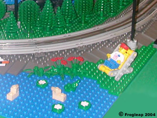
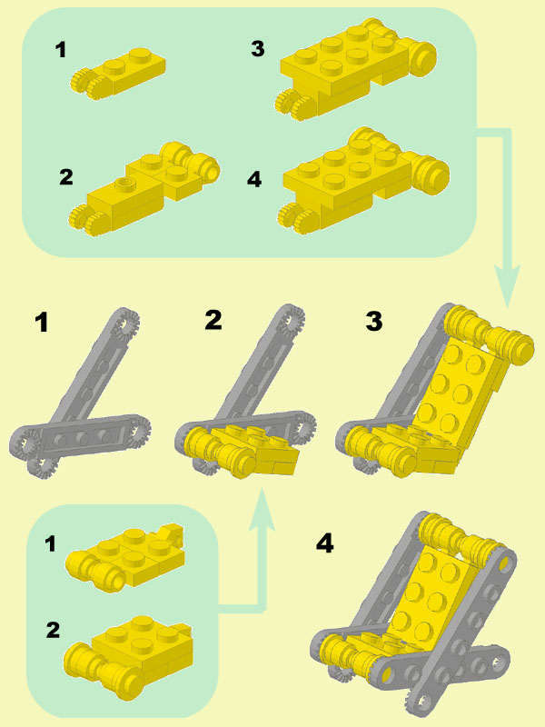

Lors de l’exposition de mon module à Orléans et St Etienne, vous avez peut-être remarqué la chaise longue dans laquelle se prélassait une minifig au bord du lac.

Et bien, je vous en propose aujourd’hui la notice de montage. Ce MOC est inspiré du modèle que l’on peut voir dans le livre "L’univers Lego" page 70. Cependant si on monte ce modèle, on se rend vite compte qu’il est trop grand pour une minifig.

J’ai donc décidé de réduire la longueur des montants à 6 tenons (au lieu de 10) et la largeur de la toile à 2 tenons (au lieu de 3). Néanmoins la réduction de la toile à posé quelques problèmes au niveau de la charnière qui relie les deux morceaux de la toile. Si la charnière mâle existe en version 1x2 avec charnière sur le coté, la charnière femelle n’existe pas (encore) dans cette version, d’où l’emploi disgracieux d’un jumper (plate 1x2 avec un seul tenon) qui épaissit inutilement la toile.

Mais trève de bavardage ! voici la notice :

