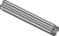
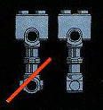
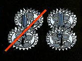
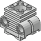
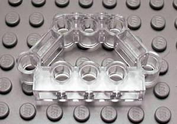

**Les moteurs à explosion factices Technic™** [^1]

**Introduction**

Deux époques, aux styles différents, existent. La première, dès l’apparition de la gamme Technic™ en 1977, a perduré jusqu’en 1988. Puis l’avènement en 1990 de nouvelles pièces a permis l’éclosion de la seconde, aujourd’hui encore très prolifique. Ces styles sont uniquement dus à l’existence de deux jeux de pièces spécifiques.

**Première génération**

La période 1977 - 1988 est, pour la création de moteurs, marquée par l’usage de ces pièces :

|  |  |  |  |
| --- | --- | --- | --- |
| Elément de bielle | Piston | Axe faisant office de Maneton de vilebrequin | Roue dentée de 24 faisant office de Masse de vilebrequin |
| 3651 | 3652 | 3705 | x187 |

Le piston n°3652 est de section carrée ce qui est curieux pour nous qui connaissons les pistons réels cylindriques. Toutefois c’est un choix qui s’explique : il n’y a pas de pièces spécifiques pour former la chambre dans laquelle ce piston va se mouvoir [^2], le maquettiste doit la reconstituer notamment avec des plaques et des briques, à l’exclusion donc de formes arrondies.

Le connecteur n°3651 s’emboîte à l’intérieur du piston. La liaison ainsi formée n’a qu’un degré de liberté en rotation. Ce point doit être souligné car la liaison de la bielle au maneton du vilebrequin n’a elle aussi qu’un degré de liberté, qui doit être coplanaire pour permettre le mouvement global. Ainsi, les deux connecteurs n°3651 reliés queue à queue doivent se présenter ainsi :

La roue dentée de 24 qui fait office de masse de vilebrequin est particulière. Il en existe deux versions et la plus ancienne possédait deux trous d’axe désaxés qui permettait le montage suivant, impossible avec la version actuelle.

Il fallait, comme vous pouvez le voir, se méfier d’un mauvais montage.

En 1977, les premiers modèles officiels utilisant ces éléments disposent :

**–** d’un moteur 4 cylindres en ligne pour la voiture [853](http://guide.lugnet.com/set/853)(956)  
**–** d’un monocylindre pour le kart [854](http://guide.lugnet.com/set/854) (948)

La notice du [948](http://library.brickshelf.com/gallery/set/0000/948-1/948-1-06.jpg) détaille en image les erreurs à ne pas commettre lors du montage d’un moteur de ce type, tout comme la notice du [857](http://library.brickshelf.com/gallery/set/0000/857-1/857-1-06.jpg) (8857) en 1979.

En 1980, le modèle [8860](http://library.brickshelf.com/cgi-bin/gallery.cgi?f=1258) offre une nouvelle configuration du moteur : un 4 cylindres à plat [^3].

C’est aussi l’année de l’apparition de la boite [n°8858](http://library.brickshelf.com/cgi-bin/gallery.cgi?f=1256) (858) complètement dédiée aux modèles de moteurs qui mérite donc qu’on s’y attarde. Elle présente :

**–** Un [3 cylindres](http://library.brickshelf.com/gallery/set/8000/8858-2/8858-2-07.jpg) en ligne qui tente de reproduire le travail des culbuteurs par l’intermédiaire d’un arbre à came.  
**–** Le premier moteur en configuration en V, un [V6](http://library.brickshelf.com/gallery/set/8000/8858-2/8858-2-11.jpg) avec un angle de 88 degrés environ.  
**–** Un [6-cylindres à plat](http://library.brickshelf.com/gallery/set/8000/8858-2/8858-2-15.jpg)  
**–** Un [monocylindre](http://library.brickshelf.com/gallery/set/8000/8858-2/8858-2-18.jpg)

Pour finir l’inventaire, suivront par la suite :

Des bicylindres : [8859, 8847](http://guide.lugnet.com/set/?q=8859%2C+8847)

Des monocylindres : [8090, 8841, 8842, 8855](http://guide.lugnet.com/set/?q=8090%2C+8841%2C+8842%2C+8855)

mais surtout en 1988 le second moteur en V : un V4 dans la Test car [8865](http://guide.lugnet.com/set/8865) :

| Nombre de cylindres | En ligne | A plat | En V |
| --- | --- | --- | --- |
| 1 | [854(948),8858, 8090, 8841, 8842, 8855](http://guide.lugnet.com/set/?q=854%2C+8858%2C+8090%2C+8841%2C+8842%2C+8855) |  |  |
| 2 | [8859](http://guide.lugnet.com/set/8859) | [8847](http://guide.lugnet.com/set/8847) | \- |
| 3 | [8858](http://guide.lugnet.com/set/8858) | \- | \- |
| 4 | [853(956)](http://guide.lugnet.com/set/853) | [8860](http://guide.lugnet.com/set/8860) | [8865](http://guide.lugnet.com/set/8865) |
| 6 | \- | [8858](http://guide.lugnet.com/set/8858) | [8858](http://guide.lugnet.com/set/8858) |

Comme on le constate, cette première génération se compose surtout de moteurs simples (monocylindre, à plat ou en ligne) alors que la seconde génération va laisser place à de nombreux moteurs en V.

**Seconde génération**

Depuis 1990 (apparu dans le ["Rally support truck" 8850](http://guide.lugnet.com/set/8850))

|  |  |  |  |  |  |
| --- | --- | --- | --- | --- | --- |
| Cylindre | Piston | Bielle | Portée de vilebrequin | Masse de vilebrequin | Maneton de vilebrequin |
| 2850 | 2851 | 2852 | 2853 | 2854 | 3704 |

Ce second jeu de pièce est à la fois plus petit [^4] et plus détaillé, ce qui a permis de créer des modèles globalement plus « fins ». On souligne ainsi :

**–** un cylindre (n°2850) fait son apparition qui ne contraint plus comme c’était le cas auparavant à en créer un à l’aide de plaques,  
**–** le piston de section carré n°3652 est remplacé par un piston cylindrique n°2851 bien plus réaliste (on y devine même l’emplacement des segments)  
**–** les pièces volumineuses nécessaire à la création de la bielle (connecteurs n°3651) et du vilebrequin (axes de 4, roues dentées de 24 dents) sont remplacées par des pièces plus petites : bielle n°2852, connecteur n°2853 et 2854, axes de 2.  
**–** la liaison entre bielle et piston à deux degrés de liberté (rotule).

Concernant les pièces de seconde génération, le cylindre n°2850 gris au départ, disparaît en 1997 au profit d’une version translucide blanche qui à le mérite de laisser entrevoir le mouvement du piston. Cet effet est mis en valeur avec des pistons n°2851 non plus gris foncé mais rouge, puis dès l’année suivante jaune, couleur qui semble être devenue la règle.

En 2000 apparaît le bloc support de connection Technic™ n°32333, servant de carter moteur, qui facilite le montage en le simplifiant, mais qui favorise les montage en V.

**Les types de moteur**

On rencontre aussi bien

**–** des configurations différentes :

-   Des monocylindres
-   Des cylindres à plat
-   Des cylindres en V

**–** que des tailles de moteur différentes

-   V2
-   V4
-   V6
-   V8
-   V10...

Une liste des modèles serait longue et peu instructive. Peeron vous fournira une liste des sets incluant au moins une bielle [n°2852](http://www.peeron.com/inv/parts/2852) et vous permettra de retrouver sans difficultés aussi bien les V10 que les monocylindres (Peeron classe par ordre décroissant).

**Perspectives**

L’arbre à came (qui commande les soupapes) peut être reproduit à l’aide des pièces composant le vilebrequin mais aucune des deux générations ne prévoit de pièces spécifiques qui représenteraient de manière convaincante une culasse, une soupape ou une bougie malgré des études intéressantes de culbuteurs....

Une pièce spécifique (carter) permettant de faire un moteur à configuration radiale serait la bienvenue.

Outre le [moteur radial de Marc Schickelé](http://www.brickshelf.com/cgi-bin/gallery.cgi?f=117773) vous trouverez de nombreux autres moteurs factices sur BrickShelf dont :

**–** [Configuration en W](http://www.brickshelf.com/cgi-bin/gallery.cgi?f=115324)  
**–** [Radial et en W](http://www.brickshelf.com/cgi-bin/gallery.cgi?f=118289)

[^1]: Ceux qui seraient déçus que l’on ne parle pas ici des moteurs électriques de la gamme Technic™ se réjouirons de l’existence de [la page de Philo (en anglais) sur ce sujet](http://www.philohome.com/motors/motorcomp.htm).

[^2]: Dont le nom technique pourrait sembler inapproprié ici : le cylindre

[^3]: Contrairement à la configuration en ligne, les cylindres sont alternativement disposés à 180 degrés

[^4]: Alors que le plus gros moteur inclu dans un modèle de la première génération est un V4, c’est un V10 de la seconde génération, d’une taille sensiblement inférieure qui fait son apparition dans les modèles de Formule 1 [8458](http://guide.lugnet.com/set/8458) en 2000 et [8461](http://guide.lugnet.com/set/8461) en 2002
