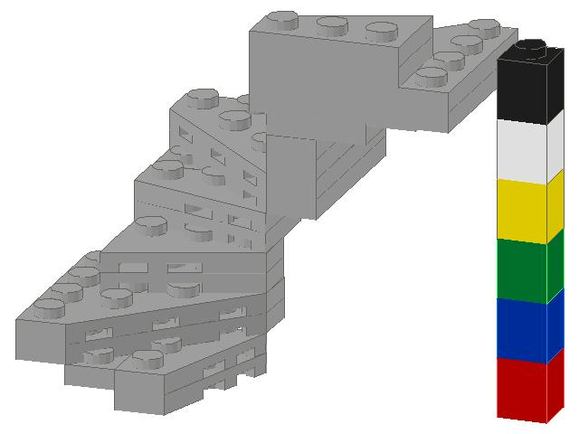

Essayant de faire un chateau pour la première fois, je suis tombé "par hasard" sur une solution permettant de faire un escalier en collimaçon sans utiliser les grosses pièces que l’on trouve dans les set Harry Potter.

Trouvant cette solution élégante, j’ai eu envie de faire un petit article pour partager l’idée avec vous.

Voici une image simplifié de cette solution (qui existe peut-être ailleurs, je n’ai pas cherché si quelqu’un avait déjà utilisé ce montage) :

Les marches de cet escalier font 3 tenons de large, ce qui est malheureusement un peu petit pour une minifig (comparé à une porte standard qui fait 4 tenons de large), mais cela fait l’affaire pour un chateau fort, où les passages sont souvent étroits.

L’idée de base est d’utiliser des wedges plates 2x3, et des plates 4x4 sans coin. L’escalier fait donc 6x6 tenons, et les plates 4x4 qui dépassent forcément servent à fixer l’escalier dans le mur (non représenté sur la photo ci-dessus pour plus de lisibilité)

A coté de l’escalier, j’ai mis une pile de brique en référence : On constate que l’escalier monte suffisament vite, en trois quart de tour, on est monté de 6 briques, ce qui représente un étage. Et les marches ne font que 2 plates de haut, ce qui est tout à fait raisonnable pour une minifig (personnellement, c’est ma hauteur de marche préféré pour les minifigs).

Enjoy !
