Suite à l’achat de ce nouveau modéle que je trouvais attrayant et à la pression de certains membres sur l’IRC de FREELUG (amical bien sûr ;-). Je vous livre içi une petite présentation de ce modéle .... A consommer sans modération .... :)

## Bonjour à tous,

Commençons par une photo :

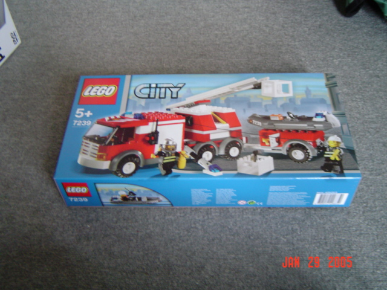

**Modéle 7239**

Boite face avant

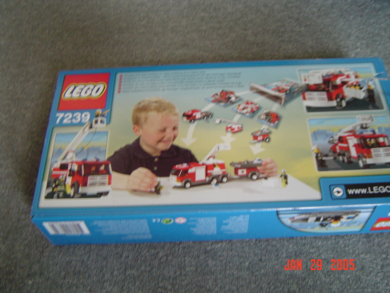

**Boite face arrière**

Face arrière de la boite

Voilà donc ce modéle LEGO référence 7239, nouvauté de cette nouvelle année 2005. Les premières images nous sont parvenus fin 2004, avare que nous sommes de tout savoir avant les autres... !

A l’ouverture de la boite :

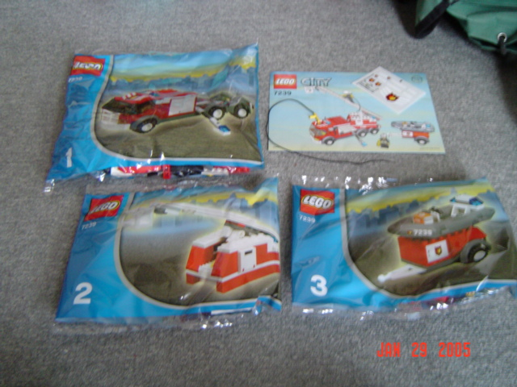

**Contenu**

Contenu de la boite

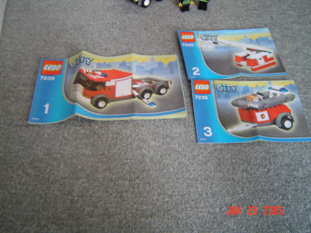

**Plans**

Plans pour la construction du modéle

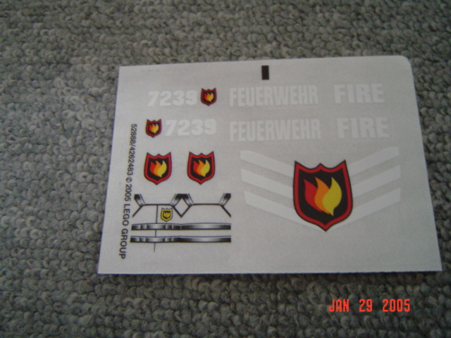

**Autocollants**

Planche des autocollants

Autant de sachets, autant de notices ! Voiçi donc un premier point marquant, il y a plusieurs plans !  
**1 ère remarque :** Il y a 1 pièces qui se balade dans la boite ainsi que l’autocollant, au risque de le retrouver détérioré.

Le montage s’avère facile, pas à priori d’incompréhension particuliére ( mais il est vrai que je suis rompu à cet exercice depuis longtemps ).  
Voiçi les 3 parties assemblées :

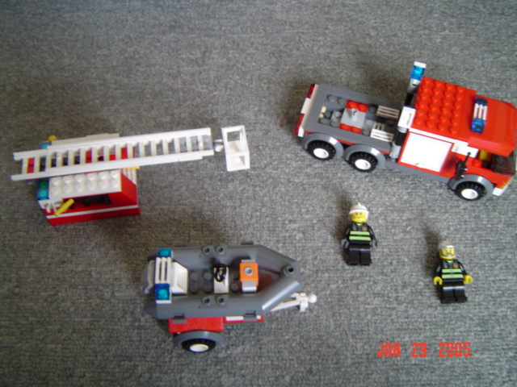

**Montage des 3 parties**

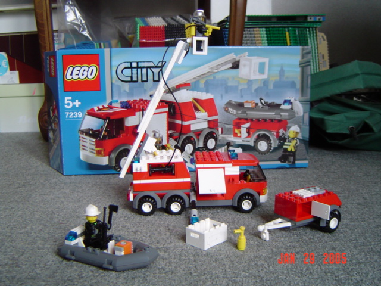

**Montage final**

Les différentes parties fonctionnels sont faciles à manoeuvrer ( attention à bien fixer l’échelle sur son support ).  
**2 éme remarque :** L’échelle ne peut pas pivoter, il faut orienté le véhicule dans la bonne direction !

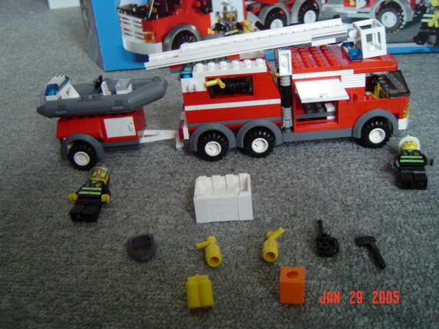

**Les accessoires**

Accessoires pour les interventions des pompiers

Le camion et sa remorque comprennent beaucoup de cases de rangement, c’est appréciable !  
**3 éme remarque :**C’est là le plus gros reproche ! Il y a trop peu de matériel : pas de pelle, de pioche, de scie à métaux, de marteau, de piolet, de lance à incendie, de clef à molette, etc ... Certaines fixations prévues restent vides !

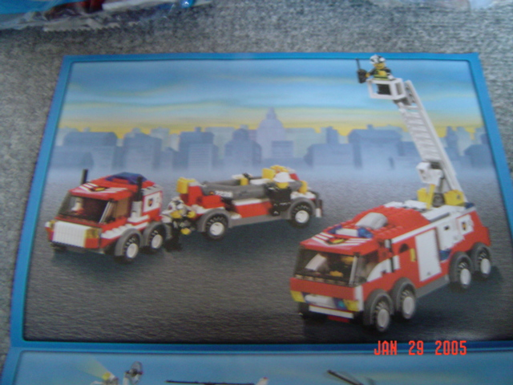

**Modéles alternatifs**

Voiçi la seule et unique photo des modéles alternatifs.

**Remarque 4 :**Les modéles alternatifs sont encore et toujours quasi-absents . Ce qui n’est pas du tout aisé d’essayer de les montés avec une seule photo !  
Mais heureusement les AFOL’s sont là !  
Je me suis donc inspiré de cette gallerie pour réaliser le mien :  
[http://brickshelf.com/cgi-bin/galle...](http://brickshelf.com/cgi-bin/gallery.cgi?f=110152)

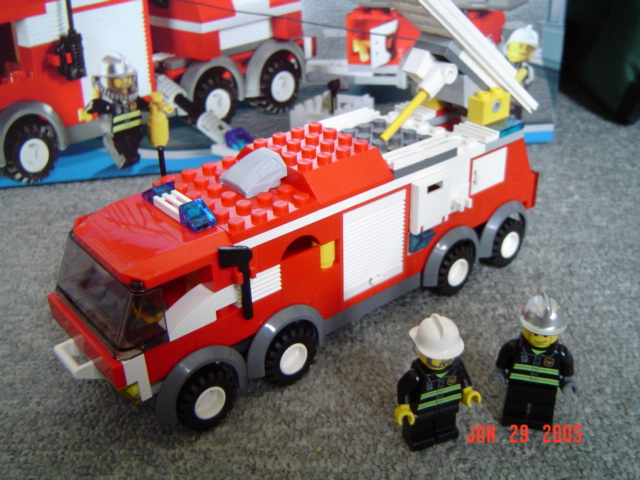

**Le modéle alternatif n°2**

Modéle alternatif

Voiçi içi les premiers camions tout neufs de la future Caserne :

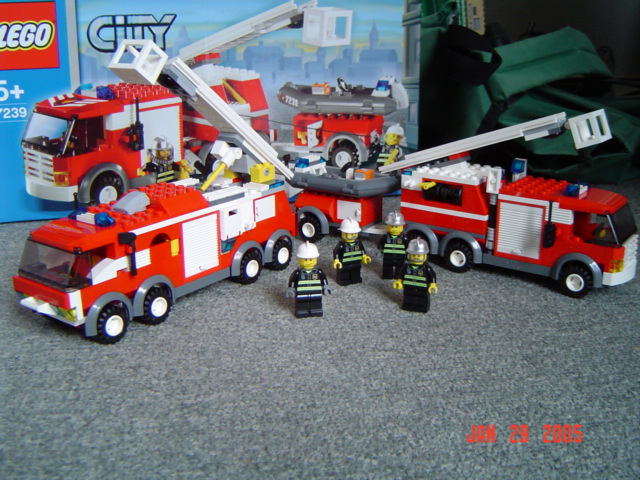

**les 2 camions**

C’est un modéle trés réaliste à mon goût et qui se rapproche beaucoup du matériel actuel. J’ai eu beaucoup de plaisir à le monter. J’espère que vous serez tentés de faire de même !

Bien Cordialement

Eric L.
