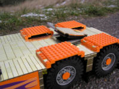
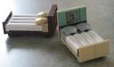
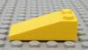
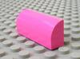
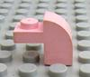
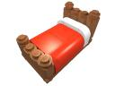
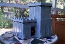
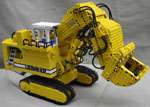

Les tenons sont parties intégrantes des pièces LEGO® : au-delà de leur fonction comment peut-on s’en servir (ou pas).

Nous avons déjà parlé des tenons dans l’article sur les [éléments de liaison](http://www.freelug.org/article.php3?id_article=279)

Mais au-delà de leur utilité fonctionnelle (le montage) que nous avions alors évoquée, ils jouent un rôle dans l’esthétique des maquettes réalisées. Le rôle esthétique peut être apprécié et être mis en avant (ce qui n’est pas évident au départ) ou au contraire on peut souhaiter faire disparaître les tenons que l’on juge disgracieux, [opinion plus répandue à laquelle même la société LEGO cède parfois, par exemple sur le 4404.](http://www.freelug.org/article.php3?id_article=170)

Nous allons aborder les deux cas.

**Faire disparaître les tenons**

Plusieurs possibilités s’offrent à nous pour faire disparaître les tenons :

**–** Les recouvrir à l’aide de plaques lisses

C’est une technique courante, et facile. Elle est cependant relativement difficile à mettre en oeuvre (si on ne l’utilise pas en combinaison avec d’autres techniques) à cause de la relative rareté des plaques lisses (en nombre et en variété). On trouve de nombreux exemples mais [celui-ci](http://www.gaasedal.dk/Images/Trucks/Volvo_FH12_Guldager_13/rear_top_2_full.jpg) par Anders Gaasedal est impressionant.

**–** Utiliser la technique de montage SNOT

Les pièces LEGO® certes présentent des tenons, mais en général seulement sur une face. Des techniques de montage SNOT (Studs Not On the Top - Tenons pas sur le dessus) permettent d’orienter les tenons de telle façon qu’ils ne soient pas visibles une fois la [maquette terminée](http://www.brickshelf.com/gallery/whateverly/New-work/Castle-themed/Featherbeds/featherbeds02.jpg).

**–** Favoriser l’utilisation des pièces LEGO® sans ou avec peu de tenons.

Les pièces LEGO® comme les briques et les plaques, présentent autant de tenons qu’elles n’en recouvrent : le ratio est alors de 1 (1/1). D’autres comme les plaques lisses présentent un ratio de 0 (0/1). Il existe tout une panoplie de pièce présentant des ratios intermédiaires qui permettent de réduire considérablement le nombre de tenons visibles :

Les briques pentues :  
**–** 0.5 (1/2), [Slope 2x1](http://www.peeron.com/inv/parts/3040b)  
**–** 0.33 (1/3),[Slope 3x2](http://www.peeron.com/inv/parts/3298)  
**–** 0.25 (1/4),[Slope 4x2](http://www.peeron.com/inv/parts/30363)  
**–** 0 : [Slope 6x8](http://www.peeron.com/inv/parts/4515)

Les briques arrondies :

**–** 0 [Brick 1 x 4 x 1 & 1/3 with Curved Top](http://www.peeron.com/inv/parts/6191)  
**–** 0.5, [Brick 2 x 1 x 1 & 1/3 with Curved Top](http://www.peeron.com/inv/parts/6091)

Cette dernière se marie très bien, ainsi que la [6081](http://www.peeron.com/inv/parts/6081) avec les plaques lisses comme on le voit dans cette [galerie](http://www.brickshelf.com/cgi-bin/gallery.cgi?f=80528) par Geoff Davis.

Certaines pièces, à l’image des plaque lisses, sont même ouvertement "antistud" (stud=tenon) comme les "Technic Studless beams" (Barres Technic sans tenon, aussi appelées en anglais liftarm). [^1]

On peut donc éliminer toute trace des tenons pour leur manque d’esthétisme, pour faire "lisse"...on peut aussi trouver des avantages esthétiques aux tenons :

**Utiliser les tenons dans un but esthétique**

**–** Les tenons, orientés sur les côtés, donnent une structuration, une rugosité qui cassent avec la monotonie d’un grand mur comme nous le montre Leonard Hoffman sur ce [château](http://www.brickshelf.com/gallery/glencaer/ClassicCastleCity/Army/keep.jpg)

**–** En laissant un vide entre deux plaques consécutives, on laisse entrevoir des tenons qui fournissent ainsi un bel effet de plaques ajourées , de grilles comme le démontre magistralement T.J. Avery sur les flancs de cet [excavateur](http://www.texbrick.com/creations/r996/final7.jpg)

En conclusion , nous voyons que, en combinaison du caractère fonctionnel des tenons, nous pouvons aussi bien exploiter son caractère esthétique encore méconnu que le soustraire à notre vue de manière optimale.

[^1]: Il est intéressant de voir que dans la gamme Technic , le tenon n’avait pas vraiment sa place - la cheville, "pin" en anglais, est au Technic ce que le tenon est au System - et qu’il disparaît petit à petit voir complètement dans les sets Technic récents.
