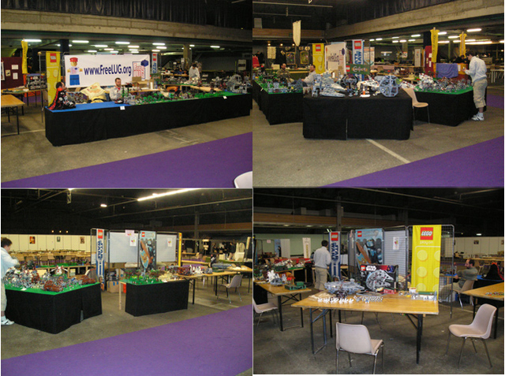
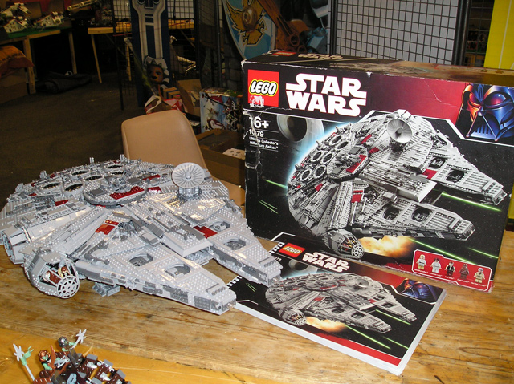
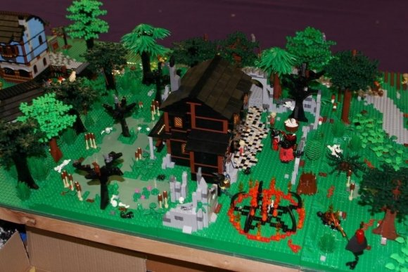
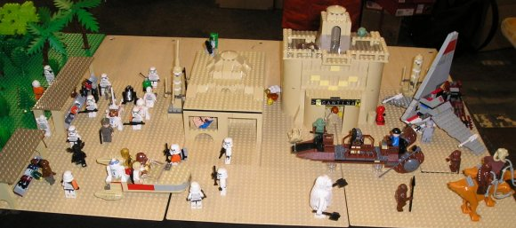
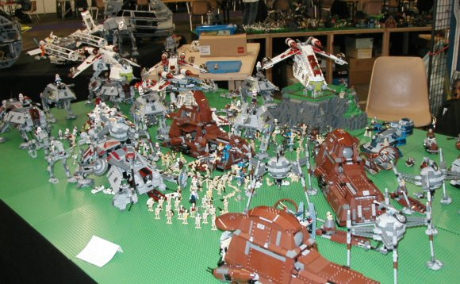
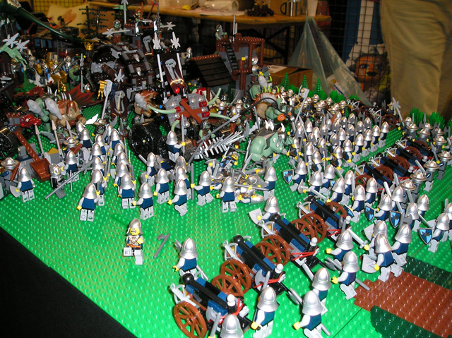
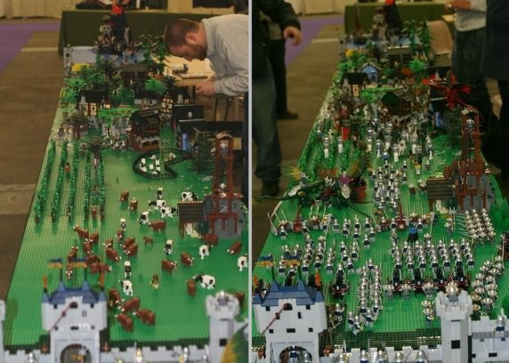

J’étais déjà allé plusieurs fois à ce salon, avec mon frére, j’en connaissait donc le principe. C’est en visitant leur site internet que j’ai vu qu’ils acceptaient tous types d’initiatives pour animer leur salon...  
Je me suis donc lancé en leur proposant nos dioramas tout en LEGO et notre bonne humeur...  
Me voilà donc parti pour organiser ma première expo..et il faut croire que cela a plu....!

Le Week-End de l’Imaginaire est une convention organisée par _Les Nocturnes Foreziennes_ (Saint-Etienne) afin de proposer des parties de cartes Magic, Wahrammer, Yu-Gi-Ho, des initiations à ces jeux et à d’autres jeux de rôles, des peintures sur figurines, des jeux de plateaux, des huits clos...

Ce salon s’est tenu au Hall A du Parc des Expositions de Saint Etienne.

FreeLUG a donc présenté des dioramas Castle et Star Wars ainsi que des modèles UCS Star Wars.

**vue d’ensemble**

Notre stand de forme rectangulaire présente deux thèmes : Star Wars (dioramas et modèles) et Castle (diorama évolutif). En plus des présentations et avec la participation de l’association Festi’Briques, deux activités sont prévues pour les visiteurs : les jeux LEGO (échecs, morpions) et la construction du Faucon Millenium 10179...

## Une (très) longue journée !

Tout a commencé le vendredi en début d’aprés midi pour aller récupérer les tables modulaires prêté par BaB, puis redescendre à Saint Etienne pour commencer le montage des tables et accueillir les copains !  
On s’est arrêté vers 21h30...

Samedi matin : arrivée vers 8h00, en forme ; derniers préparatifs pour l’ouverture au public à 9h00. L’idée du diorama Castle évolutif est simple : au début, tout est calme, les villageois sont à leurs occupations et à part une patrouille, peu de soldats sont présents. Et la situation se dégrade jusqu’à la grande bataille dimanche après-midi... C’est ainsi que l’on va enchaîner des modifications du diorama toutes les deux-trois heures pendant toute la journée, un peu moins la nuit, puis de nouveau dimanche, jour de la plus grande affluence...

Plusieurs "fans" viennent voir régulièrement l’avancement, la plupart des visiteurs sont surpris de voir cela et les enfants sont ravis.

Un petit incident (une cannonière Star Wars dégommée par un "tremblement de table" !), des mordus de la constructions (3 personnes sont restées près de 12 heures pour la construction du Millenium), visites de quelques Freelugiens... ponctuent notre week end..

**Millenium Falcon fini en moins de 12h !**

Et voilà que déjà on arrive au dimanche en fin d’aprés midi... Le diorama Castle est un vrai champ de bataille... les dioramas et modéles UCS Star Wars ont vu défiler des paires d’yeux par centaines... et le Millenium Falcon est monté... C’est déjà fini, mais que de bonheur !!

Un grand merci à Erik, Laurent et Pierre d’avoir fait le déplacement.. et puis aussi à mon frére.. ;-D

Un grand merci aux organisateurs de nous avoir acceuillis, et laisser un grand espace pour nos LEGO..!!

Merci aussi à Xavier et BaB pour les tables.

C’est donc avec un grand plaisir que je recommencerais cette manifestation !

_Pierre L. / Pierrolego_

* * *

Arrivé sur place vendredi vers 17h00 au parc des expositions de Saint-Etienne, je suis rapidement rejoint par Pierre et Etienne, avec une quinzaine de tables modulaires (Merci Xavier !). L’emplacement du stand est repéré et on commence le montage des tables. Erik arrive puis Pierre (Tribolego). Viennent ensuite pour moi le remontage des vaisseaux Star Wars UCS, et surtout la mise en place du diorama castle (maison de la sorcière, plusieurs maisons du village)... Le décor est planté, faisons le vivre !

Ce fut un long mais très agréable week-end. L’ambiance était géniale comme toujours et l’idée du diorama évolutif était enfin l’occasion de "jouer" aux LEGO lors d’une expo. Les organisateurs étaient très contents de notre présence et nous ont d’ores et déjà conviés au prochain week-end de l’imaginaire...

_Laurent_

* * *

Laurent a bien résumé les préparatifs, de mon côté j’avais un petit diorama Tatooine de 64 par 96 tenons, il reconstituait la scène où Luke et Obi wan se font contrôler par les forces impériales dans Star Wars épisode IV ; ainsi qu’un autre diorama Endor de 96 par 96 tenons représentant la bataille de la lune d’Endor de Star Wars épisode VI de manière humoristique.

Ensuite, ayant prévu avec Pierre (Tribo) une bataille clone si place il y avait, nous avons été satisfaits ayant largement de quoi faire. Un peu du [même type que celle de Bourgoin](/articles/resume-de-l-exposition-a-bourgoin-jallieu/), mais ces batailles sont toujours uniques.

De plus durant la nuit quand certain dormait, d’autre non et d’autre qui n’y arrivait pas, je me suis amusé à changer des petits détails pour rendre plus vivant la bataille en mettant en action nos amis les minifigs. Enfin, nous avions caché 5 petits Yoda sur toute la carte ce qui amusait surtout les grands qui venaient se vanter de les avoir trouvés.

C’est là que l’on reconnaissait les connaisseurs Star Wars (qui savaient exactement de quels scène il s’agissait)et les gens qui ne connaissent pas grands choses. J’ai passé un agréable week-end malgré le manque de sommeil et je remercie les organisateurs, les participants (PierreL, PierreC, Erik et Laurent), ainsi que ceux qui sont passés. J’espère que ça pourra devenir une exposition annuelle.

_Etienne_

* * *

L’annonce d’une exposition avec la possibilité de refaire un grand diorama Castle a suffit pour me décider à participer, surtout que je savais que je n’allais pas être seul.

Puisque l’évènement devait durer 36 heures non-stop, afin de ne pas s’ennuyer, j’ai proposé l’élaboration d’un diorama Castle évolutif afin de nous occuper durant tout le week-end. De plus, avec l’apparition du marché médiéval, il est difficile de mettre sur un même diorama statique à la fois une bataille et des scènes de vie quotidienne. Un diorama évolutif nous permet donc de montrer différentes choses.

Si la trame globale de l’histoire était définie, il y a eu beaucoup d’improvisation.

Après les animations du Salon du Cinéma, on retrouve finalement le plaisir de jouer, surtout qu’à plusieurs il y a de quoi faire ! Ce n’est finalement pas une histoire, mais plusieurs qui se sont déroulées sur le diorama Castle. Les participants de la convention venaient suivre régulièrement les aventures de leur(s) personnage(s) favori(s).

Ma partie du diorama reprenait celle de Kultiverse (l’île volcan des squelettes, et la côte). Laurent a amené la maison de la sorcière qui, avec ces décorations, a eu beaucoup de succès. Avec Pierre C, ils ont également réalisé la partie du village. Pierre L a amené le rempart en bout de diorama, l’objectif du diorama étant de proposer avant tout une grande bataille.

**quel champ de bataille !!**

Finalement, la surface prévue a été trop étroite pour accueillir la globalité de nos armées. Nous ferons encore plus grand au LEGOWorld !

Un grand merci à l’organisation pour l’accueil, et à Xavier pour le prêt des tables ;)

_Erik_

* * *

Mes camarades de nuit blanche (j’ai quand même pu placer un peu de sommeil par ci par là) ont bien résumé l’exposition.

Ce fut un réel plaisir de pouvoir manipuler le diorama Castle au cours de ce week-end pour le faire vivre au gré de nos humeurs. Et c’était encore plus gratifiant de voir des visiteurs ou d’autres participants du salon revenir régulièrement juste pour voir les détails qui avaient pu changer ou pour spéculer sur le devenir de telle ou telle scène :  
**–** _"Mais qui va gagner à la fin ?"_  
**–** _"Il va leur arriver quoi à ceux là ?"_  
**–** _"Oh ! regarde où il est allé lui..."_

Promis, la prochaine fois on fera pareil sur un diorama Star-Wars !

Encore merci à Pierrolego pour avoir coordonné cette exposition, à Laurent et Étienne pour leur enthousiasme à toutes épreuves, à Erik pour sa patience et à nos visiteurs du jour (JAC, Xavier, Daniel et Antoine) pour leur présence pour nous soutenir !

_Pierre C. / Tribolego_

* * *

## Galeries de photos

**–** [Galerie de photos d’Erik](http://photos.freelug.org/main.php/v/brickerik/expositions/2009/Imaginaire2009)  
**–** [Galerie de photos de Laurent](http://photos.freelug.org/main.php/v/LaurentT/Expositions/StEtienne2009)  
**–** [Galerie de photos de Pierre L.](http://photos.freelug.org/main.php/v/pierrel/exposition/nocturnes+foreziennes/)
