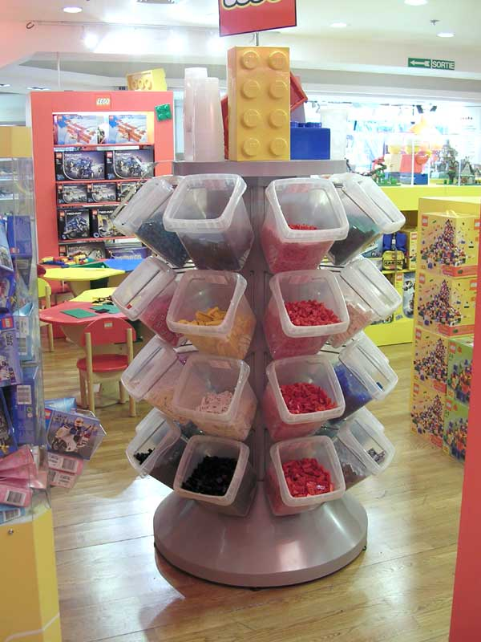
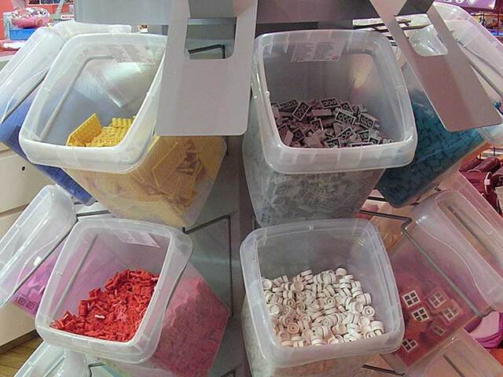
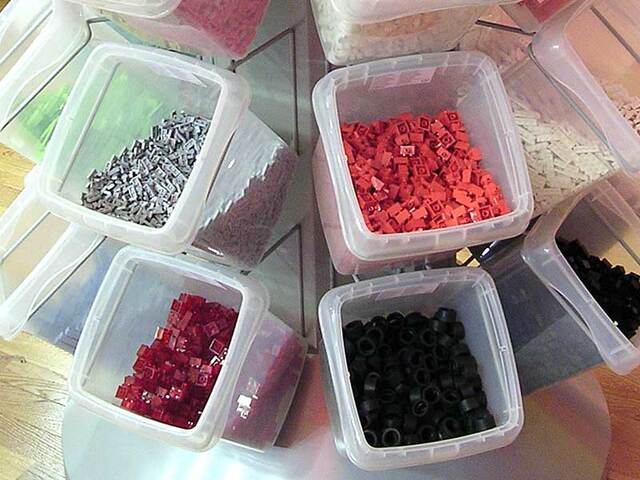
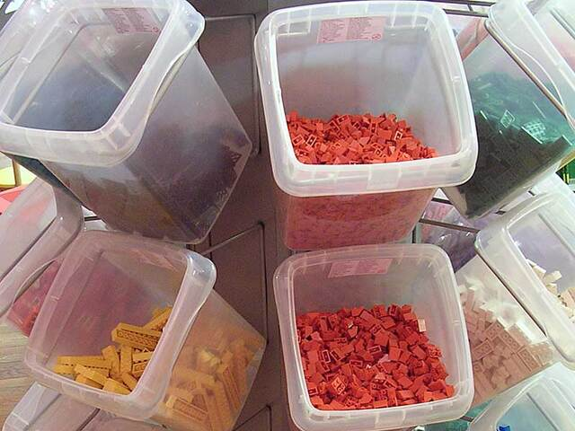
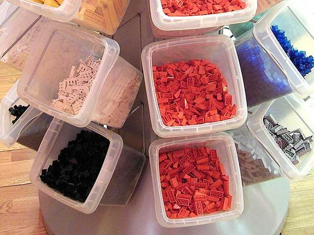
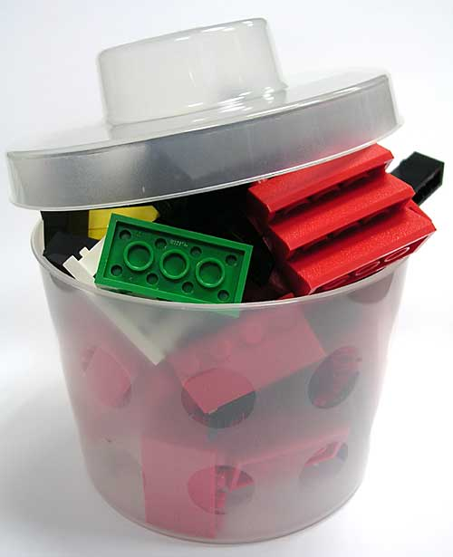
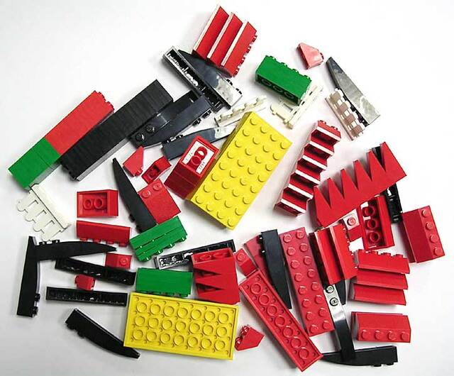

Souhaitant me détendre ce midi, je suis allé faire un tour a "Pique à brique" nouvellement créé au 5ème étage des _[Galerie Lafayette](http://www.galerieslafayette.com/)_ du Boulevard Haussmann à Paris... Voici quelques photos et une petite étude économique.

Le "Pique à brique", ça ressemble à ça :

Soit 32 bacs contenant des briques assez basiques de différentes couleurs.

Voici quelques gros plans des bacs pour mieux apprécier leur contenu.

* * *

Deux tailles de gobelets, un petit modèle (environ 0.45l) à 6€ et un à 11€ (deux fois plus grand à vue de nez) sont proposés au remplissage.

Une fois rempli, ça donne ça :

Si si, grace à un minimum de rangement, tout tenait dans le gobelet bien fermé pour passer à la caisse !

Comme vous le voyez, les pièces sont très classiques, à part peut-être les barrières blanches et les barres 1x6 arrondies :

* * *

Maintenant les prix : mon gobelet contenait 140 pièces pour 6€, ceci représente un prix moyen de 4,3 centimes d’Euro. En comparairon, la boîte **["Maison" 4886](http://guide.lugnet.com/set/4886)** qui contient le même style de briques a un prix moyen de 7,5 centimes d’Euro. C’est donc compétitif, même si ce n’est pas exceptionnel.

Autre comparaison, j’ai fait l’addition de ce que j’aurais payé sur **[Bricklink](http://www.bricklink.com/)** pour le même contenu. Je suis arrivé à 13,3$ (sans port mais avec un prix moyen de pièces, pas "le meilleur prix"), soit 7,4 centimes d’Euro par pièce. Là encore, c’est clairement rentable, mais au prix d’une diversité très faible !

Reste à savoir si le contenu se renouvellera...

Philo

...qui regrette l’absence totale de briques Technic dans l’assortiment !
