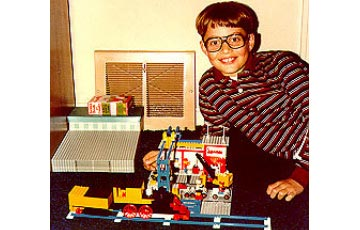
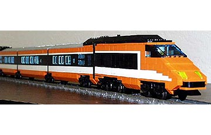
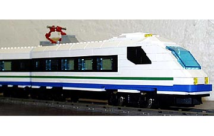

Traduction du portrait de [James Mathis sur le site officiel LEGO](http://www.lego.com/eng/trains/legoengineers/profiles.asp?id=jm)

Visitez :  
**–** [http://www.lego.com](http://www.lego.com/)  
**–** [http://www.lego.com/eng/trains/legoengineers/](http://www.lego.com/eng/trains/legoengineers/)

Merci à James Mathis et à Jake McKee pour leur aimable autorisation.

Translation into french of "interview of James Mathis" in the official LEGO website : Please visit [http://www.lego.com/eng/trains/legoengineers/profiles.asp?id=jm](http://www.lego.com/eng/trains/legoengineers/profiles.asp?id=jm)

Thanks to James Mathis and Jake McKee for their kind agreement.

**Bonjour amis fans des trains ! C’est Max le machiniste qui vous parle, et aujourd’hui je vous propose quelque chose de formidable, une interview avec un ami très doué du nom de James Mathis. James est un véritable maître constructeur de trains LEGO® ! Je ne blague pas ! J’ai vu beaucoup de trains dans ma vie, et le travail de ce gars vaut le coup d’oeil !**

**Salut James - ou peut-être devrais-je dire James le machiniste ! Entrons dans le vif du sujet et parlons de tes créations de trains de LEGO® !**

**Max : Comment as-tu commencé à construire des trains ?**

James : J’ai commencé lorsque j’ai reçu une boîte LEGO® pour mon 10ème anniversaire : le set numéro [165](http://guide.lugnet.com/set/165) - un gare de marchandise ferroviaire avec un portique - pour ma ville LEGO®. Je n’avais aucun train dans ma ville, donc j’ai rapidement transformé cette gare de chargement de trains en gare de chargement pour camions. Mais, je ne pouvais me résoudre à cette solution et j’ai eu besoin d’un vrai train. J’ai donc monté ma première création « train », une locomotive à vapeur très simple, construite autour d’un moteur 4.5V acheté au détail et de grandes roues de voiture rouges provenant de ma collection de LEGO®.

|  |  |
| --- | --- |
|  | Notre ami James à l’âge de 9 ans nous présente sa première création ferroviaire : une loco vapeur à pile |

Si vous trouvez l’inspiration, vous pouvez construire un train sans avoir besoin d’un grand nombre de pièces spécifiques aux trains.

C’est vraiment amusant de créer des maquettes de trains. Vous pouvez construire aussi bien d’anciennes locomotives à vapeur que des trains de voyageurs à grande vitesse. J’aime les trains de voyageurs modernes. Recréer leurs courbes arrondies est un beau défi à relever avec des briques LEGO®.

Ma première création d’un train grande vitesse en LEGO® a été inspirée par les pièces contenues dans un seau de briques oranges. Il y a quelques années, il y avait en magasin un seau exclusif pour Halloween rempli d’une multitude de pièces oranges. C’était donc un ensemble parfait pour créer une maquette du TGV français, qui était principalement orange souligné de lignes de noir et de blanc.

|  |  |
| --- | --- |
|  | Cette maquette du TGV Français par James comporte des boggies entre voitures, un couplage à l’aide d’élastiques et beaucoup de briques oranges |

**Max : C’est super, James ! Je suis moi-même fana de trains à grande vitesse ! En parlant des déguisements de Halloween, as-tu une casquette de machiniste ?**

James : Non, mais je pense que la tienne m’irai très bien !

**Max : Désolé, James - j’ai besoin de ma casquette ! Ce vieux conducteur Charlie risque d’oublier qui de nous deux est le machiniste si je ne la porte pas. N’as-tu jamais pris le train ?**

James : Bien sur que oui ! J’aime les trains. J’ai pris le train aux Etats-Unis, en Angleterre, et en Europe de l’ouest. J’ai un petit faible pour le « SouthWest Chief » d’Amtrak. Parmi les modernes, mon favori est le TGV français. Mais j’ai un souvenir romantique du « Cisalpino » italien dans lequel nous avons, avec mon épouse Amy, apprécié un délicieux dîner lors de notre lune de miel à bord de la voiture restaurant.

|  |  |
| --- | --- |
|  | Les fenêtres de cette maquette du Cisalino italien sont montées à 90° pour ressembler au vrai |

Je suis aussi monté dans des trains spéciaux de montagne comme celui qui mène au « Pike’s Peak » dans le Colorado ou le « Jungfrau Joch » dans les Alpes suisses.

Prendre le train est une belle occasion d’observer les paysages et de voyager avec des amis.

**Max : Habituellement quand je suis machiniste sur un train, le paysage défile trop vite pour que je puisse l’observer ! Peut-être devrais-je quelquefois ralentir et prendre un peu le temps. Ainsi, James, comment abordes-tu la construction de tes créations de trains LEGO® ?**

James : Je commence par chercher l’inspiration, comme le ferait un artiste peintre ou un sculpteur. Les briques LEGO® sont un objet artistique, tout comme la peinture ou l’argile ; il est juste plus facile de démonter les pièces LEGO® pour les réutiliser à autre chose ! Pour les créations de train, mon inspiration principale vient des trains réels que je peux voir. J’aime surfer sur Internet à la recherche de photographies de trains.

Je commence la construction à l’aide de quelques pièces clefs - celles dont je pense qu’elles définiront la forme. Je construis habituellement une première ébauche, un brouillon de la maquette pour essayer de définir la forme générale. Parfois, pour des maquettes plus grandes, je construis différentes parties séparément, de façon modulaire. Ceci m’aide à me concentrer sur chaque aspect du design. Ensuite, je peaufine les détails, comme les lumières, les échelles, et la j’améliore le schéma de couleur.

La création finale n’est généralement jamais la première version que je fais. La première version ressemble d’assez près au modèle, mais elle peut être fragile, ou certains détails ne sont pas à l’échelle, alors je commence à la modifier. Avec les pièces LEGO®, il y a beaucoup de solutions au même problème. C’est amusant de peaufiner un design jusqu’à la perfection.

D’ailleurs, la conception de mes modèles se prolonge sur mon ordinateur. J’aime utiliser les outils de DAO créés par les fans, comme [LDraw](http://www.ldraw.org/) et [MLCad](http://www.lm-software.com/mlcad/), pour essayer de nouvelles idées. Vous pouvez bricoler à l’aide d’une grande variété d’options plus rapidement sur l’ordinateur que vous ne pourriez avec les vraies briques à disposition. C’est également utile pour documenter les diverses maquettes que vous avez créées. Vous pouvez stocker et archiver vos designs dans l’ordinateur, et vous avez un nombre et un assortiment presque illimités de pièces !

Souvent le processus de création dure des jours ou des semaines, il est souvent « en cours ». Je laisse la maquette inachevée de côté pendant un jour ou deux tandis que j’y repense mentalement. Le processus est le même que celui d’un écrivain. Parfois vous devez prendre du recul pour clarifier votre vision, ce qui vous permettra d’avancer. Je me replonge fréquemment dans une image du train réel pour affiner la maquette LEGO®. La réflexion est parfois récompensée d’une trouvaille qui résout une difficulté de conception.

Quand vous construisez un train, ou n’importe quelle autre création LEGO®, je vous suggère d’être patient, de vous entraînez et d’observez finement les maquettes que d’autres font. Il y a beaucoup de belles créations de train de LEGO sur le net. Faites une petite recherche, et vous trouverez à coup sur de l’inspiration pour vos propres créations.

**Max : Et quelles belles créations tu as faites toi aussi ! Comment conçois-tu tes modèles réduits de train ?**

James : Je commence par visualiser mentalement la maquette. J’essaye de voir de quels éléments LEGO® j’aurai besoin pour débuter. Je commence alors par une base d’essayage. La base se compose habituellement d’une plaque support de 6 par 16 tenons. Sur cette plaque je commence à emboîter les éléments pour créer, par exemple, la forme spéciale du nez d’une locomotive. Je ne prends pas en compte à ce moment la couleur des pièces que j’utilise, je ne vise que la recherche des formes et des fonctions ; le schéma de couleur peut attendre jusqu’à ce que le modèle soit plus développé.

Une fois que la base d’essayage a été créée, je commence à travailler sur les couleurs : "comment puis-je incorporer le schéma de couleurs du train réel à la maquette ?" Je commence à reconstruire la base d’essayage dans des couleurs plus précises. Cette étape est habituellement une évolution, plutôt qu’une reconstruction entière.

Ensuite, je recherche les simplifications qui pourraient être faites dans la conception : "Ai-je employé deux pièces là où une seule pourrait suffire ? » « Une différence subtile de construction rendrait-elle l’ensemble meilleur ? » Ce processus dure plusieurs jours (ou semaines !), pour étudier des modifications et parfois revenir aux conceptions initiales qui fonctionnaient mieux.

Simultanément, je travaille à détailler l’extérieur. Quelles décorations peuvent être ajoutées au modèle réduit pour améliorer son aspect global ? : poignées de porte, balustrades, coffres, armoires techniques sous châssis, conduites, radiateurs, points d’accroches, dispositifs électroniques, boutons, etc.

Les détails intérieurs viennent habituellement en dernier. Parfois je ne détaille pas l’intérieur du tout suivant la jouabilité désiré pour la maquette.

**Max : Tout cela semble être un sacré défi ! Une dernière question, James - A quoi, d’après toi, ressemble un bon train LEGO® ?**

James :  
Cinq choses :

1 - Il ne doit pas dérailler. On peut aimer les déraillements , mais j’aime qu’un train fonctionne parfaitement !

2 - Il doit être facile à poser sur les rails pour apprécier son maniement,

3 - Il doit être esthétique, que ce soit une pure création de l’imaginaire ou une reproduction reconnaissable d’un modèle réel,

4 - Il doit fournir une bonne expérience de jeu. "Que peut on faire avec la maquette ? » Juste l’exposer ? Certaines maquettes sont assez belles pour cela, mais, j’aime également un train qui possède des pièces mobiles ou un dispositif mécanique intéressant que l’on puisse utiliser. L’accessibilité intérieure est un plus appréciable !

5 - Il doit fournir une bonne expérience de construction ! Par exemple on doit se dire « Génial, je comprends maintenant pourquoi cette pièce a été placée ici cinq étapes auparavant » et « Super ce petit dispositif ». Ce type de réactions montre que la construction de la maquette en elle-même est agréable. Le montage de la maquette doit être source de plaisir tout autant que de jouer avec.

**Max : Ou que de monter à bord si il s’avère que vous êtes justement un machiniste de train LEGO® ! Merci d’avoir passer ce moment avec moi, James ! J’ai appris beaucoup de choses, ainsi que nos lecteurs, je l’espère. Bonne chance avec tes trains - et tiens nous au courant de toutes tes nouvelles créations !**
