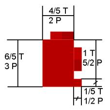
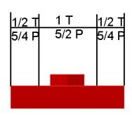
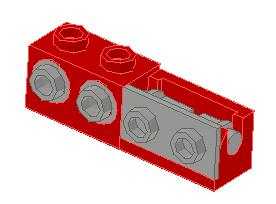
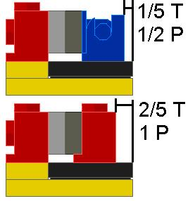
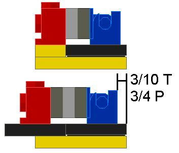
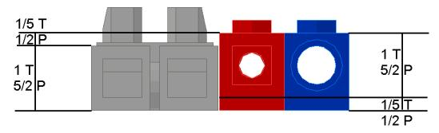
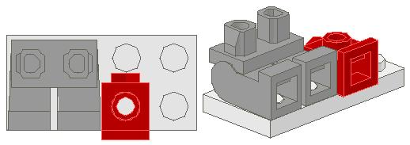
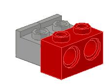
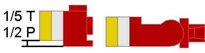
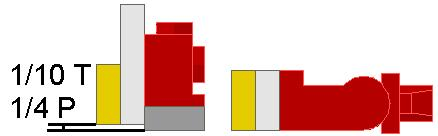

La technique de construction du décalage (offset en anglais) horizontal de 1/10 de brique a été mise en évidence par Jason J. Railton [^1]. Elle consiste, à l’aide de techniques avancées comme le SNOT ou l’AZMEP, de réaliser un agencement de briques fixées sur le même support décalées les unes par rapport aux autres d’un dixième de brique.

Ce décalage est particulièrement fin. En effet, sachant que la largeur d’une brique est environ 8mm, cela signifie un décalage de 800µm !

Je vais vous présenter ce décalage 1/10 horizontal suivi par mon étude sur la façon de réaliser le même décalage cette fois-ci à la verticale. Mais commençons tout de suite par de petits rappels.

## Petits rappels géométriques

Afin de bien de comprendre le mécanisme de cette technique, il est nécessaire de faire un petit point sur la géométrie des briques LEGO®.

_Attention_ Je ferais ici un abus de langage : bien que le tenon représente le petit cylindre qui orne chaque brique LEGO, j’associe pour la suite le tenon à une brique 1x1. Ainsi, quand je parle de la largeur d’un tenon, je parle de la largeur d’une brique 1x1.

De même, quand je parle de la largeur d’une brique, je sous-entends la largeur d’une brique d’un tenon de large.

**Rapport 5:2**

Il faut tout d’abord rappeler le ratio 5:2, 5 plates (à la verticale) = 2 tenons (à l’horizontale), d’où le petit tableau de rapports à retenir pour la suite.

|  |  |
| --- | --- |
| **P**late | **T**enon |
| 5 | 2 |
| 1 | 2/5 |
| 5/2 | 1 |
| 2 | 4/5 |
| 5/4 | 1/2 |
| 3 | 6/5 |

**Les pièces utiles**

Pour réaliser les 2 décalages, une petite armada de briques spéciales dont on connait la géometrie va être nécessaire :  
**–** la brique de Erling ou "headlight brick" étudiée par [Didier Enjary](https://www.freelug.org/spip.php?auteur24) dans son [Etude de pièce - #2](/articles/277/) ;  
**–** le jumper, également étudié par le même Didier dans son [Etude de pièce - #3](/articles/278/) ;  
**–** la charnière de 2 tenons (hinge) (qu’il n’a pas encore eu l’occasion d’étudier :) )

La _brique de Erling_

Un schéma étant plus simple pour comprendre, en voici un :

**Les cotes de la brique de Erling**

Le _jumper_ permet de placer une brique 1x1 au milieu de 2 tenons, elle réalise ainsi un décalage de 1/2 tenon. On en déduit les côtes suivantes :

**Les cotes du jumper**

La _charnière_ pourrait également être remplacée par une brique Technic 2x1 avec 2 trous et 2 demi pins.

**Charniere et brique Technic**

## Le décalage 1/10 à l’horizontale

Commençons d’abord par étudier le décalage 1/5.

L’emploi de plates placées sur la tranche provoque un décalage d’un cinquième. En effet, 1 P = 2/5 T, autrement dit, il manque un nombre impair de cinquièmes de brique pour compléter une brique (3/5 de brique dans le cas d’une plate).

Pour obtenir un nombre pair de cinquième, il faut utiliser la brique de Erling, car comme vu ci-dessus, elle possède un retrait d’un cinquième.

**Offset 1/5 horizontal**

Décalage horizontal impair et pair d’un cinquième de brique.

Pour le décalage 1/10, c’est là que le jumper intervient. En effet, il propose un décalage d’une demi brique 1x1, c’est à dire 5/10 d’un tenon. C’est la pièce qui nous permet d’obtenir un décalage impair en dixième de tenon ! Donc, on a un décalage 1/5 (= 2/10) et un décalage 5/10 ; en combinant les deux avec un peu de gymnastique, on peut obtenir un décalage de 1/10 ou un de ses multiples.

**Offset 1/10 horizontal**

Décalage horizontal en dixième de brique grâce à l’emploi du jumper.

## Le décalage 1/10 à la verticale

L’origine de ce travail était en fait l’étude des jambes des minifigs. En position allongée, cette pièce permet d’obtenir un trou pour tenon "en position basse" sans décalage... Illustrations :)

**Les cotes des jambes**

Le trou des jambes est plus bas d’un cinquieme de brique du trou de la brique de Erling ou de celui de la brique Technic qui est "en position haute"

**Jambes et Erling en SNOT**

Si on couche la brique de Erling, les trous sont au meme niveau, mais elle depasse d’un cinquieme

Une autre façon d’obtenir ce décalage est l’usage d’une brique Technic (merci [Alban](https://www.freelug.org/spip.php?auteur30) pour cette remarque) mais qui présente l’inconvénient de ne plus être sur une même horizontale niveau support.

**Solution alternative**

Ainsi, en alternant brique de Erling et jambes de minifig, on obtient un décalage vertical d’un cinquième de brique.

**Offset vertical 1/5**

Décalage vertical d’un cinquième de brique

Tout comme pour le décalage horizontal, il suffit d’introduire des jumpers et un peu de gymnastique pour réaliser un décalage plus fin d’1/10.

**Offset vertical 1/10**

Décalage vertical d’un dixième de brique.

## Et si on combinait les deux...

Ayant alors à ma disposition ces deux décalages, j’ai voulu les combiner. C’est ainsi qu’est né ce petit MOC qui n’est rien d’autre qu’un exercice de style.

**Exemple avec les deux décalages**

Ce MOC regroupe les deux décalages d’un dixième de brique, pour en faire un escalier.

Retrouvez l’ensemble des photos dans ma [galerie](http://gallery.freelug.org/offset_1_10).

## Conclusion

Je pense vous avoir présenté à travers cet article une des techniques de construction les plus sophistiquées que nous réservent les briques LEGO®. Le MOC réalisé se veut être qu’une illustration de l’existence de ces décalages.

Il est certain que l’un d’entre nous trouvera un jour un emploi plus approprié pour cette technique...

[^1]: [http://www.holgermatthes.de/bricks\_...](http://www.holgermatthes.de/bricks_us/offset.htm)
