Vous connaissiez déjà les briques de la gamme Duplo®. Deux fois plus grandes que les briques System® elles sont réputées pour être compatibles entre elles.

Depuis 2004 sont apparues les briques Quatro®, deux fois plus grandes que les briques Duplo, 4 fois plus que les briques System :

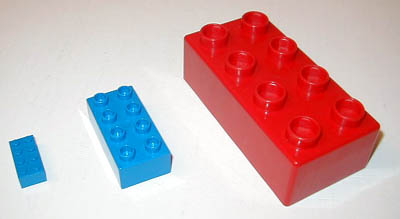

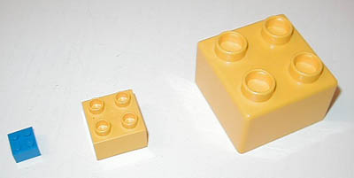

Il existe aussi des plaques (uniquement System et Duplo)

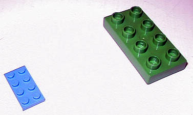

On note qu’alors que les plaques System sont 3 fois moins épaisses qu’une brique System, les plaques Duplo sont uniquement 2 fois moins épaisses qu’une brique Duplo. (et donc aussi épaisses qu’une brique System)

Un rapide montage permet de voir que la compatibilité est aussi bien montante :

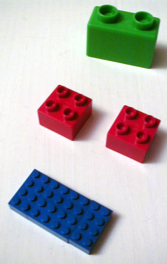

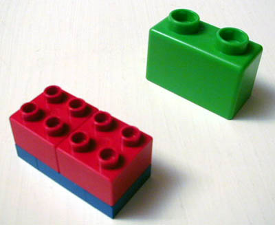

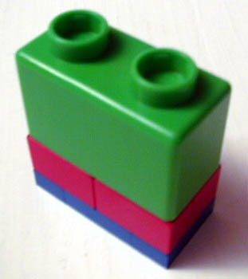

que descendante :

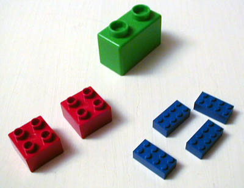

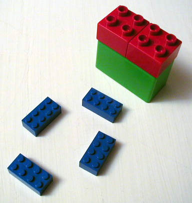

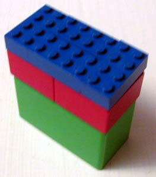

La compatibilité montante est respectée dans la majorité des cas, alors que de nombreuses exceptions existent à la compatibilité descendante :

**–** Liés au facteur 2 : les briques System de tailles impaires ne sont pas compatibles avec les briques et les plaques Duplo.

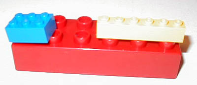

**–** Les plaques System ne sont pas compatibles avec les briques et les plaques Duplo.

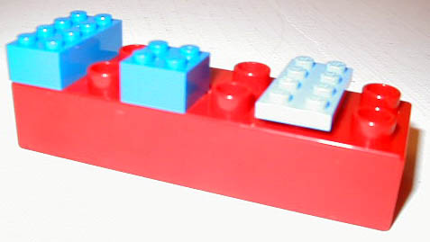

alors que les plaques Duplo sont compatibles avec les briques Quatro.

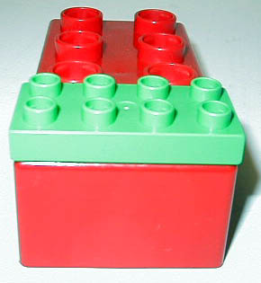

Seule la brique Duplo 2x2 est compatible avec les briques Quatro :

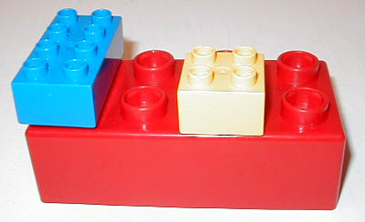

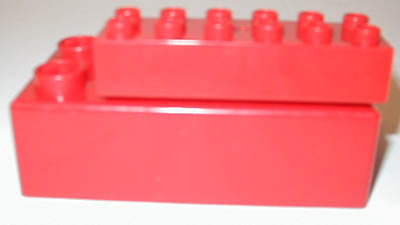

et cela à cause des nervures de renfort entre les tubes :

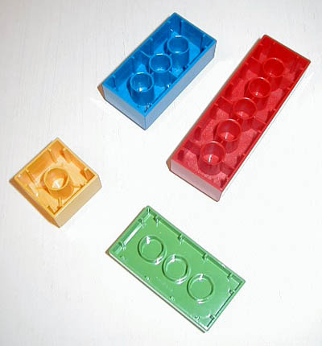

**A quoi cela sert-il ?**

C’est marketing : les briques que vous achetez aujourd’hui pour un enfant de 1-3 ans (Quatro) sont compatibles avec celles que vous lui acheterez plus tard (Duplo, puis System).

Les fans adultes se serviront des Quatro et Duplo pour les recouvrir de briques System et créer ainsi de grosses structures (montagnes).

**Un futur gamme Octo ?**

C’est peu probable. Il existe une gamme Baby (0-12 mois) mais incompatible.

**Une gamme en dessous du System ?**

Elle a existé : C’est la gamme [Modulex](http://www.peeron.com/inv/parts/x702)

En parlant de grosses briques, quelques liens sympathiques :

**–** [http://www.bmts.com/ bccook/blocks.htm](http://www.bmts.com/~bccook/blocks.htm)  
**–** [http://www.brickshelf.com/cgi-bin/gallery.cgi?f=26552](http://www.brickshelf.com/cgi-bin/gallery.cgi?f=26552)  
**–** [http://www.brickshelf.com/cgi-bin/gallery.cgi?i=77707](http://www.brickshelf.com/cgi-bin/gallery.cgi?i=77707)  
**–** [http://www.brickshelf.com/cgi-bin/gallery.cgi?i=77708](http://www.brickshelf.com/cgi-bin/gallery.cgi?i=77708)
