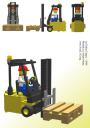
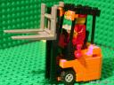
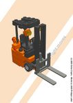

Il y a quelques mois, j’avais créé la notice de montage pour le chariot élévateur d’Alban :

Avec le modèle de [SmhlTec](http://www.brickshelf.com/cgi-bin/gallery.cgi?f=118780), il a inspiré à Philippe un autre chariot élévateur à trois roues :

J’ai pensé que ça serait une bonne chose d’avoir une notice de montage pour ce second modèle aussi : vous avez pu le voir apparaître récemment sur [FreeLUG](http://gallery.freelug.org/Chariot)

A propos de ce modèle et de sa notice :

**–** Comme vous le voyez la maquette est orange : les pièces oranges proviennent principalement de deux boite [“8641 Flame glider”](http://www.peeron.com/cgi-bin/invcgis/inv/sets/8641-1?withpics=yes), mais vous pourrez le construire aussi en jaune.  
**–** Il y a d’autres type de fourches qui peuvent convenir.  
**–** La notice montre la fourche non chargée en position basse alors que dans la réalité, le ressort la maintient en position haute.  
**–** En [page trois](http://www.brickshelf.com/cgi-bin/gallery.cgi?i=1132550), vous pouvez utiliser des [“plate 2x2 corner”](http://www.peeron.com/inv/parts/2420) pour faire un montage plus solide (à joints décalés)  
**–** Les livrées (jaune et orange) sont inspiré des couleurs des sociétés Caterpillar et [Still](http://www.still.co.uk/products/index.htm). La société [Fenwick](http://www.fenwick-linde.com/wfenwick.nsf/ch_index.htm) utilise le rouge.
