Translation into French of ["Evolution of the minifig"](http://vignettebricks.blogspot.com/2005/03/evolution-of-minifig.html)

Thanks to Bruce for his kind agreement.

**Un bref aperçu de l’évolution des minifigs.**

La première minifig est apparue en [1975](http://library.brickshelf.com/scans/catalogs/1975/c75uk/c75uk-07.html) mais elle n’avait ni bras, ni jambes, pas même de visage.

[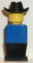](http://www.bricklink.com/catalogItemPic.asp?M=old030)

Trois ans plus tard, en [1978](http://library.brickshelf.com/scans/catalogs/1978/c78us/c78us-13.html), les personnages devinrent positionnables et commencèrent à sourire. Cette date marque le commencement de l’époque du Sourire Classique. Durant la décennie qui suivit, il n’y eut pas de changement à cette base ; les minifigs connurent une variété de torses, d’outils, de chapeaux ou chevelures pour les adapter à leurs fonctions de chevaliers, de spationautes et bien d’autres, mais elles conservèrent leur forme de base ainsi que ce visage souriant et bilieux.

[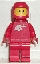](http://www.bricklink.com/catalogItemPic.asp?M=sp005)

En [1989](http://library.brickshelf.com/scans/catalogs/1989/c89nl/c89nl-01.html), le monde de la minifig évolua. Le thème « Pirate » apporta son lot de visages, de jambes et bras nouveaux, même si le Sourire Classique continuait à s’imposer dans la plupart des thèmes.

[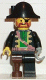](http://www.bricklink.com/catalogItemPic.asp?M=pi002)

En [1990](http://library.brickshelf.com/scans/catalogs/1990/c90nl/c90nl-01.html), le fantôme fut la première minifig spécifique. Elle possède un corps particulier ainsi qu’une tête noire.

[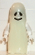](http://www.bricklink.com/catalogItemPic.asp?M=gen002)

En [1992](http://library.brickshelf.com/scans/catalogs/1992/c92nl/c92nl-25.html), le Sourire Classique reste la norme même si des visages spécifiques apparaissent de plus en plus dans des thèmes comme la ville, l’espace ou le château.

[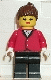](http://www.bricklink.com/catalogItemPic.asp?M=par014)

En [1993](http://library.brickshelf.com/scans/catalogs/1993/c93de/c93de-01.html) apparaît la barbe,

et en [1994](http://library.brickshelf.com/scans/catalogs/1994/c94de/c94de-46.html) les têtes d’autres couleurs que le jaune s’établissent avec les extra-terrestres et les robots.

[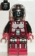](http://www.bricklink.com/catalogItemPic.asp?M=sp041)

En [1995](http://library.brickshelf.com/scans/catalogs/1995/c95uk/c95uk-01.html) le squelette complète cette liste de minifigs spécifiques.

[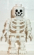](http://www.bricklink.com/catalogItemPic.asp?M=gen001)

A cette date, les visages spécifiques semblent avoir pris le pas sur le Sourire Classique qui semble disparaître petit à petit. En [1997](http://library.brickshelf.com/scans/catalogs/1997/c97nz/c97nz-41.html) les Indiens d’Amérique sont la première ethnie à avoir une minifig à leur image (bien qu’un peu caricaturale).

[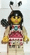](http://www.bricklink.com/catalogItemPic.asp?M=ww018)

Cette minifig est par ailleurs la première à recevoir un nez explicitement dessiné avec le reste du visage. Cette ethnie est suivie par les asiatiques en [1998](http://library.brickshelf.com/scans/catalogs/1998/c98nz/c98nz-37.html) dans le thème Ninja.

[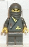](http://www.bricklink.com/catalogItemPic.asp?M=cas049)

En [1999](http://library.brickshelf.com/scans/catalogs/1999/c99nl-2/c99nl-01.html) la société LEGO® commence à acheter des licences produits avec l’introduction de la gamme « Star Wars ». Les licences ont été un bienfait pour la diversification du monde des minifigs, avec de nombreuses innovations pour les besoins de celles-ci. Par exemple, en [2000](http://library.brickshelf.com/scans/catalogs/2000/c00am-100dpi/c00am-04.html) est apparue une nouvelle tête pour Jar-Jar.

[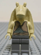](http://www.bricklink.com/catalogItemPic.asp?M=sw017)

Bien d’autres suivirent, dont C-3PO, Greedo et Yoda, ainsi que Dobby et les Gobblins pour la gamme Harry Potter.

En [2001](http://guide.lugnet.com/set/7146) le chasseur Tie inclus des têtes sans visage sous les casques du StormTrooper et du pilote Tie, la tête du pilote étant marron.

[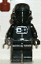](http://www.bricklink.com/catalogItemPic.asp?M=sw035a)

Cela ralluma le débat au sujet duquel certains pensent que les têtes devraient être de couleur chaire afin de permettre de représenter toutes les ethnies.

En [2002](http://guide.lugnet.com/set/4714) les besoins pour les gammes Star Wars et Harry Potter mènent à la créations de jambes plus courtes (boudinées), qui depuis sont utilisées pour représenter les enfants.

[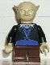](http://www.bricklink.com/catalogItemPic.asp?M=gob002)

C’est aussi en [2002](http://guide.lugnet.com/set/1383) que la société LEGO introduit les têtes à doubles visages (NdT : On dit aussi tête Janus, comme la divinité romaine qui avançait un visage tourné vers le passé et un autre vers l’avenir.) qui peuvent donc présenter des visages différents par simple rotation.

[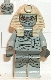](http://www.bricklink.com/catalogItemPic.asp?M=hrf007)

En [2003](http://guide.lugnet.com/set/10123) la société LEGO clôt un long débat en introduisant des personnages humains avec des visages d’une autre couleur que le jaune avec Lando Calrissian.

Ils décidèrent ainsi que les minifigs qui représentent des personnes réelles (comédiens, sportifs issus de licences comme Star Wars Harry Potter, SpiderMan et le championnat national de basket-ball américain NBA) auraient désormais des teints de peau réalistes alors que les autres resteraient jaunes.

[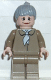](http://www.bricklink.com/catalogItemPic.asp?M=spd024)

C’est aussi en [2003](http://guide.lugnet.com/set/3560) dans la gamme NBA que sont apparues des minifigs avec des jambes munies de ressorts et des bras d’un nouveau type qui permettent à ces minifigs de ramasser et de lancer de petits ballons.

[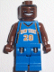](http://www.bricklink.com/catalogItemPic.asp?M=nba14)

Aujourd’hui, en [2005](http://guide.lugnet.com/set/7256), apparaissent des minifigs « électrifiées » qui s’éclairent quand vous appuyez sur leur tête.

Avertissement : Je sais que cet article n’est pas exhaustif. J’ai complètement omis les sujets torses imprimés contre stickers, tenons de tête pleins ou évidés, modifications des moules de torses, évolutions des impressions (têtes, torses mais aussi jambes, faces arrières et bras), les minifigs promotionnelles, les figurines non minifigs (droïds de combats, martiens, Jack Stone, etc.), ainsi que la grande variété de visages spécifiques, d’outils, de chapeaux, etc. De nombreuses sources d’informations sur les minifigs existent , parmi lesquelles :

**–** [Minimundo](http://www.minimundo.de/)  
**–** [La galerie de visages par Brendan](http://www.brickshelf.com/cgi-bin/gallery.cgi?f=24145)  
**–** [Peeron](http://www.peeron.com/cgi-bin/invcgis/inv/catpic/3626ap01?page=1)  
**–** [BrickLink](http://www.bricklink.com/catalogTree.asp?itemType=M)
