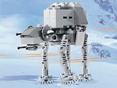
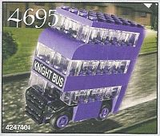
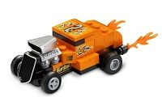

Les minis ne sont pas un thème LEGO® à proprement parler mais ils semblent s’installer progressivement : autopsie d’un phénomène.

**Que sont les "minis" ?**

Le terme mini se rapporte à deux caractéristiques :

**–** l’échelle des modèles qui est une échelle très petite [^1]  
**–** la taille des maquettes qui tiennent dans la main.

**Mini historique des "minis" officiels**

Tout à vraiment débuté avec les "minis" Star Wars (pas moins de 17 modèles) entre 2003 et 2004

**–** Mini Tie Fighter  
**–** Mini Tie Advanced  
**–** Mini X-wing fighter  
**–** Mini Jedi Starfighter  
**–** Mini Sebulba’s podracer  
**–** Mini Anakin’s podracer  
**–** Mini AT-ST  
**–** Mini AT-AT  
**–** Mini MTT  
**–** Mini AT-TE  
**–** Mini Snowspeeder  
**–** Mini Boba Fett’s Slave I  
**–** Mini Millenium Falcon  
**–** Mini Republic Gunship  
**–** Mini Star Destroyer  
**–** Mini Sith Infiltrator  
**–** Mini Imperial Shuttle

Harry Potter à suivi en 2004 avec le Magicobus ([Mini Knight Bus](http://guide.lugnet.com/set/4695)).

Aujourd’hui les 4 miniracers ([gamme "Tiny Turbos"](http://guide.lugnet.com/set/?qc=lego/racers/tinyturbos)) rencontrent aussi un beau succès.

**Et les AFOLs ?**

Les fans adultes se sont emparés des "minis" et en ont créés dans de nombreux thèmes

**–** Trains (généralement en deux de large : 2-wide) :

-   [Didier Deses](http://www.brickshelf.com/cgi-bin/gallery.cgi?f=77092)
-   [Peer 1](http://www.brickshelf.com/cgi-bin/gallery.cgi?f=17071) et [2](http://www.brickshelf.com/cgi-bin/gallery.cgi?f=17443)
-   [James Mathis](http://www.brickshelf.com/cgi-bin/gallery.cgi?f=3416)

**–** Ville et Mer :

-   [Joe Meno](http://www.brickshelf.com/cgi-bin/gallery.cgi?f=97005)
-   Le développement des "minis" est telle que certains constituent des [villes complètes](http://www.mocpages.com/moc.php/96)

**–** Espace et SW

-   [Les excellents minis avec notice de montage de Christopher Deck](http://www.brickshelf.com/cgi-bin/gallery.cgi?f=93256)
-   [Didier Deses](http://www.brickshelf.com/cgi-bin/gallery.cgi?f=76988)

**–** Médiéval

-   [Don Bruce](http://www.brickshelf.com/cgi-bin/gallery.cgi?f=15775)

font des "concours" inattendus : [montage du set dans le sachet](http://www.brickshelf.com/cgi-bin/gallery.cgi?f=117715)

et des présentations dans les clubs : [Wamalug](http://www.scrope.com/PhotoGalleries/WAMALUG_Meeting_20041212/pages/07_jpg.htm) et pages suivantes.

Enfin, récemment, s’est terminé le concours [LegoFactory](http://www.lego.com/eng/factory/showroom/default.asp) de la société LEGO® qui à développé de manière extraordinaire le thème "mini".

**Les raisons du succès ?**

**–** Tout d’abord parce que commercialement le produit est attractif (petite boite pas chère parfaite pour déclencher l’achat impulsif)  
**–** L’effet de collection (par exemple si vous achetez une gamme complète de 4 minis StarWars vous pouvez en faire un cinquième)  
**–** La taille réduite du produit permet aux enfants de l’emporter partout avec eux pour jouer. C’est un produit nomade.  
**–** Ensuite parce que vous n’avez pas besoin de posséder beaucoup de pièces LEGO® pour développer votre créativité dans le domaine des "minis".

...et puis comme chacun le sait, tout ce qui est petit est joli :-).

[^1]: Echelle inférieure à l’échelle minifig. On voit la que l’on devrait parler non pas de "minis" mais de "micros". D’ailleurs, si vous êtes lecteur de Lugnet, vous retrouverez les minis dans la rubrique [build.micro-scale](http://news.lugnet.com/build/microscale/). Voir aussi l’[article sur les échelles](http://www.freelug.org/article.php3?id_article=272)
