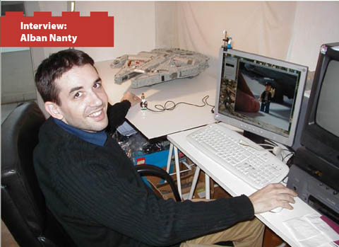
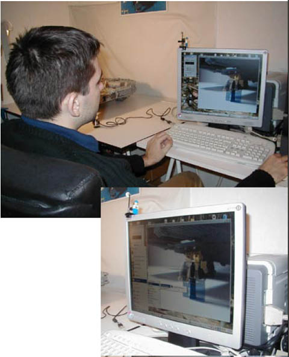
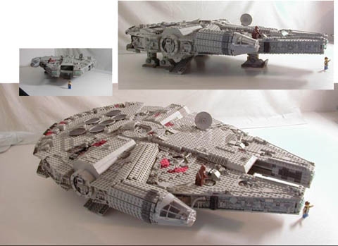

BrickJournal s’en est allé en France à la rencontre d’un constructeur à la tête d’un projet ambitieux : tourner un film Star Wars. Mais pas n’importe lequel, comme vous allez le voir....

Alban est à la fois un fan de LEGO® et de Star Wars (SW). Rien de bien original jusque là. Mais il réalise aussi des BrickFilms [^1] et celà l’a tout naturellement conduit à se lancer dans le projet "LEGO Star Wars" (LSW).

**BrickJournal** : Bonjour Alban. Tout d’abord, pourrais-tu présenter "banban" à nos lecteurs ?

**Banban** : Je suis français et j’ai 31 ans. Je travaille dans l’industrie du jeu vidéo en tant que programmeur. J’ai joué avec les sets LEGO de l’âge de 4 ans (mon premier set fut le 218 que j’ai reçu pour mes 4 ans) jusqu’à l’âge de 16 ans. Je suis alors entré dans mon Dark Age jusqu’à mes 25 ans. Quand la gamme Mindstorms est apparue, je suis revenu aux LEGO car je m’interessais à la programmation. Je suis ainsi devenu un "hôte" du forum LEGO Mindstorms officiel. Mais comme vous l’avez dit, je suis aussi un grand fan de Star Wars, dès lors que TLC a sorti les sets SW, je suis devenu collectionneur. Ce fut le premier pas vers ce projet fou que représente le projet LSW.

**BJ** : De quoi s’agit il exactement ?

**BB** : Et bien c’est assez simple, je peux l’expliquer en quelques mots : Le projet LSW (LEGO Star Wars) consiste à retourner le film de George Lucas "Star Wars : Episode 4 un nouvel espoir" avec des briques LEGO image par image. Mon brickfilm LSW sera aussi proche que cela est possible du film original (même durée, même plans,etc.)

**BJ** : Tu plaisantes ? Tu vas réellement retourner l’épisode 4 de SW en briques ? Commet cette idée folle t’es venue à l’esprit ?

**BB** : En fait j’ai été assez impressionné par [le film "StarLEGO"](http://www.torps.com/starlego.html) des productions Torps lorsque je l’ai vu pour la première fois. Mais j’étais un peu déçu car les vaiseeau n’étaient pas fait de briques LEGO (ils avaient utilisé les plans originaux du film). Alors, au bureau, à la machine à café, j’ai dit à un collègue que je pourrais retourner les plans avec des vaisseaux en pièces LEGO. C’était un pari, un challenge. Alors j’ai construit le Star Destroyer, tourné les scènes et je lui les ai montrées. Il m’a alors répondu : "il ne te reste plus qu’à finir le film". Il était clair qu’il plaisantait, mais j’ai juste répondu : "D’accord, soit simplement patient".

**BJ** : Combien de temps as-tu passé sur ce projet jusqu’à présent ?

**BB** : Oh ! Vraiment beaucoup...je ne sais pas exactement. J’ai travaillé sur ce projet durant 4 ans je pense et je prévois de finir en 2008. Par exemple, j’ai travaillé plus de 100 heures sur la création du faucon millénium.

**BJ** : Dis nous un peu comment tu travailles. Quel type de matériel et de logiciel utilises-tu ?

**BB** : Quand j’étais gamin, je rêvais de faire un film image par image. Mais la technologie étais relativement inaccessible à cette époque. Maitenant, avec une simple webcam, vous pouvez faire facilement un BrickFilm. Et vous pouvez par ailleurs trouvé des logiciels gratuits sur le net comme [Anasazi](/articles/416/).

C’est un logiciel qui vous permet de gérer votre webcam pour faire des film image par image avec des fonctions spéciales comme la "pelure d’oignon". La pelure d’oignon permet de voir l’image en cours en transparence avec la précedente ce qui permet de mieux contrôler la fluidité de l’animation.

**BJ** : Pour un tel projet, tu dois avoir beaucoup de briques pour pouvoir reconstituer toutes ces scènes.

**BB** : Non, pas vraiment... c’est vrai que ma collection est à la hauteur de ce que doit possèder tout respectable fan de LEGO :-) Mais en fait dès que j’ai fini de filmer une scène, je détruis le décor pour réutiliser les briques. Mais avant cela, je crée le fichier [MLCAD](/rubriques/44/) au cas où je devrais retourner une scène.

**BJ** : As-tu fais d’autres BrickFilms ou bien LSW est un projet unique ?

**BB** : Je devrais répondre oui car j’ai fait quelques petits BrickFilms pour le plaisir, comme ce [clip musical](http://www.brickfilms.com/films.php?mode=basic&query=banban&basicText=banban&a=0) avec des Battle Droïds ou un [très court film](http://www.lswproject.com/download/pizza_fly.avi) (avec Jean-Yves Brot) avec le personnage Joe Vig.

**BJ** : Utilises-tu des modèles officiels ou bien des créations personnelles ?

**BB** : Bien sur j’utilise les minifigs SW quand elles sont disponibles, et j’essaye de recréer celles qui me manquent (comme les Jawas). N’oubliez pas que certains plans de mon projet LSW ont été tournés ils y a plusieurs années alors même que toutes les minifigs SW n’avaient pas encore été produites.

Pour les modèles (vaisseaux et décors), je n’utilise pas les modèles officiels car ils sont trop petits (comme le faucon millénium), ou pas assez détaillés. Pour ce projet, une part du plaisir s’ancre dans la création, pas uniquement dans les prises de vue.

Mais en général, je ne construit pas le décor en entier. Je travaille comme un décorateur dans l’industrie du cinéma. Je construit uniquement les parties visibles à l’écran. Pour les véhicules, je construit une version pour le tournage en extérieur (sans les détails intérieurs) et une autre version complètement différente pour les plans d’intérieurs, parce que c’est plus simple pour filmer.

**BJ** : Tu es donc un constructeur. A part SW, quel(s) thème(s) t’intéresse ?

**BB** : Bien sur j’aime beaucoup construire mes propres modèles. Je m’intéresse aux thème train, micro, médiéval et aux vignettes "Joe Vig"... et ce n’est pas bon pour ma productivité sur le projet LSW car je passe du temps à construire toutes ces créations.

**BJ** : As-tu des plans pour faire d’autres longs métrages en briques ?

**BB** : Oui. J’aimerais en faire un après que j’ai fini LSW, mais cette fois-ci, ce sera un film complètement original adapté d’un livre anglais à succès (je n’en dirais pas plus, je souhaite gardé le secret pour le moment). Le défi sera bien plus grand car je devrais écrire un script avec les dialogues, définir les lieux, choisir les angles de vues et créer la bande son en entier (dialogue, effet sonore et musique).

Mais je ne le commencerais pas avant 2009.

**BJ** : Merci de nous avoir présenté ton film.

**BB** : Ce fut un plaisir.

[^1]: un film image par image avec des pièces LEGO
