Après avoir acheté [ce set](http://guide.lugnet.com/set/7244), j’ai décidé de vous le présenter. Plusieurs raisons ont motivé l’achat de cette boite :

-   Le look et la taille générale du bateau.

-   Les flotteurs réf. 50820 et réf. 50821 peuvent être intéressants.

-   C’est le premier bateau flottant LEGO® Système (mis à part Jack Stone™ et même Belleville™) depuis 1999 !

-   J’ai pensé qu’il irait bien à côté de mon remorqueur réf. [4005](http://guide.lugnet.com/set/4005). ;o)

## Plusieurs remarques sur la boîte :

Quelque chose me frappe sur la face avant de la boîte : le logo City™ n’ apparait pas.

Pourtant ce set fait bien partie de ce thème : d’ailleurs la silhouette de la ville (skyline) apparait en image de fond. Serait-ce un oubli de la part de LEGO® ?

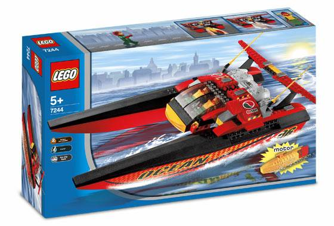

_Boîte face avant_

La face arrière de la boite montre le modèle plus en détails mais curieusement ne montre pas de modèles alternatifs. Je n’ai pas fait attention si cela se répétait sur d’autres sets : là aussi, est-ce la nouvelle tendance ?

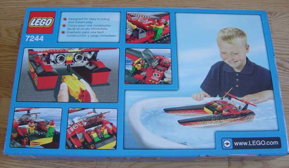

_Boite face arrière_

Enfin, une inscription me gêne sur cette boite : (qui est d’ailleurs présente sur d’autres sets City™)

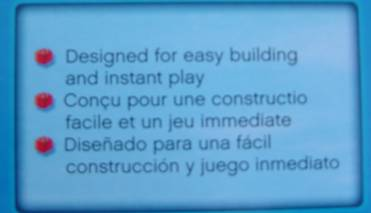

Ce n’est pas moins les fautes d’orthographe (même si cela ne fait pas très sérieux) que surtout la nouvelle méthode _marketing_ employée ici : LEGO® se renie ; d’après eux la construction du modèle (ce qui selon moi constitue la véritable force du système LEGO®, ce qui fait le vrai jeu !) devient une tarre. A quand les sets prémontés et collés ?

## Ouverture de la boite :

L’ouverture de la boite révèle que non, la boite n’est pas trop grande. Elle est compartimentée. Deux grandes pièces (une plaque 2 x 16 et une meta-pièce) de même que les flotteurs (mais ça je m’y attendais) ne sont pas sous sachet.

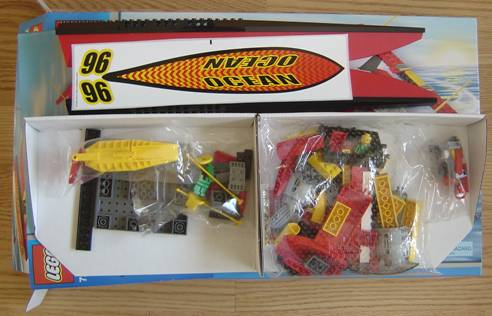

Les autocollants, comme à l’habitude ne sont pas non plus protégés. Mais ouf ! Ceux-ci ne sont pas cornés ou froissés :

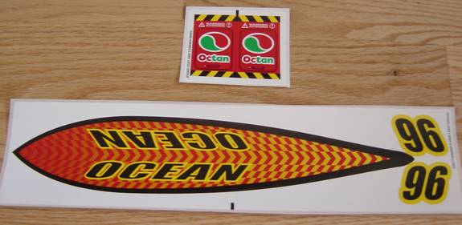

## Les flotteurs :

Ces flotteurs sont une nouveauté. En fait, et ça on ne peut pas le deviner, ils sont en deux parties démontables. La partie noire est faite du plastique rigide LEGO® habituel, alors que la partie rouge est faite elle d’un plastique souple différent, qui a l’air bon marché (_cheap_). Ceux qui ont connu les [minis Galidor™ de chez McDonald’s®](http://guide.lugnet.com/set/?qc=lego/galidor/promotional/mcdonalds) savent de quoi je parle. ;o)

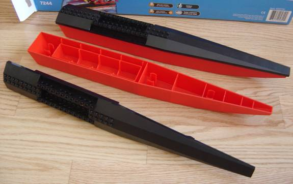

La partie rouge est cependant de bonne qualité et la qualite du moulage est plus que correcte. Cette pièce est également compartimentée : les compartiments sont trop petits pour accueillir des piles, ils peuvent peut-être accueillir du lest ?

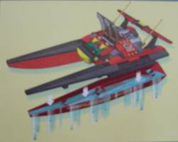

Est-ce que LEGO® va sortir par la suite d’autres sets avec ces mêmes pièces ?

## Le montage :

Le montage est très facile, du fait du nombre important de pièces de grandes dimensions et de [metapièces](http://www.freelug.org/article.php3?id_article=271&recalcul=oui). L’ensemble une fois assemblé est bien rigide et donne une impression de robustesse.

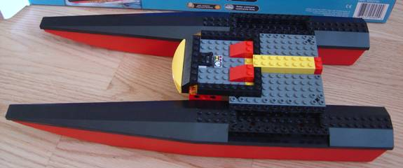

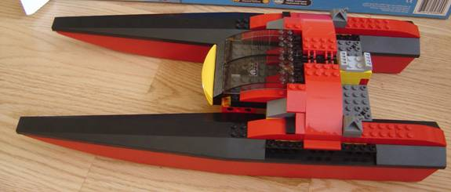

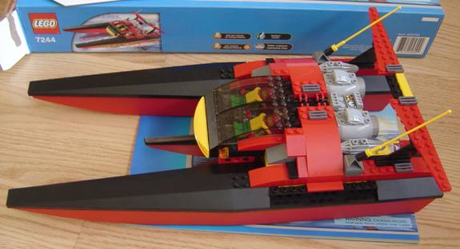

## Le moteur :

Enfin un moteur à hélice avec gouvernail réglable peut être attaché sur le bateau : il pend et se balance librement entre les deux flotteurs du bateau.

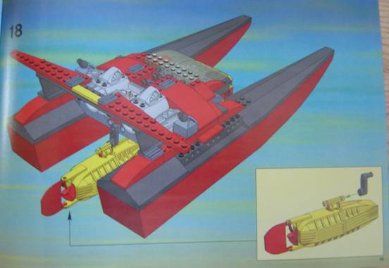

Ce moteur n’est pas nouveau et faisait également partie du set Jack Stone™ [4669](http://guide.lugnet.com/set/4669). C’est une nouveauté par rapport à d’anciens sets comme le [4005](http://guide.lugnet.com/set/4005) où l’on pouvait monter un moteur propriétaire non LEGO® :

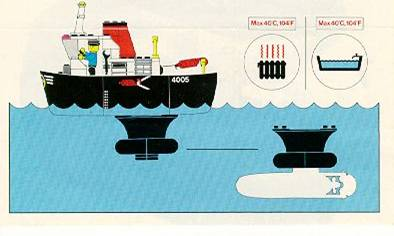

La présence de ce moteur dans ce set est tout de même une bonne chose mais il fait certainement gonfler considérablement le prix d’achat de la boite.

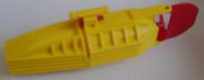

## Modèles alternatifs :

Deux modèles alternatifs sont pris en photo dans la notice. Ils ne sont cependant pas reproduits au dos de la boîte, ce qui est surprenant.

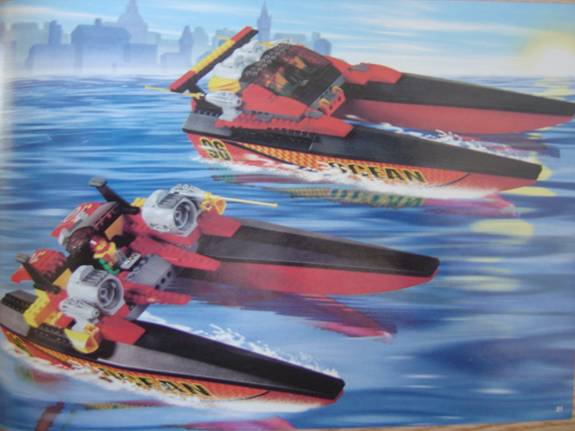

## Essai de flottaison :

Le bateau est bien équilibré et flotte parfaitement. Un peu à l’étroit tout de même sur la photo : disons qu’il est en cale \[pas encore\] sèche pour révision. :o)

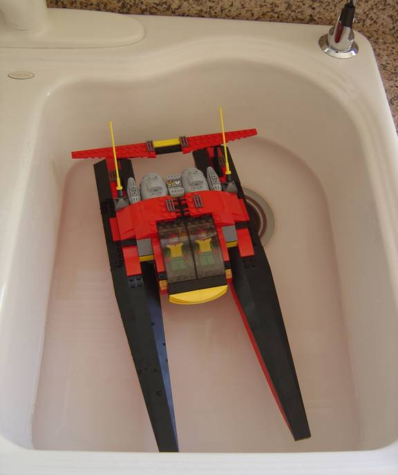

## Idées de MOCS :

Dans quelles créations personnelles (MOC) peut-on réutiliser ces flotteurs ? Les appels sont lancés. Voici en attendant des idées en vrac :

-   [Catamaran](http://www.brickshelf.com/cgi-bin/gallery.cgi?f=122880)

-   Voilier catamaran

-   Voilier mono-coque en positionnant les flotteurs dos à dos (peut-être pas)

-   bras d’un robot géant ?

Je vais peut-être essayer de combiner ce set avec les éléments radiocommandés du set [8376](http://guide.lugnet.com/set/8376) (ou [8366](http://guide.lugnet.com/set/8366)) afin de créer le premier (à ma connaissance) bateau LEGO® radiocommandé. Tout dépend des capacités de flottaison.

## Conclusion :

-   Ce set, même s’il contient beaucoup de [metapièces](http://www.freelug.org/article.php3?id_article=271&recalcul=oui) et même s’il est un peu “Jack Stonisé” est agréable.

-   C’est le premier bateau flottant système depuis 1999 ce qui est en soi un événement majeur.

## Avertissement :

Certaines images qui illustrent cet article sont la propriété de la société LEGO® ([Site officiel LEGO®](https://www.lego.com/))
