Cinq de nos membres se sont rendus à la compétition Mindstorms organisée par LEGO au parc LEGOLand à Billund (Danemark) les 9 et 10 avril 2005. Voici le récit de leurs aventures.

## Voyage aller

Toute aventure commençant par un voyage, nos 5 compères (Philo et Annie, Khan, Manu et JLB) prirent l’avion avec un plaisir évident.  
En plus, Ô joie, Ô bonheur, c’est un avion Maersk !

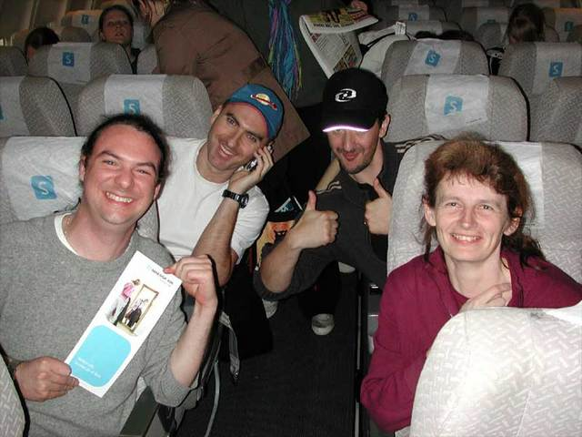

Après notre arrivée et un voyage en navette du parc LEGOland plus tard ... Là, le rêve commence, une belle navette au couleurs LEGO ! et avec un chauffeur avé la cravate avec des briques dessus.

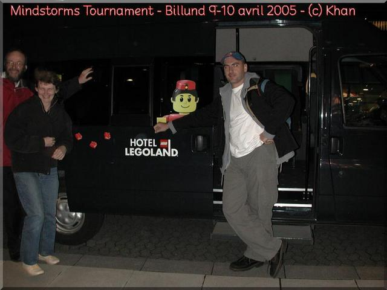

Il nous a fallu trouver de quoi nous restaurer (les ventres criaient famine \[petite voix dans le fond : FAMINE\] ). C’est là que nous nous sommes aperçus que Billund était une toute petite ville, il n’y avait plus grand chose d’ouvert à 22h. Heureusement, avec l’aide de quelques employées (le charme de Khan a encore fait des ravages :-)), nous avons réussi à trouver des pizzas. Elles furent accueillies comme il se doit (les pizzas, pas les employées :-)).

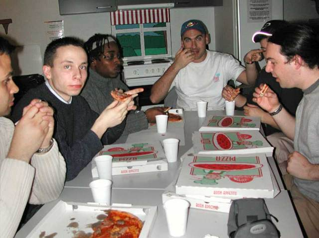

Avant d’aller se coucher, certains firent du tourisme dans le village LEGOland et se mirent à rêver de briques géantes.

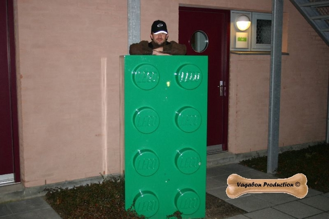

## Samedi matin : LEGOLAND

La matinée du samedi étant libre, nous n’avons pu résister à une visite du parc LEGOland (ce fut la première fois pour certains).  
De plus à cette heure matinale (10h) le parc était plutôt vide, on en a donc bien profité :

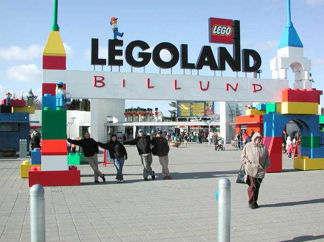

Voici donc 5 grands gamins arpentant le parc et s’essayant à toutes les attractions. Certains en gardent des souvenirs renversant ...  
Tu me fais tourner la tête ...

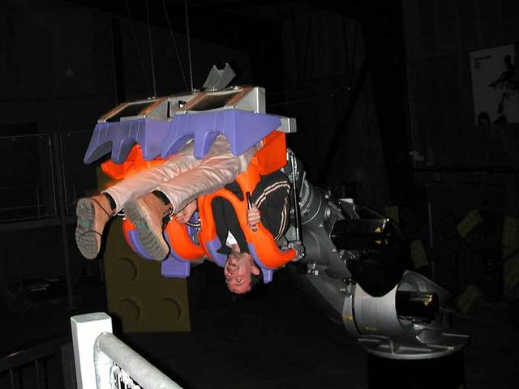

D’autres des souvenirs humides ... Forcément, z’avait mis le "gros" au milieu, l’entrée dans l’eau a été envahissante, le canoë s’est vite rempli !

[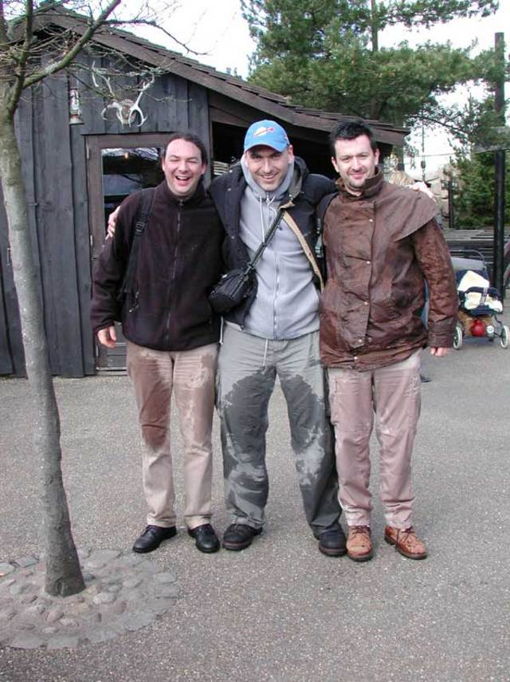](https://www.freelug.org/IMG/jpg/PH2_Visite_parc_39.jpg)

Mais quoi qu’il en soit, une bonne visite d’un parc LEGO ne peut se terminer sans le passage obligé au shop (et nos aventuriers n’attendaient que cela).

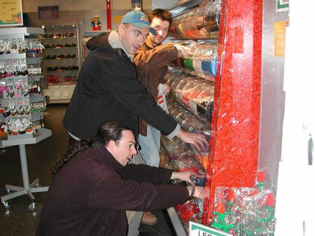

Vous pouvez suivre les escapades de nos aventuriers dans le parc [ici](http://gallery.freelug.org/Legoland)

## Samedi après-midi + nuit : construction

L’après-midi du samedi commence et les visages se font plus crispés pour certains. Si nos petits français sont venus avec une tonne de bonne humeur, et le plaisir de venir participer, d’autres sont venus pour la compétition.

Bref nous sommes rassemblés avec les équipes Americaines (2 équipes), Italienne (une équipe gigantesque de 13 personnes), Hollandaise (nos amis ZUUUUUUUUUUUP du LEGOworld :-)), Danoise, FLL et Française (Nous, plus une école de petits ingénieurs : les DTRE. Demandez à Manu la signification...)

Après une heure d’attente (soit nous n’avons pas compris l’heure du RDV, soit il y a un décalage horaire que nous avons raté :-)) les organisateurs du concours, Jan Beyer et Henrich, viennent nous présenter le sujet du concours.

**Les règles du jeu**

Nous avons des tables, type [First LEGO League](http://www.firstlegoleague.org/fr/), sur lesquelles sont disposées des balles de différentes couleurs, que nous devons récupérer et déposer à différents endroits. Les balles valent un nombre de points différent selon leur couleur. Les endroits où l’on dépose les balles (un coin de la table ou une goulotte entre les 2 tables) ont des facteurs multiplicateurs différents (de 1 à 10) sur les valeurs des boules. Il y a aussi des boules grises qu’il ne faut pas faire tomber d’une sorte d’arbre en Duplo, sinon cela marque des points négatifs.

Suivant le nombre de balles que notre robot récupère et dépose soit dans le coin, soit dans la goulotte, il marque un certain nombre de points qui permet de remporter le match contre son adversaire.

Les rencontres se déroulent un contre un (chacun sur sa table, mais avec la goulotte partagée entre les 2 tables, ce qui donne des stratégies intéressantes). Une première poule est faite où les robots font 2 matchs contre 2 équipes differentes. Les 4 premiers robots en nombre de points marqués passent en demi-finale avec élimination directe.

Les règles sont beaucoup plus détaillées (il y en avait 5 pages je crois), mais je vous épargne les subtilités.

Nous avions à notre disposition un kit RIS 2.0 + un moteur + 1 capteur de lumière + 1 capteur de rotation + un tas de briques en vrac partagées par toutes les équipes (et c’est ce qui a causé quelques problèmes...) pour réaliser notre robot.

Au niveau du temps de construction nous avions du samedi 16h jusqu’à dimanche 10h pour réaliser notre robot. Le temps limité et le stress ont eu des effets dévastateurs chez certains, et des effets stimulants chez d’autres.

Pour nous entraîner nous avions 2 tables d’essai, dont une isolée dans une piece, à se partager avec les autres équipes.

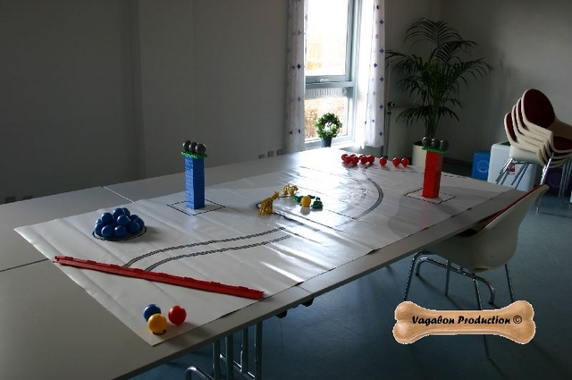

**Construction**

La construction commence. Et là nous voyons tout de suite ceux qui sont venus pour la compétition et ceux qui sont venus pour participer et s’amuser. Certaines équipes prennent leurs briques et vont s’isoler dans leur chambre pour ne pas montrer leur stratégie de compétition. D’autres restent dans la pièce commune pour construire et déguster des spécialités hollandaises :-) Je pense qu’il est inutile de préciser que l’équipe francaise est restée en compagnie de l’équipe hollandaise :-) Le ZUP et le Chouchen coulant à flot entre deux frikandels...

Le travail jusque très tard dans la nuit (nous sommes partis nous coucher vers 3h du matin) ont eu des effets inattendus sur certains (avec l’aide de certaines boissons frelatées tout de même). Quelques extraits de cette nuit...

Khan essaie de suivre (ou fait semblant) meuh non, je suivais :)

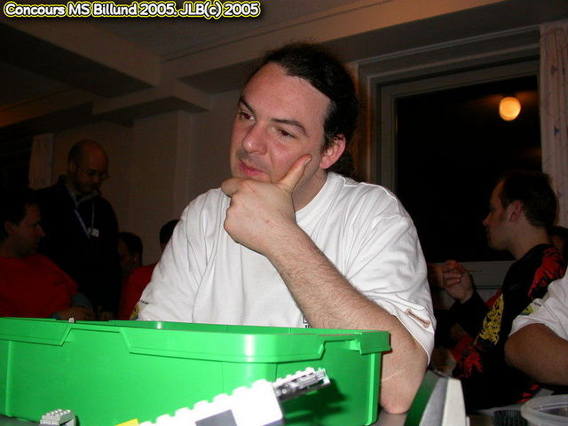

Manu essaie de se transformer en cyborg (en s’alimentant de Chouchen)

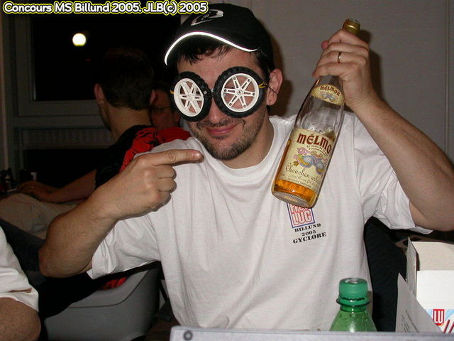

Philo cogite à fond en nous lançant des "Mecs" à tout bout de champ ("j’ai trouve Mec !" ou "Ca marche Mec !"). Il a même tenté un discours en allemand, très vite arrété en voyant nos têtes ébahies.

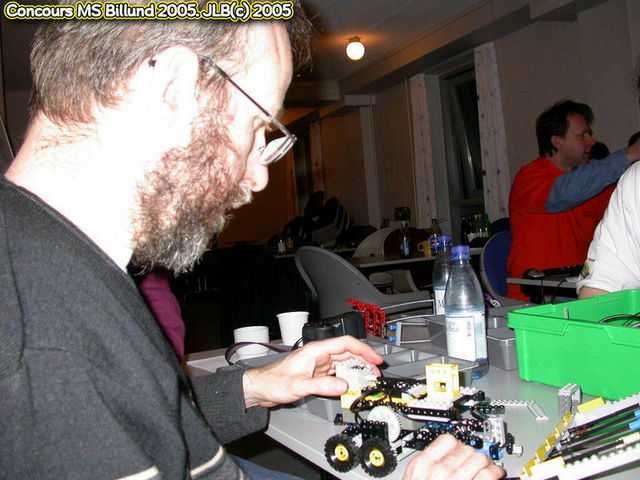

JLB essaie de coder...

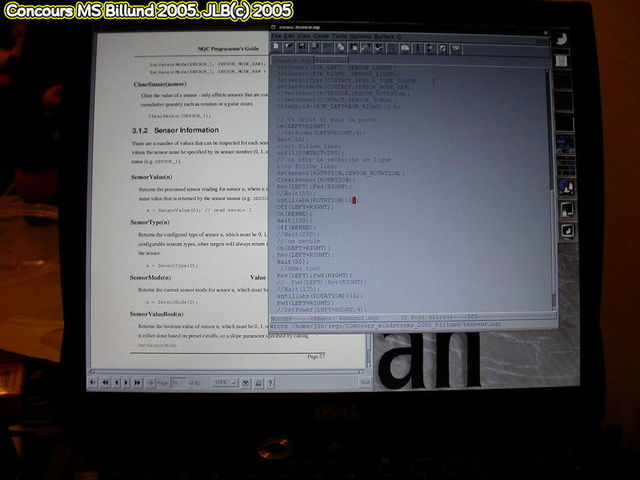

...Enfin lorsqu’il arrive à ouvrir les yeux... (notez le tuning de casquette :-))

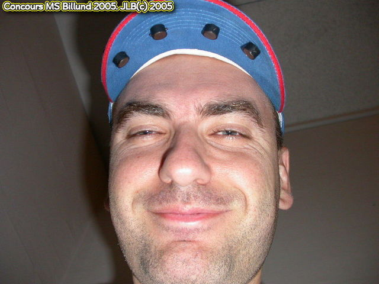

Quoiqu’il en soit, nous avions les plus beaux t-shirts. Merci à Manu pour cette belle réalisation.

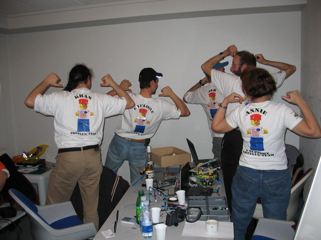

Après quelques heures de travail/test, nous arrivons à un résultat où notre robot est capable de rapporter 2 lots de boules. Nous déclarons que c’est suffisant, et nous allons nous coucher aux alentours de 4h du matin.

Certaines équipes n’ont pas dormi de la nuit.

Quelques autres photos de la nuit de construction et du robot que nous avons fait sont [ici](http://gallery.freelug.org/Construction)

si vous etes interessé par les programmes que nous avons ecris, voici les sources de ceux-ci :

**Les programmes de notre robot**

## Dimanche : Compétition

Driiiiiiiiiiiiiing .. le réveil sonne beaucoup trop tôt pour nous, mais il faut y aller. Après tout on est venu aussi pour cela.

A 9h30, nous présentons notre robot aux juges.

Nous nous rendons ensuite de nouveau au parc LEGOland où se déroulera la compétition. Il serait impossible de résumer l’ensemble des matchs. Pour faire égocentrique, notre robot a bien marché lors du premier match, puis a déconné (on ne sait pas pourquoi) au deuxième. Ce qui nous a valu de rater la demi-finale à 5 petits points (une balle). Il faut croire que le chiffre 5 nous collait à la peau ce weekend, car nous étions une équipe de **5** personnes, nous avions le numéro d’équipe **5**, nous ratons la demi-finale pour **5** points et nous finissons à la **5**ème place. Cela étant dit, nous étions venus pour participer et s’amuser. Et ce fut réussi de ce point de vu là :-)

Pour faire moins égocentrique, il faut bien admettre que la Team Hassemplug (et Steve en tête) est quand même impressionnante par le fait qu’il arrive à faire des robots simples et efficaces dans un temps limité et avec un nombre de pièces limité. Malgré tout cela ce n’est tout de même pas eux qui ont remporté la coupe, mais l’équipe Italienne (ils avaient mis le paquet : 13 personnes) menée par les frères Ferrari.

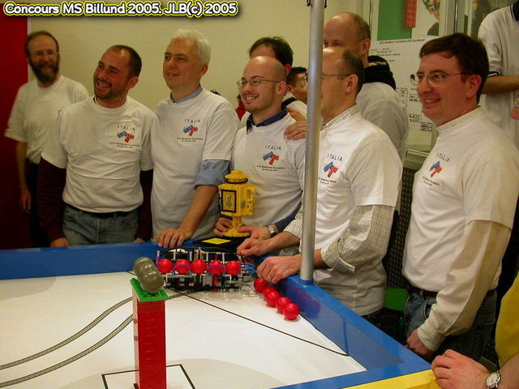

Heu philo reviens .. on a besoin de toi pour l’an prochain :-)

**Les resultats**

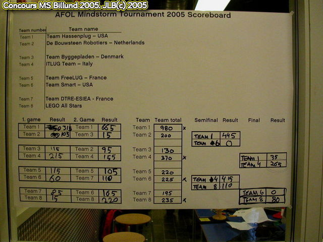

Et la tonne de photo est [ici](http://gallery.freelug.org/Concours01)

En marge de la compétition a eu lieu un vote pour élire l’équipe la plus sympa du concours. FreeLUG n’a toujours pas gagné, mais c’est nos amis hollandais qui ont remporté très justement cette coupe.  
Le coup des Frikandels a séduit du monde, et notre tactique de saoulage des autres avec le Chouchen a été très vite démasquée :)

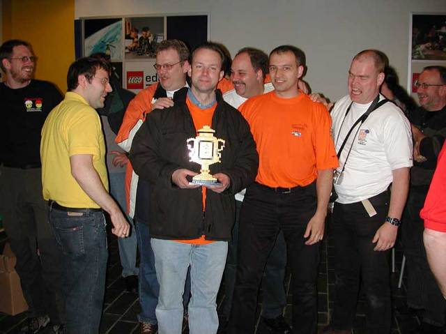

## Epilogue

Après la compétition Steve Hassemplug nous a sorti son fameux robot joueur de Puissance 4. C’est une construction impressionnante à voir fonctionner, et très difficile à battre. Philo s’y est essayé... sans succès. Le robot calcule près de 100 coups à l’avance !

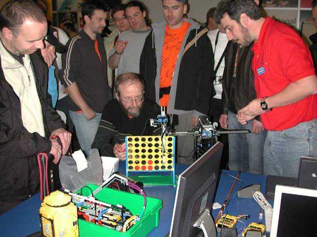

Un repas était organisé dans le restaurant du château dans le parc, pour clore ce we AFOLant. Cela nous a permis de faire, comme dans toute bonne compétition, un échange de T-shirt avec nos amis Hollandais (sauf Annie qui n’a pas réussi à faire rentrer un hollandais dans son petit T-shirt ;o). Et hop voilà des ch’tits francais en orange et des ch’tits hollandais en FreeLUG :-)

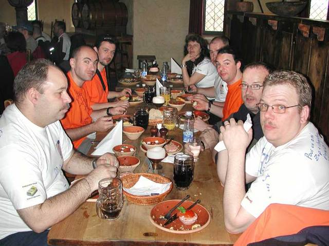

## Conclusion

Quand est-ce qu’on y retourne ? :-)

Malgré quelques imperfections dues à une première fois, ce weekend fut vraiment très agréable. Cela nous a permis de faire connaissance avec des gens très éloignés (les USA par exemple), de sceller une amitié debutée au LEGOWorld 2004 avec nos amis Hollandais (Paul et Peter en tête), de faire mieux connaissance avec Jan Beyer (representant AFOL auprès de LEGO en Europe), de découvrir le parc LEGOLand à Billund (un mythe tout de même), de faire le plein de briques (rah c’est beau un shop LEGO et un grand pick a brick :-)) et de vraiment bien s’amuser (ZUP, Chouchen, multipass ...).  
Un seul regret tout de même : ne pas avoir eu le réflexe de prendre Annie en serviette de bain nous ouvrant la porte le samedi matin :-))

Bon quand est-ce qu’on y retourne ? ;-)

En attendant quelques lien vers des photos de ce fabuleux Week-End :  
**–** [http://gallery.freelug.org/Concours...](http://gallery.freelug.org/ConcoursMSBillund2005)  
**–** [http://gallery.freelug.org/album43](http://gallery.freelug.org/album43)  
**–** [http://gallery.freelug.org/Billund\_...](http://gallery.freelug.org/Billund_9-10_Avril_2005)  
**–** [La gallerie BS de Debouwsteen](http://www.brickshelf.com/cgi-bin/gallery.cgi?f=126444)
