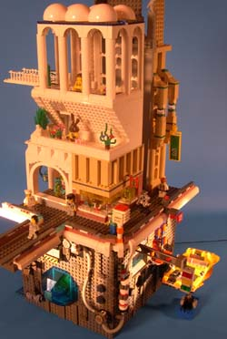
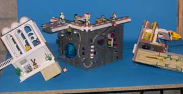
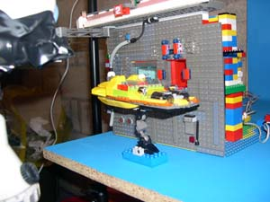
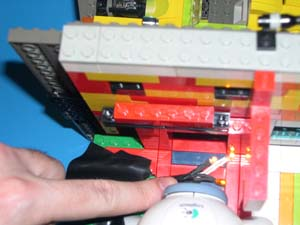
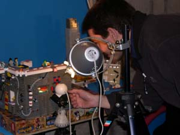
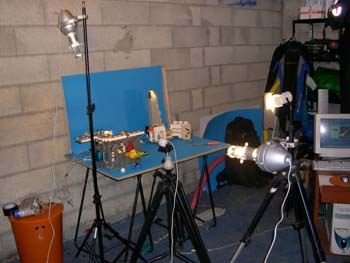
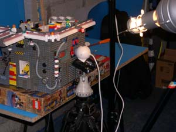
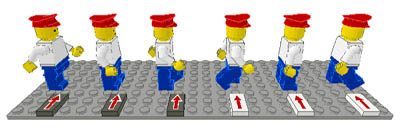

**Le challenge :**  
réaliser un Brickfilm [^1] en une (grosse) demi-journée.

**Les protagonistes :**  
Je ne présente pas Banban car le monde entier le sait, c’est LE passionné qui réalise Stars Wars épisode 4 dans son intégralité en stop-motion [^2] 100% LEGO.  
Moi même Jean-Yves qui ai commis 1 court de 10 min ("La gadoue", malheureusement non diffusé sur Internet) et quelques petites choses en LEGO et pate à modeler.

**Le décor :**  
J’ai réalisé le décor par avance, car le but de la journée était l’animation proprement dite, il s’agit d’un décor de ville type fantastique, un peu hétéroclite, je savais que ce décor ne servirai pas dans son intégralité, mais je me suis fait plaisir :

Ce décor est démontable, ce qui est un minimum pour pouvoir faire des prises de vues assez libres :

**Le matériel :**  
Une webcam, le logiciel gratuit « anasazi » [^3], Adobe Première, des pieds photo, des lucioles de modélismes, 2 mini projecteurs focalisables [^4] trouvés chez IKEA (une merveille), une boite à lumière pro (dont on aurait pu largement se passer), un halogène monté dans un petit boîtier, un plan de travail et un fond bleu [^5].

**Le scénario :**  
Aucun scénario n’a été fixé avant le jour j ! en fait cela s’est décidé très vite, Banban ayant amené ses Joe Vig, j’ai proposé qu’il fasse une gaffe avec une pizza et Banban a immédiatement pensé à Dark Vador en personne comme victime de Joe !

**Le tournage :**  
On peut résumer la journée ainsi : la stop-motion c’est 30% de technique de base et 70% de débrouille et d’inventivité. Voici une liste de petits trucs utilisés sur ces 20 secondes de film :

**–** Speeder monté sur rotules pour reproduire le roulis d’un véhicule en lévitation :

**–** Travelling [^6] du premier plan réalisé en faisant bouger le décor et non la caméra.  
**–** Feux tricolores éclairés par un pinceau de lumière pour donner l’apparence du feu rouge.  
**–** Joe vig éclairé par des lucioles de modélisme placées entre lui et la Webcam (4cm !) :

**–** Animation de la boite de pizza devant le nez de Dark Vador : Joe Vig n’apparaît pas, seule la boite est animée grâce à une antenne lego devant la webcam :

Sur cette photo on voit bien l’ensemble du plateau (hormis la boite à lumière), la webcam est simplement scotchée au pied et en légère contre-plongée afin de masquer le pied à rotules du speeder, le projo vertical éclaire l’intérieur de l’appartement, le projo de face éclaire simplement la partie du bâtiment situé au-dessus du speeder (dirigé grâce aux couteaux [^7] et adouci par un morceau de calque [^8]), le projo du fond + la boite à lumière créent l’ambiance [^9] :

Une boite Harry Potter s’invite au tournage (si le pied ne descend plus, une seule solution rehausser l’ensemble du décor !) :

Voilà, comme disent les pro lors du dernier plan tourné (qui peut être le premier du film) : « c’est dans la boite » il nous reste tout le travail de post-prod [^10] et ensuite la diffusion sur le net via le site de Banban [lswproject](http://www.lswproject.com/) et tentative de diffusion sur [brickfilm](http://www.brickfilms.com/) (mais le film a été refusé).

En conclusion cette animation a été extrêmement enrichissante pour tous les deux. Banban m’a convaincu de la supériorité de l’animation avec un onionskin [^11], il m’a montré des astuces de montage avec le logiciel Première, ainsi que sa technique de marche [^12] pour les minifigs. Pour ma part je pense lui avoir apporté quelques idées sur l’éclairage ainsi que l’utilisation du « blue tack » [^13] pour maintenir en position des minifigs récalcitrantes sur des tiles glissantes.  
Allez je glisse tout de même mon seul regret : n’avoir pas eu le temps de démontrer à Banban les merveilles de la prise de vue avec une caméra numérique dont la qualité d’image aurait vraiment rendu grâce au travail des animateurs, mais ... ce n’est que partie remise.

Nous espérons que cet article vous a donné envie de voir notre [mini-film disponible ici](http://www.lswproject.com/download/pizza_fly.avi) et surtout envie de vous aussi, donner vie à vos minifigs !

Jean-Yves et Alban.

[^1]: _Brickfilm_ : Film d’animation à partir de briques LEGO. Le site emblématique où l’on trouve ces film est [www.brickfilm.com](http://www.brickfilm.com/).

[^2]: _Stop-motion_ : Technique d’animation (donc prise de vue image par image à raison de 25im/s en vidéo) à partir d’éléments en volume, marionnettes, patamodeler, LEGO.

[^3]: _Anasazi_ : Petit logiciel magique qui permet de réaliser de la stop-motion à partir d’une webcam et qui permet la fameuse option de l’onionskining. Il est téléchargeable [ici](http://www.animateclay.com/modules.php?op=modload&name=Sections&file=index&req=viewarticle&artid=24&page=1).

[^4]: _Projecteurs Focalisables_ : Projecteur avec une lentille permettant de donner un faisceau de lumière plus étroit et dirigé

[^5]: _Fond Bleu_ : Technique qui consiste à filmer une partie des personnages, décors, devant un fond bleu, afin de pouvoir réaliser des incrustations en post-production en supprimant sélectivement cette couleur grâce au logiciel de montage (Première par ex.). Le bleu est choisi car c’est une couleur quasiment absente du corps humain, avec les lego ça marche aussi puisqu’ils sont jaunes ou chair !

[^6]: _Travelling_ : C’est le déplacement de la caméra dans l’espace, en avant, arrière, gauche, droite, (avec un chariot appelé dolly) haut, bas ou tout ça en même temps (avec des grues spéciales, les louma). Pour les brickfilms si le décor n’est pas trop important on peut le déplacer au lieu de déplacer la caméra, cela permet de faire des mouvements qui seraient très difficiles à faire avec la caméra (tourner et descendre autour du décor image/image c’est pas évident).

[^7]: _Couteaux_ : Accessoires utilisables avec un projecteur focalisable qui donne un faisceau de forme rectangulaire, en principe accessoire de pro, on trouve chez Ikéa un projecteur pour la déco de la maison qui possède tout les outils de contrôle de la forme du faisceau et ça c’est top !

[^8]: _Adouci par un morceau de calque_ : Le papier calque permet de transformer une lumière dure en lumière diffusée donc d’éclairer un sujet sans créer d’ombre trop dures.

[^9]: _Ambiance_ : C’est la lumière qui baigne le plateau afin de ne pas avoir des ombres trop dures, réalisée par exemple avec un projecteur + calque

[^10]: _Post-prod_ : Tout ce qui se passe après la fin du tournage pour arriver à produire le film, donc pour la stop-motion, toute la bande son, le montage, les effets spéciaux (incrustation, sabre laser, explosions...).

[^11]: _Onionskin_ : Outil informatique qui permet de mettre en surimpression l’image en cours de prise et la prise précédente, cela est important pour contrôler la fluidité de l’animation et surtout est indispensable si votre minifig est tombée ou si votre décor à bougé.

[^12]: _Technique de marche_ :
    
    

[^13]: _Blue tack_ : De l’anglais "petit clou bleu". En fait il s’agit d’utiliser de la patafix (genre de pate a modeler utilisée pour coller des affiches sur des murs lisses), pour faire tenir les personnages dans des positions de déséquilibre. La patafix a un gros avantage sur la pate a modeler, c’est qu’elle s’enlève beaucoup plus facilement des Lego et ne tache pas les briques.
