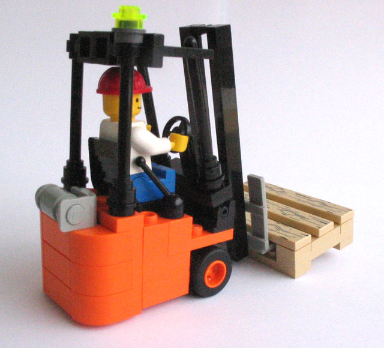
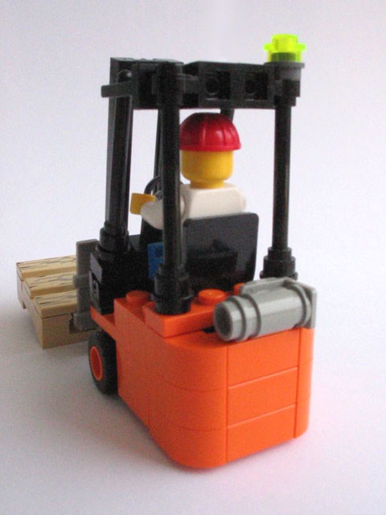
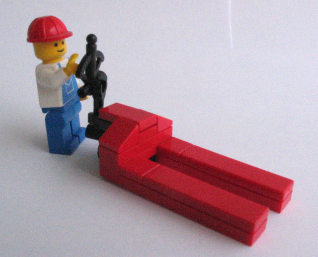
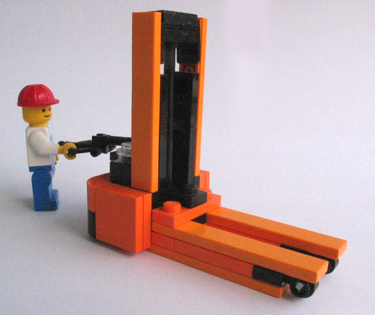
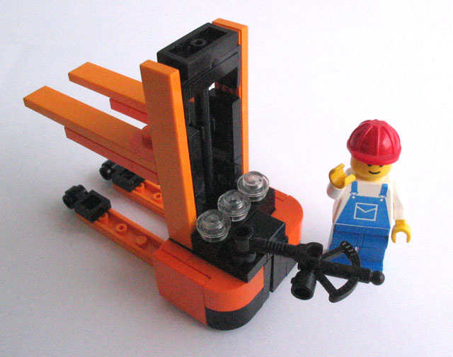

Il y a quelques temps de cela j’avais réalisé un MOC représentant un [Chariot élévateur](/articles/257/), dont Didier m’avait aimablement fait la notice de montage.

Aujourd’hui je souhaite vous en présenter une nouvelle version améliorée sur plusieurs points (du moins j’espère que vous jugerez ces changements comme des améliorations).

Il y a 3 changements majeurs :  
**–** L’arrière est arrondi, et non plus conique  
**–** Le chariot est légèrement plus court (à peine), je trouvais l’autre encore trop long  
**–** J’ai rajouté une bouteille de gaz à l’arrière (bien qu’elle ne soit pas obligatoire sur tous les chariots élévateurs)

D’autre part, comme vous l’avez sans doute remarqué, j’ai changé la couleur : la nouvelle version est orange, c’est à dire aux couleurs de la marque "Still". Ce n’est pas vraiment une amélioration, mais cela est moins courant que le jaune pour du Lego...

Mais puisque j’étais dans un trip "appareil pour déplacer des palettes", j’ai aussi tenté de faire un transpalette hydraulique (manuel quoi), et un transpalette électrique !

Ce transpalette manuel est assez facile à faire car il ne nécessite pas beaucoup de pièces. Il utilise toutefois la pièce slope 1x1 dernièrement crée pour le set de la BNSF (enfin dans une autre couleur).

Et voici le transpalette électrique, très largement inspiré d’un modèle de chez "Still" :

J’ai aussi fait un modèle de palette pouvant fonctionner avec ces deux transpalettes, mais je n’ai pas les pièces dans les bonnes couleurs, c’est pour cette raison qu’elles n’apparaissent pas sur les photos.

Je tiens à remercier tout particulièrement :  
**–** Jean-Yves et Loys pour m’avoir poussé à refaire l’arrière en arrondi  
**–** Didier et David (un collègue de bureau) pour m’avoir incité à trouver un moyen de rajouter la bouteille de gaz  
**–** Pascal (Le Gnome) pour son idée de tile 1x6 tan décorée avec un motif de planche du set Harry Potter pour la palette  
**–** Et tous les autres qui m’ont donné plein de conseils et que j’ai peut-être oubliés...

Pour plus de photos, jetez un oeil à ma galerie [brickshelf](http://www.brickshelf.com/cgi-bin/gallery.cgi?f=129783)
