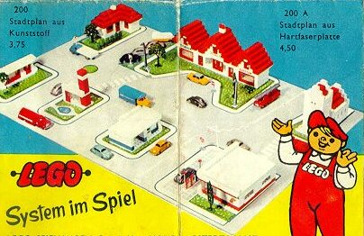
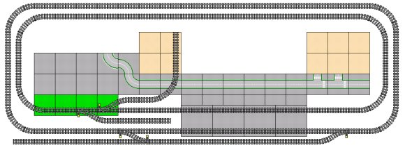

Le premier évènement FreeLUG de l’année 2007, c’est une exposition à _Bourgoin Jallieu le 28 janvier_.

Après 2003 et 2004, nous voici invités une troisième fois par le club **OMNIBUS** pour une exposition qui a pour thème "Le jouet ancien".

Voici le programme complet :  
**–** Date : dimanche 28 janvier 2007  
**–** Lieu : **Espace GRENETTE** à **Bourgoin Jallieu** (38), c’est en plein centre ville  
**–** Horaires : 9h00 à 18h00

Alors c’est vrai que la brique LEGO est vraiment un jouet actuel, vu la campagne publicitaire de ce Noël 2006, mais nous allons aussi montrer que cette histoire dure depuis les années 50... Ca en fait un jouet ancien, ça , non ?

Nous allons présenter la boite 200 .

Bien sur, nous allons aussi monter un "petit" réseau de train de 5m x 2,50m...

Alors, Denis Huot et moi même, nous vous invitons à venir nous voir, histoire de faire un bout de causette.

@ bientôt !!
