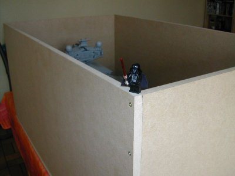
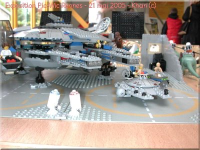
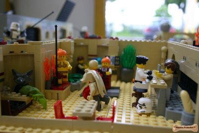
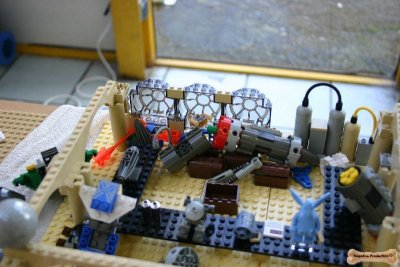
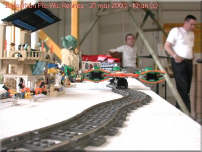
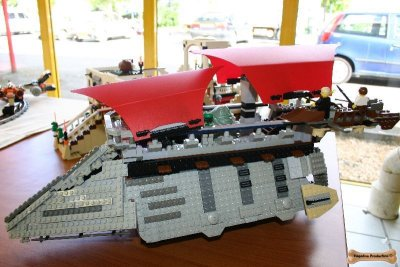
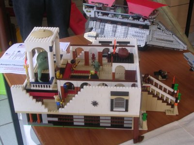
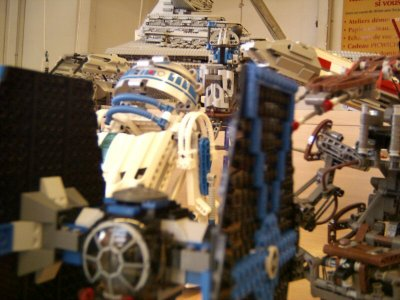
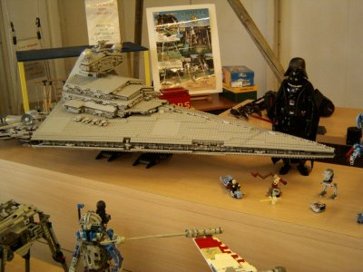
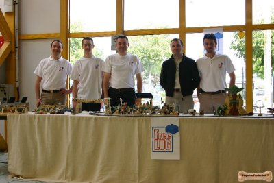

Après plusieurs semaines de préparation, arrivé le jour J est et nos modèles exposés nous avons. Star Wars étant à l’honneur notamment avec la sortie du IIIème épisode de la double trilogie.

Tout a commencé un soir de pleine lune, la bande des freeluguiens rennais décidait d’accepter l’invitation fort chaleureuse du responsable du magasin Pic Wic de Rennes.

Une réunion un soir, et un développement via une [page du wiki](http://wiki.freelug.org/tiki-index.php?page=Exposition+Pic+Wic+Rennes) et une [galerie de photos des MOCs en développement](http://gallery.freelug.org/PicWic-21_mai_2005) a permis de bien s’organiser. Chacun ayant sa zone bien définie. Le diorama STAR WARS était prêt, mais dispersé dans la campagne bretonne.

Jour J-1 : vendredi 20, 18h30  
Ça y est ! Le jour de l’installation tant attendu est arrivé. Manu nous a rejoint en début d’après-midi après un périple de 400km avec un [ISD (Imperial Star Destroyer)](http://guide.lugnet.com/set/10030) qui le poursuivait (presque, il était dans une énorme caisse dans son coffre !).

**L’ISD dans sa caisse de transport**

Les tables s’installent et nous z’aussi ! On étend la toile couleur sable qui finalement s’avère un chouilla trop courte ! Elle faisait pourtant grande dans le salon :)  
Les [MOCs](/articles/128/) sortent des coffres, caisses et autre moyens de transport pas forcément orthodoxes :)

Et voila un hangar avec un beau [Faucon Millénium](http://guide.lugnet.com/set/7190)

**Le hangar du Faucon**

Et une cantine, ou s’accumule les détails humoristiques (rat dans la poubelle, squelette et même un stormtrooper qui se soulage sur un mur !)

**La cantine de Mos "Gyclore" Eisley**

Plus loin apparait une véritable décharge, celle de Watto se plaignant de la chute du cours des termobidulateurs à réaction inversée.

**La decharge de watto**

Le milieu de la toile est occupée par la course de modules (pod-racers) avec un large public dont Jabba le Terrible.  
Les trains attirent beaucoup le regard des enfants, et ce fut exactement le même phénomène avec les pods tournants sur les rails. Certains enfants ne voulaient plus partir !

**Course de Pods**

La Superbe barge de Jabba trône également sur le layout, proche du palais du même monstre.

**Barge de Jabba**

**Palais de Jabba**

Sur une deuxième table sont réunis les modèles techniques. [L’ATAT](http://guide.lugnet.com/set/9754) ainsi que le [R2D2](http://guide.lugnet.com/set/9748) ont eu le droit à leur petit tour dans le magasin, ce qui a plu aux plus grands :) Le chien lui tournait la tête lorsqu’on le regardait (merci la télécommande ! Il est joueur le Manu...)

**Table technics**

Ainsi que l’ISD qui trône fièrement.

**ISD ... sorti de sa boite :)**

Une fois l’installation terminée, on prend les chemins de traverse en pleine compagne pour se retrouver chez Marc pour déguster un excellent barbecue ainsi qu’un très bon gâteau (merci à vous deux) et on se dirige vers le cinéma pour voir l’épisode III de la double trilogie Star-Wars.

Jour J : samedi 21 de 9h30 à 19h00

Nous avons eu du monde toute la journée en un flot continu. Cela a été agréable car tout le monde pouvait voir le diorama sans problème.  
De plus, ne pas mettre trop de modèles permet une meilleur visibilité et on regarde plus les détails humoristiques que le nombre de sets.

Petit bémol, en voulant faire bien on avait mis des affiches de FreeLUG, malheureusement certains visiteurs ont cru que c’était une campagne promotionnelle pour un clone à LEGO ! Il va donc falloir ajouter "Association" sur nos affiches et demander de la PLV de petites tailles à LEGO afin de bien montrer que c’est réalisé avec des briques LEGO !

Nous avons tous passé une excellente journée et je crois que tout le monde a envie de remettre ça l’an prochain !

**nous :)**

Un grand merci à Emmanuel HOUDUS, le directeur du magasin, ainsi que tout le personnel pour l’acceuil chaleureux et surtout nous avoir laissé "jouer" toute une journée.
