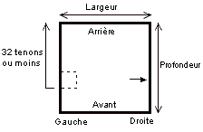
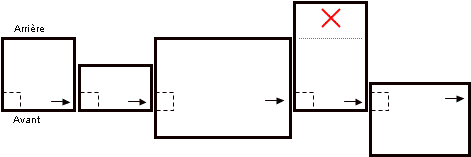
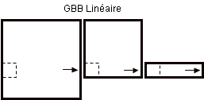
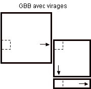

Ce document est une traduction, avec son accord, du document [Great Ball Contraption Set-ups and Examples](http://www.teamhassenplug.org/GBC/GBCExamples.htm) de Steve Hassenplug

Cet article est un complément de [Le Grand Bidule à Balles](/articles/362/)

Dans les exemples ci-dessous, le petit carré pointillé représente le "panier d’entrée" du module, tandis que la flèche indique où les balles ressortent du module.

1.  La sortie est à l’opposé de l’entrée, et en ligne droite.
2.  L’entrée est à gauche et la sortie à droite.
3.  Le coin avant du panier d’entrée 10x10 doit être situé à moins de 32 tenons de l’arrière du module (autrement dit, un module ne peut être plus profond que 32 tenons derrière l’avant du godet d’entrée). Il est également préférable (mais non obligatoire) que les modules soient plus longs (de gauche à droite) que profonds (de l’avant à l’arrière).

* * *

**Exemple**

Voici un petit exemple de disposition - le premier module est supposé de taille 32x32. Notez que le module 4 (marqué d’un "X") **ne suit pas** la norme, car son bord arrière est situé à plus de 32 tenons de l’avant de son panier d’entrée. Par contre les modules 2 et 5 sont conformes (il sont en dessous de cette limite).

* * *

**Virages**

Quelques heures après l’annonce des règles GBB, de gens ont commencé à proposer des moyens de modifier celles-ci pour autoriser les virages. Il est devenu rapidement clair que des virages à droite ou à gauche pouvaient être réalisés sans modifier la norme. Par exemple, dans la première installation ci-dessous trois modules forment un GBB "normal" (rectiligne). Le second schéma montre comment ces mêmes modules peuvent être réorganisés pour permettre un virage à droite puis à gauche.

