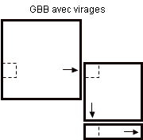

Ce document est une traduction, avec son accord, du document [Great Ball Contraption Standard-Breaking Behavior](http://www.teamhassenplug.org/GBC/GBCStandardBreaking.htm) de Steve Hassenplug

Cet article est un complément de [Le Grand Bidule à Balles](/articles/362/)

Même s’il y a une quantité de choses intéressantes à faire, _tous les modules doivent être construits pour se conformer à la "norme GBB"_ ! C’est la seule façon de garantir que tous les modules pourront coopérer dans un GBB complet. Si vraiment vous voulez expérimenter, assurez vous de suivre les deux "Lois" du GBB :

1.  ère Loi : un module GBB **doit** se conformer à "L’interface Standard type 1" pour qu’il puisse être intégré à un GBB.
2.  ème Loi : un GBB peut se permettre de casser les règles tant que l’on peut l’utiliser d’une façon qui se conforme à la première loi.

Prenons l’exemple des virages : bien que la norme ait été créée avec en tête l’idée de GBB linéaire, tant qu’un module ne s’étend pas au devant de son entrée et de sa sortie, il peut être tourné et réaligné pour réaliser un coude à 90° vers la droite. De même, un module qui ne s’étend pas derrière son entrée et sa sortie permet de réaliser un coude gauche, et si il ne fait que 10 tenons de large il permet de tourner à droite ou à gauche. Ainsi un module conforme à la norme peut également être utilisé de façon non standard.

Un autre exemple est celui des modules qui séparent le flux : tant que les deux flots résultants sont traités et peuvent être (si besoin) recombinés avant la sortie standard, pas de problème. Le module peut même avoir une sortie annexe ; tant que le module ne _requiert_ pas cela (par exemple si la sortie non standard peut être désactivée et qu’alors toutes les balles sont acheminées vers la sortie standard), il peut être utilisé de façon standard donc est conforme à la première loi.
