Philo nous a invité à la réalisation d’un [Goûter "Grand Bidule à Balles"](/articles/397/).

## Modules

Vauban, Nicolas, Erik, Philo et JLB ont réalisé quelques modules pour l’occasion, dont voici une petite présentation.

## Le Module GBB de Vauban en étroite collaboration avec CHRISDIGO

Quand sur mon idée nous nous sommes décidés à faire un SKIP, Chris et moi nous n’avons pas réalisé que ce projet n’était pas trop adapté aux contraintes des GBB.  
Trop gros et trop lent.  
Surtout trop haut !!! même si nous avons fait tenir la construction dans un module de base. Il faut un second module pour rendre les billes au niveau de la trémie d’entrée.

Principe :  
Une benne pivotante fixée sur un chariot. Le chariot est prisonnier de ses rails. Au sommet le chemin de roulement se courbe. Le chariot vient en butée et la benne bascule sous l’action des câbles.

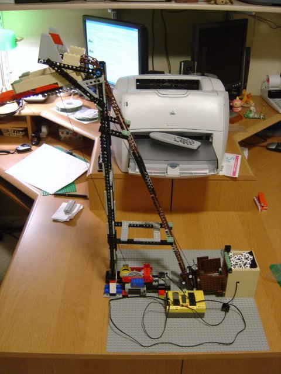

**le skip de Chrisdigo**

## Le Module GBB de Nicolas

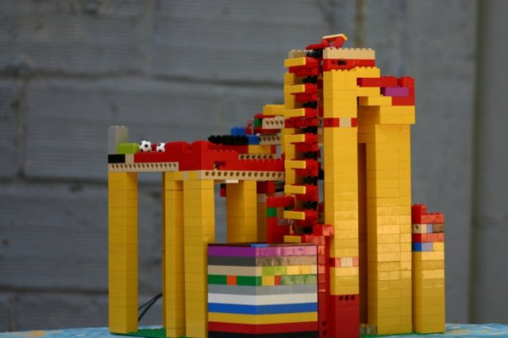

**Module GBB de Nicolas**

C’est le premier grand bidule à balles que j’ai construit, après de longues heures de montage et de démontage, après avoir aussi subit un vandalisme ( qui a bien osé mettre une tête de minifig ???), mon module est enfin prêt pour le grand jour.

Après quelques essais je me rend vite compte que mes quelques balles de test n’ont pas la même incidence que 50 balles arrivées d’un coup.

Dans l’ensemble ça marche plutôt bien, même s’il faut assurer une petite maintenance de temps en temps, une fois tous les modules réunis, l’ensemble forme un GBB très sympa même si parfois on cours après les quelques balles qui refusent de subir la torture.

Ce fut un très agréable moment et Philo nous avait préparé un très très bon goûter

Merci Philo pour tes très bon gâteaux, et merci à tous pour ce premier GBB.

## Le Module GBB de Erik

Pour ce premier GBB, je n’ai pu amener qu’un seul module :

**Le moulin à balles**

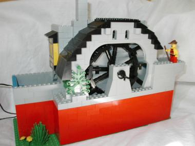

**Module GBB d’Erik : Moulin à balles**

Après plusieurs heures de mise au point, mon module est prêt au matin du jour J.

N’étant absolument pas un grand _Technic_ien, et préférant grandement le _System_, mon module était forcément orienté dans un des thèmes LEGO que j’affectionne : le Moyen-Age.

Ce moulin à eau permet la remontée des balles dans sa grande roue.

Bien sûr, quelques soucis sont apparus :  
**–** résistance moyenne à une charge importante : si trop de balles arrivent, la roue se charge trop, tourne moins vite et n’arrive plus à ejecter correctement les balles (il va falloir que je fasse un mécanisme de récupération :) )  
**–** quelques blocages en entrée de la roue (un petit bras qui viendra pousser les balles est à rajouter).  
**–** casse d’un élastique... prévoir du matériel de rechange.

Sinon, dès que le bon rythme des balles en entrée a été trouvé, le résultat était parfait. Un bon entrainement avant Reims !

## Les modules GBB de Philo

D’autres photos et vidéos sont disponibles sur mon site ([http://philohome.com/gbc/gbc.htm](http://philohome.com/gbc/gbc.htm))

**\- Le grand tonneau**

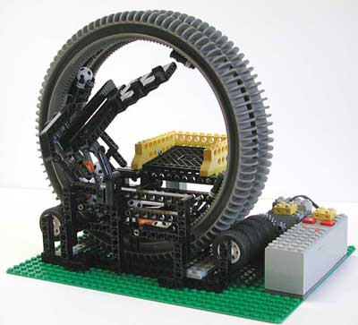

Premier module GBB que j’ai construit, il utilise deux roues de Hailfire Droid pour faire monter les balles. Six petits godets sont attachés aux roues, attrapent les balles dans le bas et les libèrent sur une rampe vers le module suivant.  
Bonne fiabilité, mais très bruyant (ça fait partie du plaisir !)... La première version ne comportait que 4 godets et avait du mal à suivre le rythme.

**\- La pelleteuse**

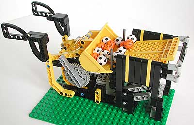

Une pelleteuse vient récupérer les balles du panier d’entrée. La benne appuie sur la porte, ce qui abaisse celle ci et monte en même temps le fond du panier pour récupérer les balles. La liaison mécanique de la benne permet à celle-ci de basculer et de relâcher les balles vers le module suivant. Des guides, qui viennent se placer au dessus de l’entrée du module suivant, dirigent les balles.

La fiabilité est correcte. Lorsque le panier d’entrée est trop plein (30 balles et plus), la benne peine à soulever les balles. Mais elle parvient généralement à enlever 1 à 2 billes, ce qui facilite les choses au cycle suivant (environ 1 cycle toutes les 4 secondes).

**\- La balayette**

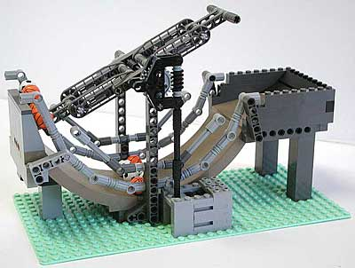

L’un des modules les plus simples : une raclette pivotante pousse les balles sur une piste cylindrique (constituée de pistes de skateboard).

Bonne fiabilité. Lorsque de nombreuses balles arrivent simultanément, certaines passent au dessus de la balayette et retombent parfois hors du module.

**\- La scie sauteuse**

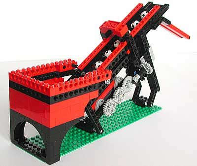

Une lame de scie animée d’un mouvement circulaire pousse les balles vers le haut de la rampe, tandis que deux autres (fixes) les empêchent de redescendre. Le mouvement de la scie à la base du godet d’entrée suffit à empêcher le colmatage.

Très bonne fiabilité. Eviter toutefois de faire fonctionner le moteur dans le mauvais sens, c’est catastrophique !

**\- La vague noire**

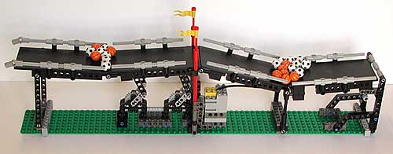

Le coeur de ce module est une bande de roulement constituée de 4 sections (plaques de 8x16). La première et la troisième section ont une pente dirigeant les balles vers la sortie, la troisième section est animée d’un mouvement vertical alternatif permettant de hisser les balles au dessus de l’entrée du module suivant. Les sections 2 et 4 suivent le mouvement de la section 3. La longueur "à plat" de la bande de roulement n’étant pas constante, seul le milieu est fixe (axes rouges). Les sections sont raccordées par des charnières coulissantes avec élastique de rappel.

Très bonne fiabilité. Si la charge d’entrée est importante, toutes les balles ne sont pas évacuées en 1 cycle (temps de mise en roulement), mais le débit global reste important.

**\- La pompe à balles**

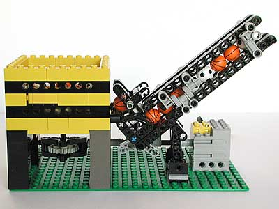

Un rotor à trois lames pousse les balles dans un tube montant. Lorsque la colonne de balles est à son point haut, la nouvelle balle arrivante s’intercale dessous et empêche la redescente. Le panier d’entrée est équipé d’un fond tournant qui alimente la pompe une balle à la fois. Comme toute pompe refoulante, elle ne fonctionne que lorsqu’elle est alimentée, en cas de disette la colonne de balles restantes est animée d’un mouvement alternatif (bruyant).

Fiabilité moyenne. Les essais préliminaires avaient été bons, mais lors du goûter GBB le système d’alimentation s’est bloqué plusieurs fois, nécessitant une intervention.

**\- La vis d’Archimède**

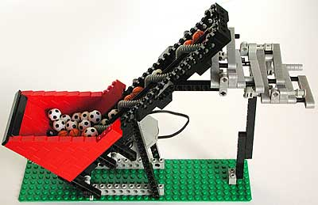

Une vis sans fin, constituée d’un axe long (L=32) et d’un tuyau annelé, emmène les billes en haut de la rampe. Une pale rotative au fond du panier d’entrée empêche le colmatage. Le débit est auto-régulateur, puisque la vis d’Archimède emporte deux balles à la fois lorsque le godet d’entrée est fort plein. Une descente en zig-zag agrémente la sortie.

Très bonne fiabilité. Comme le module scie sauteuse, explose si on fait fonctionner le moteur à l’envers.

**\- Le train Spybot**

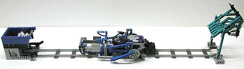

Le petit dernier, montré pour la première fois lors de ce goûter. Une navette équipée d’une benne transporte les balles sur une voie de train placée entre les paniers d’entrée et de sortie. Cette navette, construite autour d’un Spybot, illustre bien le manque de modularité de celui-ci, les moteurs et capteurs n’étant pas placés idéalement pour cette application. L’un des deux moteurs assure la propulsion, tandis que l’autre manoeuvre la benne. La position de la benne est obtenue par le capteur de contact du Spybot : en position basse, la benne appuie directement dessus, et un système de leviers permet de l’enfoncer également en position haute. La navette détecte les extrémités de la voie grâce à son capteur de lumière déporté par fibre optique. La navette libère les balles en poussant la porte du godet d’entrée, tandis qu’un filet récupère les balles, les amortit et les guide vers l’entrée du module suivant.

Fiabilité : correcte. Les fibres optiques du détecteur de lumière rendent celui-ci trop sensible à la lumière ambiante. Le fonctionnement de ce module est compromis dans une pièce trop lumineuse ou lorsque l’éclairement varie rapidement (des seuils auto-adaptatifs permettent de s’affranchir des variations lentes).

## Le module GBB de JLB

**\- L’escalier sans fin**

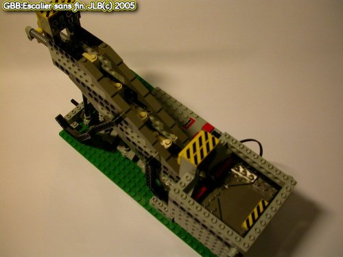

Le principe est tout simple : passer une bille d’une marche à l’autre pour la faire monter en hauteur.

L’idée de ce module germait depuis pas mal de temps dans ma tête avant que je me décide à passer à l’action. Contrairement à ce que je pouvais penser, avant de passer à la phase de construction, le plus compliqué n’est pas le mécanisme pour faire monter la bille, mais bien le godet d’entrée, si l’on veut éviter tout blocage à ce niveau là dû à l’effet entonnoir du module.

C’est mon premier module, et je l’ai mis au point juste au dernier moment (le matin avant le goûter j’étais encore sur le godet d’entrée). Cela m’a permis de m’apercevoir qu’il était trop lent, et pas assez fiable. J’espère avoir corrigé cela depuis, mais il nous faudrait un nouveau goûter GBB :-)

Fiabilité : moyenne lors du goûter (pas assez rapide, et des blocages du système d’entrée. Je pense avoir réparer ces problèmes depuis. A valider à Reims :-)

D’autres photos ici : [http://gallery.freelug.org/Escalier...](http://gallery.freelug.org/Escalier_sans_fin)

## Rassemblement des modules

Le but étant de rassembler les modules et de s’échanger des billes, voici donc la chose faite (non sans mal) :

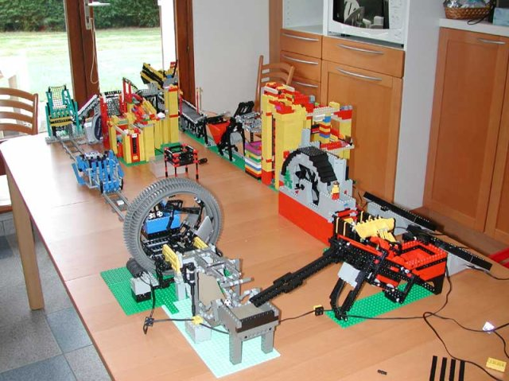

**Le GBB Complet**

Après plusieurs minutes à trouver comment assembler l’ensemble des modules pour faire un circuit qui boucle sur lui-même (et après avoir "rabaisser" le skip de Richard afin qu’il ne jette pas les billes de trop haut), nous avons trouvé la combinaison que vous voyez ci-dessus.

La mise en route se fit dans un vacarme de mécanique en action et de billes qui tombent et se heurtent. C’est là qu’on s’aperçoit qu’un réseau de modules GBB est vraiment très bruyant (encore une raison pour nos wafols de détester les LEGO :-))

La beauté, et le plaisir, de ce genre de chose est de voir nos petites billes se propager au travers de tout le réseau. Le plus amusant est de mélanger une balle de basket à tous ces ballons de foot afin de suivre la propagation de la balle au travers de tous ces modules.

Ce genre d’assemblage est aussi le moyen pour certains de valider leur module et/ou de constater qu’il est trop lent, ou pas suffisamment fiable (se bloque, perd trop de billes...). Nous sommes tous repartis (enfin sauf peut-être Philo qui avait déjà pas mal testé tous ses modules) avec des idées d’amélioration à appliquer sur nos modules. Vivement le prochain rassemblement de GBB à [Reims](http://reims.freelug.org/).

Vous trouverez les images et vidéos de ce goûter ici : [http://gallery.freelug.org/we\_GBB\_050605](http://gallery.freelug.org/we_GBB_050605)

## Conclusion

"Le GBB c’est passionnant, mangez-en :-)". Les modules GBB sont une manière agréable de pouvoir faire des modules dans son coin et de les regrouper à l’occasion d’exposition ou de goûter de ce genre. Bref, pourvu que cela dure :-)

Un grand merci à Annie et Philo pour leur accueil toujours impeccable, et merci pour ces bons gâteaux (tout le monde est reparti avec la recette du gâteau choco-marron).

Prochain RDV GBB à [Reims](http://reims.freelug.org/) et sûrement à de nombreuses autres expositions ou goûters.
