Cet article est la partie II de la discussion sur les techniques de décoration pour trains LEGO® \[[1](#nb2-1 "Didier Enjary, Trains LEGO® et motifs de décoration : Les motifs diagonaux")\].

**Introduction**

Vous pouvez avoir besoin de mettre des noms de marques (Santa Fe) ou des acronymes (TGV) sur les côtés de vos wagons, voitures ou locomotives.

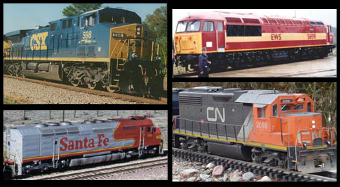

Voyons par quels moyens vous pouvez réussir de telles décorations.

**1) Mosaïque**

Vous pouvez utilisez des lettres et des chiffres basés sur la technique classique de la mosaïque.

La société LEGO® proposes une police de caractère dans le [livret d’idée 226](http://library.brickshelf.com/scans/0000/0226/0226-78.jpg)

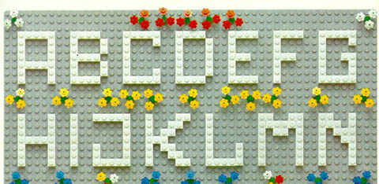

Eric Harshbarger propose lui une police plus petite [ici](http://www.ericharshbarger.org/lego/fonts.html) basé sur cette technique.

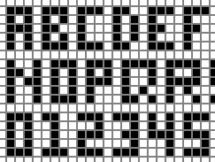

La réalisation est facile et toutes les lettres sont représentées mais plutôt encombrante : 5 tenons de haut, les barres des lettres sont épaisses (1 tenon). A cause de cette taille importante, cette technique n’a pas été utilisé pour des trains LEGO®

Des exemples dans d’autres domaines que le train :

[Logo de IndyLUG](http://www.brickshelf.com/gallery/matthew1980/IndyLUG/CNPE-FEB-2005/000indylug.jpg)

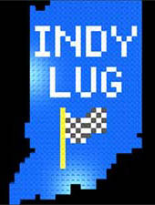

[La tour Smart©](http://www.brickshelf.com/gallery/dickydidier/smart/p1120002.jpg)

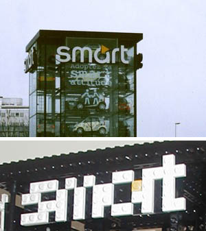

[Une remorque "Milk"](http://www.brickshelf.com/gallery/SEBarile/LLCA/mainstreet_4.jpg)

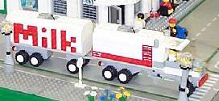

Les deux derniers exemples montrent des lettres de 4 tenons de haut mais il est dans ce cas impossible de créer toutes les lettres de l’alphabet.

**2) L’assemblage classique**

L’alternance de plaques de couleurs en assemblage classique permet de faire des lettres-mosaïques plus petites.

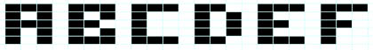

L’épaisseur des barres horizontales des lettres n’est plus que de 0.4 tenons. La largeur des barres verticales est inchangée (1 tenon).

La structure des lettres est identique à celle de la polic de caractère de Eric Harshbarger que nous venons de voir.

Par conséquent, les lettres semblent plus larges que hautes mais ça convient assez bien puisqu’elles apparaissent sur les larges flans des locomotives et des wagons.

Cette technique convient particulièrement bien aux lettres ne comportant ni courbe, ni diagonale (E,F,H,I,L et T) ou aux lettres qui peuvent être rendues carrées (A,C,G,J,O,P,S,U). On obtient aussi des résultats correct pour les autres lettres (B,D,K,M,N,Q,R,V,W,X,Y,Z)

Bien que les lettres soient plus petites, ce n’est pas un grand avantage car la réduction ne se fait que dans le sens de la hauteur. Toutefois c’est suffisant pour voir un grand nombre d’application sur des trains LEGO®

Walt May a créer les lettrages pour : [CN](http://www.brickshelf.com/gallery/crazeed/GP40-2LW/amg_1357.jpg), [CSX](http://www.brickshelf.com/gallery/crazeed/csxAC6000/aaaac6000.jpg) et [GT](http://www.brickshelf.com/gallery/crazeed/work-in-progress/gt_gp-9side.jpg).

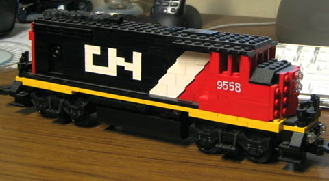

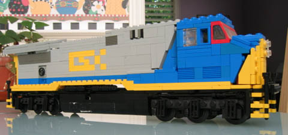

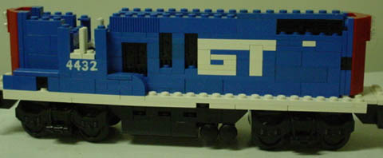

et James Mathis pour le marquage [SBB](http://www.brickshelf.com/gallery/jamathis/Trains/Locomotives/SwissRe44/v1/swiss_re44_v1_p5.gif) et [CFF](http://www.brickshelf.com/gallery/jamathis/Trains/Locomotives/SwissRe44/v2/swiss_re44_v2_p1.gif) sur une motrice Re44 des chemins de fer suisse.

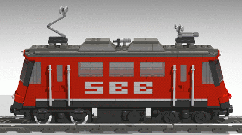

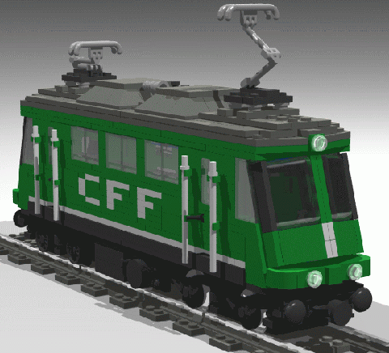

L’[ICE](http://www.1000steine.com/themen/eisenbahn/008/index.php) est une réalisation de Patrick Rumpel

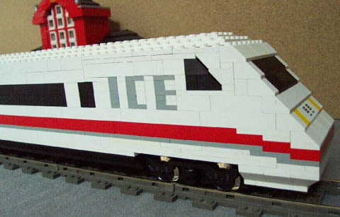

Masahiro Yanagi a créé des exemples dans le thème [Espace](http://www.brickshelf.com/cgi-bin/gallery.cgi?m=MasahiroYanagi&n=47)

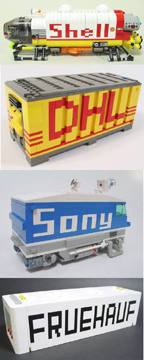

**3) La police de caractère dite "Railton"**

Jason Railton a écrit deux articles fondamentaux \[[2](#nb2-2 "Jason Railton,Advanced SNOT, The Brick Issue #4, Christmas 2003")\] \[[3](#nb2-3 "Jason Railton,LEGO SNOT, The Brick Issue #3,Summer 2003")\] utile à la création de ce style de lettrage qu’il à utilisé dans au moins trois réalisations.

Il à définit une police de caractère constitué d’un empilement classique de plaques et de briques placé en SNOT à 90°.

Du fait de cette rotation, les barres verticales des lettres sont larges de 0.4 tenon alors que les barres horizontales sont épaisses de 1 tenon.

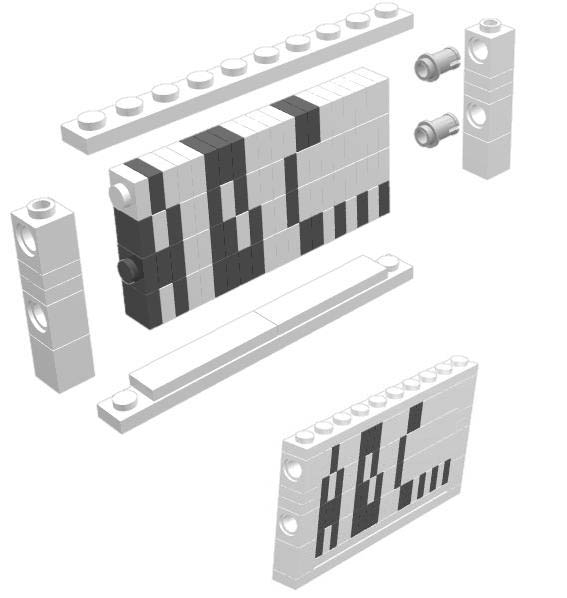

Réalisations de Jason Railton :

**–** [Bolsover](http://www.brickshelf.com/gallery/jjrailton/trains/wagons/bolsover_colliery_01.jpg)  
**–** [Saxa](http://www.brickshelf.com/gallery/jjrailton/trains/wagons/saxa_salt_01.jpg)  
**–** Oxo

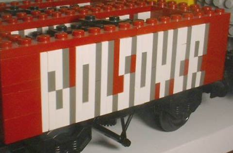

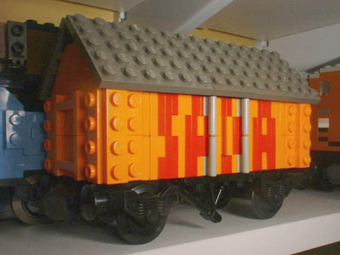

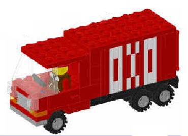

Curieusement \[[4](#nb2-4 "en fait cela s’explique sans doute par un manque de place")\], cette police de caractère est haute de 4 tenons ce qui complique la reproduction de lettres comme le E ou le B qui comporte des barres à mi-hauteur.

Une police de caractère Railton haute de 5 tenons possédant la même structure que la police Harshbarger aurait été meilleure.

Cependant, la fonte \[[5](#nb2-5 "police de caractère")\] Railton possède des barres verticales fines ce qui permait malgré tout de reproduire le B et le S assez correctement comme on le voit sur le wagon "Bolsover".

Le logo TGV par James Mathis utilise des lettres en améliorant la police Railton, amélioration qui permettrait de reproduire une police de caractère partielle de 2,8 tebons de haut.

Le logo en italique du [TGV](http://www.brickshelf.com/gallery/jamathis/Trains/Passenger/TGVNord/tgv_nord_v3_p1.gif) par James Mathis est particulièrement remarquable.

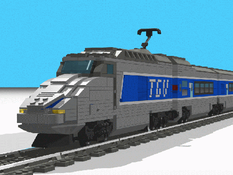

Vous trouverez la notice de montage de ce lettrage dans la galerie [ILTCO "SNOT Train"](http://www.iltco.org/gallery/view_photo.php?set_albumName=album35&id=Slide33).

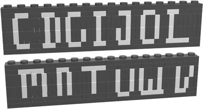

Comme vous le voyez, l’amélioration de Mathis sur la police Railton consiste simplement à ajouter des barres horizontales en haut et/ou en bas sans toutefois apporter des complications majeurs dans le montage.

**4) Les polices de caractère SNOT**

Le SNOT \[[6](#nb2-6 "Plus d’information sur les techniques de montage  SNOT ici : James Mathis, (…)")\] permet de créer des lettres plus fines et donc avec plus de précision.

**–** La police ["Harshbarger"](http://www.ericharshbarger.org/lego/fonts.html)

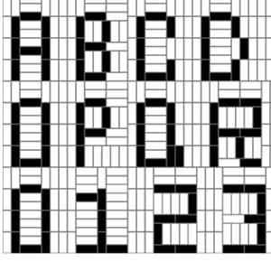

est complete et relativement petite (3,2 tenons de hauteur) mais aussi relativement complexe à construire à l’aide des techniques SNOTs. Je n’ai pas trouvé d’exemples de réalisation dans le thème "train"

**–** Police de caractère ["JBC"](http://www.brickshelf.com/gallery/sonnich/gallery/alfabet_2high.jpg) (Jensen/Bellis/Crawford)

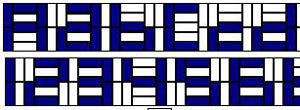

est la une fonte vraiment petite (2 tenons de haut) mais incomplète (la lettre B majuscule par exemple ne peut être reproduite). Les minuscules sont intéressantes.

Ce lettrage, plus fin, est aussi plus difficile à mettre en oeuvre et requiert une connaissance des techniques SNOT. Le grand avantage avec les lettrages SNOT est que les lettres présentant des lignes à mi hauteur (A et E par exemple)peuvent être reproduite contrairement aux lettres Railton amélioré par Mathis.

Les lettrages SNOT ont l’inconvénient de nécessiter au moins 2 tenons de profondeur. Ceci peut interdire leur utilisation dans des applications dans le thème train, par exemple en 6 de large ou si vous souhaitez détailler l’intérieur des maquettes.

Cette technique est particulièrement apprécié par Mark Bellis :

[60001 EWS](http://www.brickshelf.com/gallery/mbellis/Trains/Mixed/66_9f_20_ba_agm_2004.jpg) et [Glorious Class 50 Hoover 50033](http://www.brickshelf.com/gallery/mbellis/Trains/Diesel/Class-50-Hoover/class_50_glorious_side_hull_2004.jpg)  
par Mark Bellis

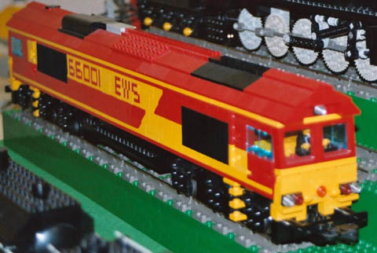

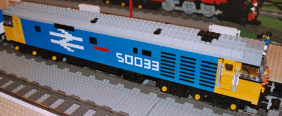

[Railtrack](http://www.brickshelf.com/gallery/mbellis/Trains/Wagons/railtrack_hopper_kid_2004.jpg) par Mark Bellis

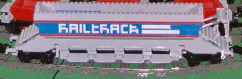

Un conteneur toujours par Mark Bellis [Conteneur Maersk](http://www.brickshelf.com/gallery/mbellis/Trains/Scenery/maersk_container_ba_agm_2004.jpg)

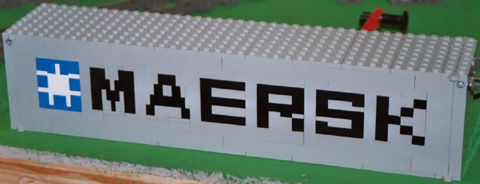

**5) Tableau récapitulatif de la taille des lettrages**

| Type de lettrage | Taille | Epaiss. barres vert. | Epaiss. barres horiz. | Fonte |  |
| --- | --- | --- | --- | --- | --- |
| Mosaïque - TLC | 7 | 1 | 1 | C \[[7](#nb2-7 "Complete")\] |  |
| Mosaïque - Harshbarger | 5 | 1 | 1 | C |  |
| Empilement - May | 2.8 | 1 | 0.4 | C |  |
| Empilement - Mathis | 2 | 1 | 0.4 | C |  |
| Railton | 4 | 0.4 | 1 | C |  |
| Railton amélioré | 2.8 | 0.4 | 0.4 | I |  |
| SNOT - Harshbarger | 3.2 | 0.4 | 0.4 | C |  |
| SNOT - JBC | 2 | 0.4 | 0.4 |  | I \[[8](#nb2-8 "Incomplete. Par exemple, les majuscules B et D ne sont pas modélisable")\] |

**6) Créations par d’autres fans de LEGO®**

Le [KCS](http://www.brickshelf.com/gallery/crazeed/KCS--SD40-2/aa9kcs.jpg) et le [SantaFe](http://www.brickshelf.com/gallery/crazeed/updated-dash8-40BW/sfclosedetail.jpg) par Walt May présentent un mélange de techniques.

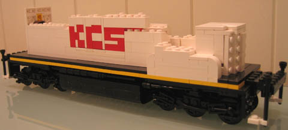

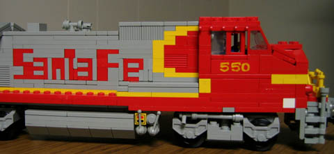

Mon point de vue est orienté sur les applications ferroviaires mais bien sur ces techniques sont employées dans d’autres domaines telle que la Ville :

Logo [In’n’out](http://scltc.org/) par le SCLTC (Club Californien)

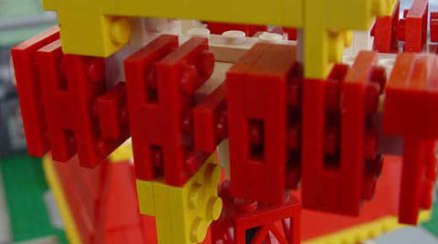

Le maintenant célèbre camion [Schleim](http://www.brickshelf.com/cgi-bin/gallery.cgi?f=73401) (camion par James Mathis, lettrage par Holger Matthes qui est deux fois plus grand que le lettrage JBC)

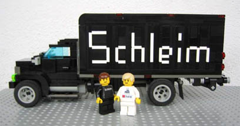

Une remorque ["Chips"](http://www.brickshelf.com/gallery/bccook/LUG/TrainShowApril2005/trainshowapril23_026.jpg) (auteur indéterminé - lettrage JBC)

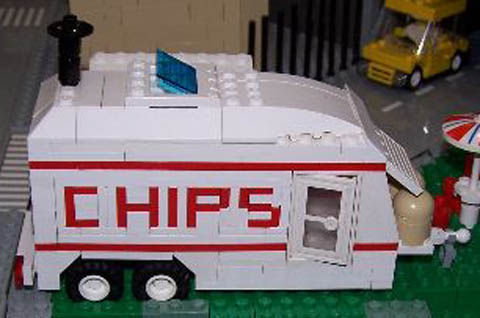

**7) Autres lettrages**

**–** Lettrage mosaïque fantaisie de grande taille

par El caracho [Wagon Coca-cola](http://www.brickshelf.com/gallery/Caracho/berlin2003/coca-cola_wagon.jpg)

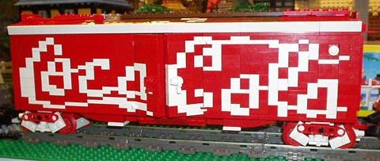

**–** Briques pentues

Logo [Home Depot](http://www.brickshelf.com/gallery/SEBarile/Buildings/hdlego1.jpg) par Steve Barile

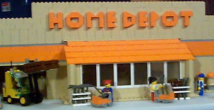

**–** Lettrage à l’aide de motifs diagonaux (briques pentues)

Locomotive [VIA](http://www.brickshelf.com/gallery/MK-Ultra71/Trains/Locomotives/VIA/via01.jpg) par Mike Kollross

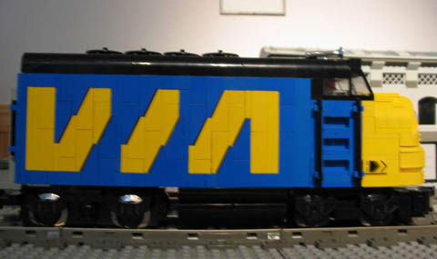

**–** Lettrage arrondi

Logo [ESSO](http://www.bricksonthebrain.com/photoblog/index.cfm?action=display&photo=458) par Casper Van Nimvegen

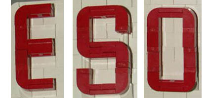

**8) D’autres mosaïques décoratives**

Hors-sujet car ce ne sont pas des lettrages mais ces mosaïques dans le thème train sont sympas :

Le wagon [banane](http://www.brickshelf.com/gallery/mister-j/Wagons/Banana/ban_side.jpg)

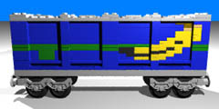

La décoration [CP](http://www.brickshelf.com/gallery/Plan-B/MOC/CAD-Rendering/Trains/3cp-rail.jpg)

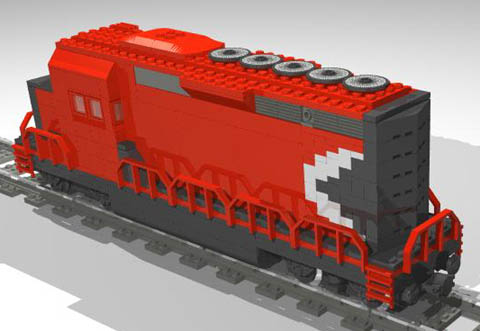

Le [logo](http://www.brickshelf.com/gallery/mbellis/Trains/Diesel/Class-50-Hoover/class_50_glorious_side_hull_2004.jpg) de la compagnie britannique des chemins de fer par Mark Bellis

**9) Exemples Miniland / LEGOland**

"CLOTHES" (mosaïque) et "SAMSING" (Lettrage JBC) [voir ici](http://www.brickshelf.com/cgi-bin/gallery.cgi?i=792494)

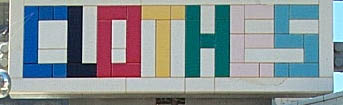

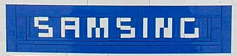

["DAYTONA"](http://www.brickshelf.com/cgi-bin/gallery.cgi?i=930282) (Lettrage Railton italique)

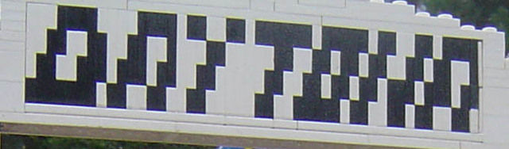

["SPACE SHOP"](http://www.brickshelf.com/cgi-bin/gallery.cgi?i=951539) (Lettrage à brique pentues)

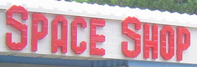

["WASHOMATIC"](http://www.brickshelf.com/cgi-bin/gallery.cgi?i=960100)

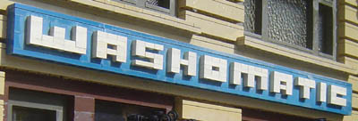

et de nombreux autres exemples en haute définition sur [la galerie de photo du Miniland Californien par LEGO-DESIGNER](http://www.brickshelf.com/cgi-bin/gallery.cgi?f=84272).

**Conclusion**

Le lettrage SNOT est typique d’une technique AFOL \[[9](#nb2-9 "jamais employé dans un set officiel mais seulement dans des MOCs")\] mais elle ne nécessite que des pièces courantes : petites briques, plaques et plaques lisses, [brique Technic 1x1](http://ldraw.org/library/official/images/7/6541.png), [brique de Erling](http://ldraw.org/library/official/images/0/3x/4070.png)...toutes disponibles dans un large choix de couleur.

En référence à un post \[[10](#nb2-10 "message sur les forums de discussion")\] de Larry \[[11](#nb2-11 "Larry Pieniazek, citation d’un post LUGNET, Octobre 2004")\] à propos du SNOT, le lettrage est une technique que chaqu’un devrait avoir à sa disposition pour réaliser un motif donné.

Cet article ne vous dit pas quelle technique est la bonne.

Certaines polices de caractères sont incomplètes mais ce n’est pas forcément un problème car vous n’avez pas besoin de l’alphabet complet pour former le nom d’une marque.

D’autres polices sont petites ou hautes, fines ou larges. D’un côté on appréciera le lettrage JBC pour leur finesse, de l’autre on préfèrera les lettres à empilement classique pour leur simplicité.

C’est à vous de choisir le lettrage en fonction du MOC dans lequel vous allez l’intégrer.

Les plaques et briques décorées ou les autocollants sont une autre solution aux lettrages de vos MOCs mais elles sont moins créatives et un peu hérésique (pensons aux autocollants faits "maison"). Je serais content de lire vos remarques argumentées si vous pensez que j’ai tort sur ce point :-).

**Remerciements**

Merci à

**–** Erik "Brickerik" Amzallag qui n’hésite jamais à partager ses idées sur les techniques de montage,  
**–** Rob "Brickmodder" Hendrix pour son aide dans l’écriture de la version anglaise de cet article,

et des remerciements plus particuliers à tous les AFOLs \[[12](#nb2-12 "allemand, américain, anglais, australien, canadien, estonien, néerlandais et (…)")\] cités dans cet article à travers leurs contributions.

N’hésitez pas à répondre à cet article si vous souhaitez faire partager une réalisation sur le thème du lettrage.

\[[1](#nh2-1 "Notes 2-1")\] Didier Enjary, [Trains LEGO® et motifs de décoration : Les motifs diagonaux](http://www.freelug.org/article.php3?id_article=390)

\[[2](#nh2-2 "Notes 2-2")\] Jason Railton,[Advanced SNOT](http://www.brickish.org/bi/bi4.PDF), _The Brick Issue #4_, Christmas 2003

\[[3](#nh2-3 "Notes 2-3")\] Jason Railton,[LEGO SNOT](http://www.brickish.org/bi/bi3.pdf), _The Brick Issue #3_,Summer 2003

\[[4](#nh2-4 "Notes 2-4")\] en fait cela s’explique sans doute par un manque de place

\[[5](#nh2-5 "Notes 2-5")\] police de caractère

\[[6](#nh2-6 "Notes 2-6")\] Plus d’information sur les techniques de montage SNOT ici : James Mathis, _[SNOT Train](http://www.iltco.org/gallery/view_album.php?set_albumName=album35)_, ILTCO Gallery

\[[7](#nh2-7 "Notes 2-7")\] Complete

\[[8](#nh2-8 "Notes 2-8")\] Incomplete. Par exemple, les majuscules B et D ne sont pas modélisable

\[[9](#nh2-9 "Notes 2-9")\] jamais employé dans un set officiel mais seulement dans des MOCs

\[[10](#nh2-10 "Notes 2-10")\] message sur les forums de discussion

\[[11](#nh2-11 "Notes 2-11")\] Larry Pieniazek, [citation d’un post LUGNET](https://www.freelug.org/%22http://news.lugnet.com/space/?n=36413), Octobre 2004

\[[12](#nh2-12 "Notes 2-12")\] allemand, américain, anglais, australien, canadien, estonien, néerlandais et japonais !! La passion pour les trains LEGO est vraiment universellement partagée
