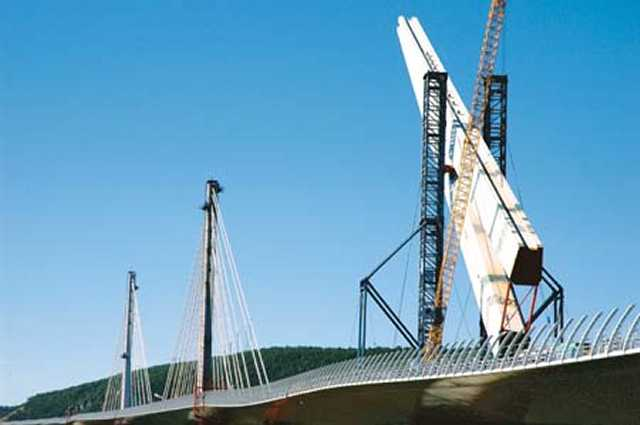
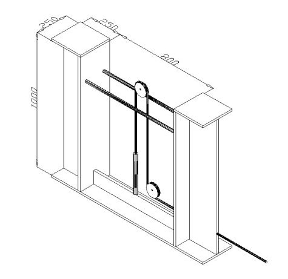

Ceci constitue le règlement officiel du concours de résistance de ponts qui aura lieu au LEGOWorld 2005 à zwolle du 20 au 25 Octobre 2005.

## CONCOURS DE RESISTANCE DE PONT

**quel exploit technique digne des pyramides**

## BUT DU CHALLENGE

Construire un pont enjambant une longueur de 100 studs (800 mm) le plus résistant possible.

## REGLEMENT GENERAL

**1- PARTICIPANTS**

**–** Le concours est ouvert à tous les adhérents d’une ligue exposant au LEGOWorld.  
**–** Les inscriptions individuelles sont transmissent par leurs ligues respectives.  
**–** Le nombre de participants est limité à 20.

**2- CATEGORIES**

Il n’est pas prévu de catégories.

**3- LIMITE DES INSCRIPTIONS.**

Les inscriptions sont closes le 20 Octobre sauf si la limite de 20 participants est atteinte avant. Auquel cas seuls les 20 premiers inscrits seront retenus.

**4- MODALITES D’INSCRIPTIONS**

Les inscriptions sont à faire parvenir à l’adresse suivante : [legoworld@freelug.org](mailto:legoworld@freelug.org) jusqu’au 18 octobre 2005, et sur le stand FreeLUG à partir de l’ouverture du LEGOWorld.

**5- FRAIS D’INSCRIPTION**

Le concours est gratuit.

**6- JURY**

Un jury de 3 juges veillera au respect du règlement et de la bonne marche de l’épreuve. Il sera constitué de 3 personnes ne participant pas au concours  
**–** 1 membre désigné par FreeLUG  
**–** 1 membre désigné par Debouwsteen  
**–** 1 membre d’une ligue participant au concours. Cette ligue sera tirée au sort le 20 Octobre et désignera son juge.

Pour être membre du jury il faut impérativement maîtriser l’anglais (pour une bonne compréhension).

Le jury sera chargé particulièrement :

1.  de chronométrer les temps d’arrêt demandé par le concurrent
2.  de chronométrer le temps de tenue (1 mn)
3.  de vérifier l’absence de pièces modifiées ou non LEGO.
4.  de vérifier la relative conformité avec l’apparence qu’on attend d’un pont de chemin de fer.

**7- MISE HORS CONCOURS**

Seront déclarés hors concours :  
**–** Les ponts ne répondant pas aux spécifications techniques  
**–** Les participants ayant une attitude non conforme aux idéaux de camaraderie ou de fair-play.

Le jury est seul juge et ses décisions sont sans appel.

Si le concurrent est déclaré hors concours uniquement pour une raison technique, il pourra participer à l’épreuve sans être classé et ne recevra pas de diplôme commémoratif.

**8- DATE ET HEURE DU CONCOURS**

Le concours se déroulera le 22 Octobre à une heure à définir au début du LEGOWorld. Cela devrait être normalement dans la soirée.

**9- PRIX**

**–** Les 3 premiers ponts recevront un trophée  
**–** Tous les participants recevront un diplôme commémoratif  
**–** Deux diplômes seront en outre attribués

-   Un diplôme récompensant l’élégance de la construction
-   Un diplôme récompensant l’audace technique.

Les résultats seront publiés sur Lugnet.

**10- DEROULEMENT DE L’EPREUVE.**

**–** Chaque concurrent aura 5 minutes pour mettre en place son pont y compris l’accrochage de la charge.  
**–** Il aura ensuite 3 minutes pour libérer la place après l’épreuve. Pendant ces temps il peut se faire aider par au maximum 3 personnes.  
**–** L’ordre de passage sera tiré au sort par le jury avant l’épreuve.

## REGLEMENT TECHNIQUE

**REGLES**

**–** Le pont enjambe un fossé ;  
**–** Le pont est juste posé. Aucune fixation n’est permise (vis, serre joint etc ).  
**–** La distance à enjamber sera de 100 studs de long (800 mm) ;  
**–** Le pont sera assez large (10 studs) pour recevoir une voie de chemin de fer LEGO ;  
**–** la hauteur libre au dessus des rails (hauteur de passage) est fixée à 12 studs minimum.  
**–** la contre flèche maximum du tablier est de 2 % soit 16 mm au centre du pont ;  
**–** La hauteur du pont est libre ;  
**–** Seules des pièces officielles LEGO non modifiées sont autorisées ;  
**–** L’usage de colle est interdit ;  
**–** Le pont doit avoir la silhouette approximative d’un pont réel (Proportions et apparences).

**CHARGE**

**–** Le pont doit comporter un point de fixation. Il doit permettre l’accrochage d’une cordelette de 5 mm de diamètre tout en préservant le passage d’un train ;  
**–** Le concurrent est responsable de l’accrochage. si le noeud cède, il est autorisé 3 essais successifs.  
**–** Si le système d’accrochage cède pendant l’épreuve, le pont sera considéré comme ayant céder.  
**–** Le Banc d’essais permet de mesurer des efforts jusqu’à 50 kg.  
**–** le pont doit soutenir la charge pendant 1 minute. Si le pont cède avant ce délai le résultat enregistré sera diminué de 5%.  
**–** Le Concurrent décide seul de la charge à appliquer. la charge est validée lorsque le concurrent decide d’arrêter de charger son pont.  
**–** des pauses peuvent être demandées pour inspecter l’état du pont. La durée totale des pauses est de 1m30. Le concurrent peut, pendant ce délai, effectuer tout ajustement nécessaire, mais ne peut rajouter de pièces supplémentaires  
**–** L’effort sera appliqué progressivement.  
**–** Le temps maximum pour passer de 0 à 50 kg sera de 3 min.  
**–** Le concurrent ou un aide actionnera le dispositif de mise en charge

**CORDES ET FICELLES**

**–** Les cordes et ficelles non LEGO sont autorisées ; le diamètre maximum est de 1 mm  
**–** le système d’accrochage doit être identique au système LEGO (plate 1x1 ronde 4073) ou attachée à des pièces LEGO non modifiées  
**–** les plates peuvent être percées par le concurrent, (ceci dans le but de préserver les cordes LEGO). c’est la seule modification de pièce qui sera acceptèe.  
**–** si possible et pour une question de ressemblance la couleur noire sera préférée, mais non imposée.

**CAS DES PONTS A TABLIER MOBILE**

Pour inviter les concurrents à faire preuve d’audace et d’imagination, si un concurrent présente un pont à tablier mobile (levant, pivotant ou coulissant), sous réserve qu’il le fasse fonctionner pendant le temps imparti à la mise en place, il se verra attribué une majoration de 50% sur la charge effectivement supportée et dans ce cas le temps d’accrochage de la charge ne sera pas pris en compte dans le temps de préparation.

Le fonctionnement doit être assuré par un mécanisme électrique, pneumatique ou manuel. Mais pas par une action directe du concurrent.  
La fixation de la partie fixe sur le banc d’essais par des serres joint est autorisée pour les ponts à tablier mobile, mais ceux ci doivent être enlevés avant l’application de la charge.

**VAINQUEURS**

**–** Le pont le plus résistant sera déclaré vainqueur.  
**–** Au cas où plusieurs ponts résisteraient à la même charge, sera déclaré vainqueur le pont le plus léger.  
**–** Si l’égalité persiste le pont comportant le moins de pièces sera déclaré vainqueur.

## ANNEXES

**PLAN DU BANC D’ESSAIS**

