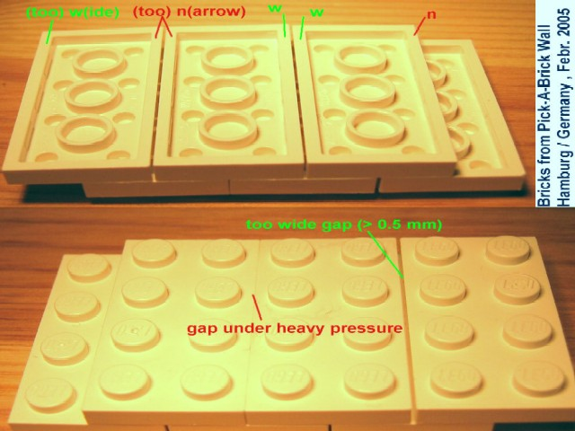
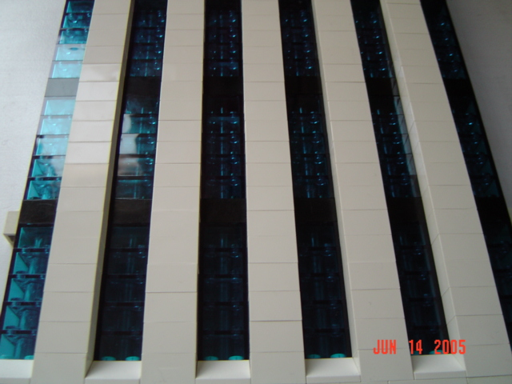

Depuis quelques temps déjà, plusieurs pièces blanches présentes dans les sets LEGO , s’avèrent défectueuses !

J’ai constaté, et je ne suis malheureusement pas le seul, plusieurs pièces LEGO blanches de fabrication récentes défectueuses.  
Nos homologues allemand du club 1000Steine l’ont également détecté, ils ont avisé LEGO ( voir la discussion en ligne : [FORUM 1000 STEINE](http://f27.parsimony.net/forum67755/messages/261.htm)).

**2x4plates**

pieces blanches 2x4 défectueuses

Cette discussion concerne une pièce plate 2x4 blanche, après enquête, il s’avère que seules seraient concernées les pièces fabriqués sur le moule N°57 ( comprenant 8 pièces - numérotées : 57-1 à 57-8 ), vous pouvez retrouvez ce numéro, sur vos pièces ( à vos loupes ).  
Ce qui peut entrainer dans certains cas l’impossibilité d’assemblage.

Après quelques recherches dans mon stock, j’ai retrouvé des pièces plates 2x4 moule n°57 en bleu, elles ne présentent pas ce défaut !

Mais malheureusement ce n’est pas tout d’autres pièces sont impliqués par ce défaut : briques 2x4, 2x3, 2x2, 1x4, ... Certes le défaut est moins important, mais reste très visible !

**projet immeuble**

pièces blanches, briques 2x2 décalés

En conclusion : je ne pense pas que ce défaut concerne les moules, mais plus la nature du plastique injecté.

Eric L.
