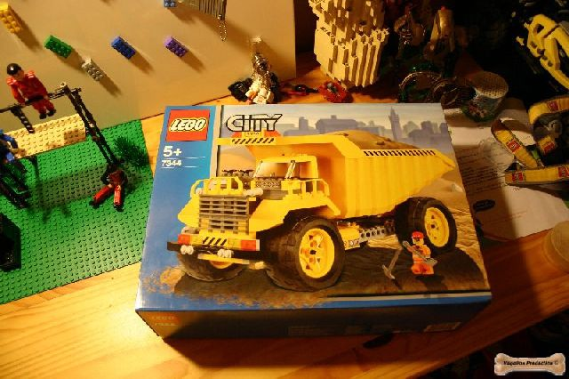
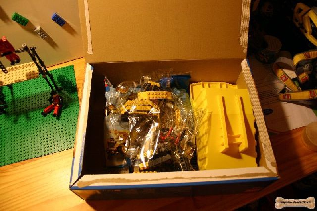
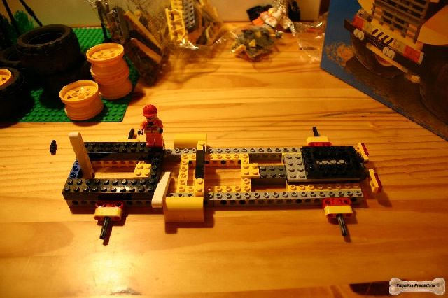
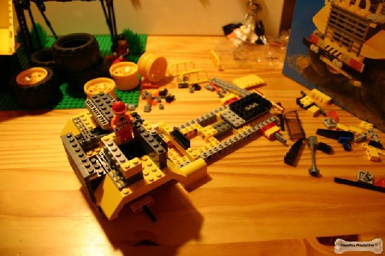
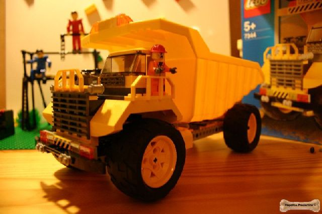
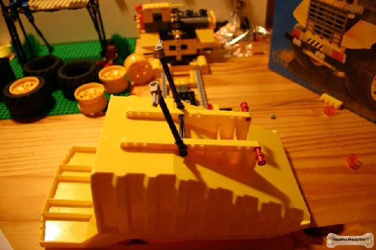

Tard, une nuit où il a fait si chaud, je me suis attaqué à la construction du set 7344, le camion benne. Voici quelques photos des étapes et mes commentaires.

## 22h20 : c’est parti !

Ma femme et ma fille dorment enfin, il est temps d’attaquer le montage du [7344](http://www.lugnet.com/set/7344)

**La boite**

## 22h21 : Ouverture du carton

**Contenu**

Première constatation, il est plutôt bien rempli pour une fois comme on peut le voir sur [l’inventaire sur Peeron](http://www.peeron.com/inv/sets/7344-1).

Tiens un autre détail, les jantes et pneus reprennent le design du 4x4 du set [4404](http://www.lugnet.com/set/4404) mais en gris cette fois-ci pour les jantes.

3 sachets : un pour le châssis, un autre pour la carrosserie et le dernier l’incontournable sachet de petites pièces de liaison et autre.

Enfin, la voilà la benne tant désirée, en plastique rigide reprenant le design des bennes de camions. Rigide juste ce qu’il faut pour supporter un chargement conséquent et être jouable sans risquer de se blesser en tombant dessus.

## 22h22 : montage du châssis

Commençons le montage.  
Enfin, on retrouve de vraies briques TECHNIC&reg comme on aime.

**le chassis**

## 22h35 : montage de la carrosserie

Le montage du châssis fut facile et rapide (l’habitude peut être :-) ), la mention montage facile sur la boite semble se confirmer.

Attaquons la carrosserie maintenant.  
Sans difficulté, le montage se poursuit à un rythme effréné.  
Tiens, un peu exigüe la cabine et question confort même pas un siège pour le conducteur.

**cabine**

## 22h45 : Fin du montage

Devant mes yeux plein de sommeil, se dresse un magnifique camion de transport lourd.  
Sa calandre massive est du plus bel effet et le rapport d’échelle entre la minifig et le camion tout simplement convaincant.

**le camion**

**Point négatif**

Je suis un peu déçu par le système de levage de la benne trop simpliste et quelque peu fragile sous la charge.

**system de levage**

Par contre l’espace vide sous la cabine et le châssis laisse envisager de multiples transformations : ajout de vérin pour la benne, motorisation du modèle, etc.

De jolis MOC en perspective, le mien est en cours de réalisation.

## Conclusion

En conclusion, je dirai que le 7344 est un modèle plutôt réussi, assez robuste dans l’ensemble (ma petite puce l’a testé depuis :-) ), facile et rapide à monter pour pouvoir jouer avec au plus vite.

C’est un modèle à posséder, j’en suis déjà à mon deuxième.

Voilà, je vais me coucher maintenant, à vous de jouer ....

## Liens

le reste des photos : [http://photos.freelug.org/main.php/...](http://photos.freelug.org/main.php/v/Gyclore/Sets/7344/)
