Les heurtoirs font partie du décor ferroviaire. Le monde des trains LEGO n’échappe pas à la règle, ces éléments étant à la fois décoratifs et fonctionnels, en empêchant vos trains de sortir des rails en fin de voie.

Il nous est déjà arrivé de placer des voies de garage non fermées en bord de table, et lors d’une fausse manoeuvre, la catastrophe arrive, le train bascule dans le vide, laissant le soin au mauvais conducteur de ramasser les briques éparpillées et au propriétaire de le reconstruire.

Pour remédier à ce problème, une solution toute simple est de placer en fin de voie des heurtoirs. Petite revue non exhaustive de ce qu’il se fait en la matière.

**Les heurtoirs officiels**

On retrouve dans quelques modèles LEGO un heurtoir, soit car c’est un élément à part entière du modèle, soit on le trouve dans les modèles alternatifs. Ces modèles sont suffisamment robustes.

**–** Set [7745](http://guide.lugnet.com/set/7745) : le heurtoir fait parti des éléments du modèle alternatif.

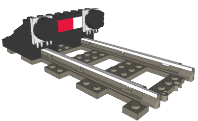

**–** Livre d’idée [7777](http://guide.lugnet.com/set/7777) : attention, ce heurtoir a été conçu pour les rails 12V, une adaptation est nécessaire pour le rendre compatible avec les rails 9V.

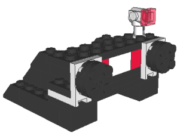

**–** Set [4553](http://guide.lugnet.com/set/4553)

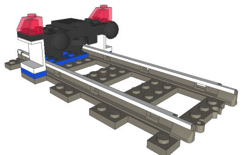

**–** Set [4512](http://guide.lugnet.com/set/4512) : le heurtoir est employé pour fermer la voie la voie de garage.

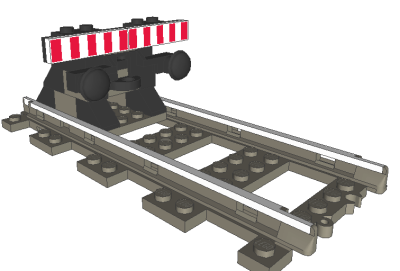

**Les heurtoirs statiques**

Tout comme les modèles ci-dessus, les heurtoirs suivants doivent encaisser le choc du train circulant. Une bonne solidité est de mise !

**–** [Modèle de Carsten CaL Luetjens](http://www.brickshelf.com/cgi-bin/gallery.cgi?f=89305)

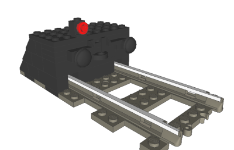

Ce modèle est particulièrement robuste.

**–** [Modèle de Nate Jacobs](http://www.brickshelf.com/cgi-bin/gallery.cgi?f=32201). Ce heurtoir est en plus équipé d’une lumière 9V.

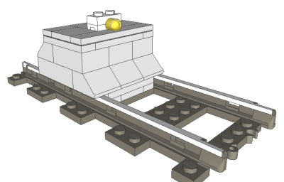

Ce modèle ne dispose pas de tampons, le train vient taper directement dedans.

**–** Mon heurtoir, tel qu’on peut en voir sur nos voies françaises.

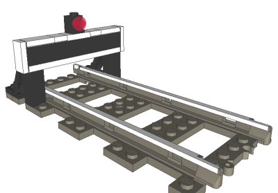

Ne résistant pas aux chocs, il sert plutôt d’accessoire de décoration sur une voie statique.

**Les heurtoirs dynamiques**

Les heurtoirs dynamiques sont des heurtoirs avec absorbeur de chocs. Cela permet d’absorber une partie de l’énergie.

[Modèle de blackflame](http://www.brickshelf.com/cgi-bin/gallery.cgi?f=47151)

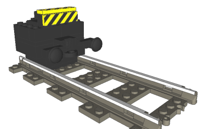

Ce modèle ne résiste pas très bien à un train rapide, et le design est un peu pauvre.

**–** Mon modèle, qu’on peut voir en terminus de gare, avec les tampons absorbeurs.

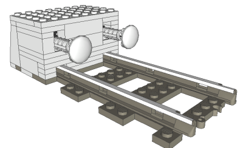

**Heurtoir motorisé**

[Modèle de A&M LWorks](http://www.ozbricks.com/jediagh/a_downloads/bi/bi_0012.htm)

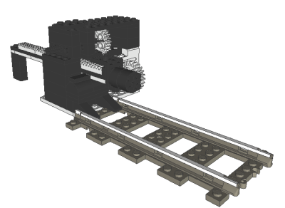

Cet accessoire ne fait pas vraiment office de heurtoir, mais permet plutôt de repousser un wagon vide.

**Les feux de repérage**

Si vous souhaitez ajouter une lumière à votre heurtoir, sachez que la signalisation française est la suivante :  
**–** feu rouge sur les heurtoirs de voie principale (terminus en gare en général) ;  
**–** feu violet sur les heurtoirs de voie de garage.

Vous l’aurez compris, il existe de nombreuses façons de faire des heurtoirs en briques LEGO. En fonction des besoins, vous choisirez un heurtoir esthétique mais peut-être fragile pour une scène statique, tandis que vous opterez pour un heurtoir plus massif si il est utilisé pour arrêter un train lancé à grande vitesse.

De façon générale, un heurtoir sera d’autant plus résistant qu’il aura de l’emprise sur les rails et éventuellement sur la plaque de base.

* * *

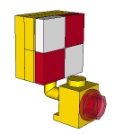

Enfin, en bonus je vous propose ce jalon d’arrêt à damier rouge et blanc avec lanterne, qui viendra s’ajouter à la liste des accessoires pouvant trouver place le long de vos voies.

* * *

Retrouvez l’ensemble des fichiers CAD dans l’archive zip suivante :

**Les fichiers CAD des heurtoirs**
