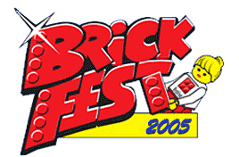
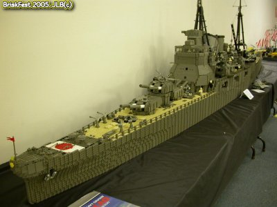
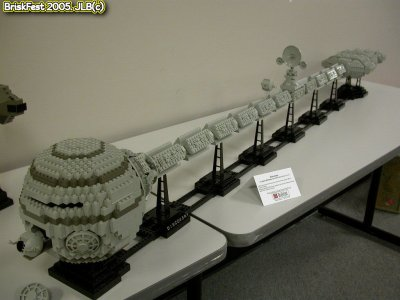
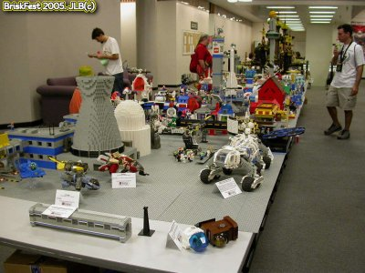
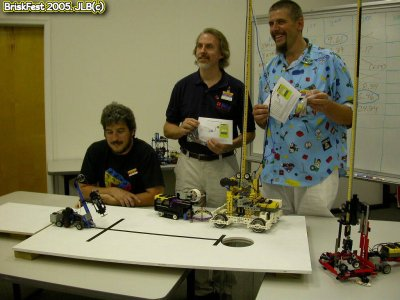
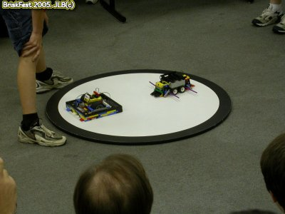
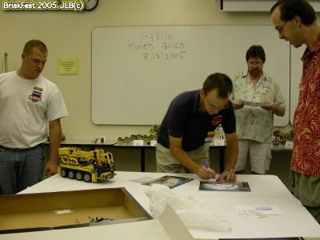
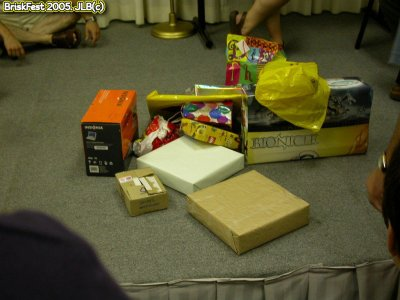
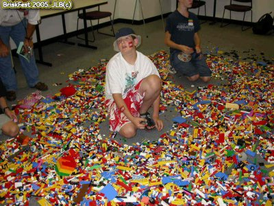

Trois membres français de FreeLUG se sont rendus cet été aux Etats-Unis pour assister à BrickFest.

[BrickFest](http://www.brickfest.com/) est à ce jour la plus grande réunion de fans adultes au monde.

Elle a lieu chaque année dans la proche banlieue de Washington, aux Etats-Unis, depuis l’an 2000. BrickFest dure 3 jours et se déroule plus précisément dans l’enceinte d’un bâtiment d’université sur trois étages (dans un peu plus d’une vingtaine de salles).

Elle a regroupé cette année près de [350 fans](http://www.brickfest.com/registration/whosattending.php), pour la plupart américains mais aussi canadiens, néerlandais et bien sûr français. Un Chilien et un Japonais vivant au Brésil avaient même fait le déplacement.

La particularité de BrickFest est qu’il ne s’agit pas d’une simple exposition de créations de fans mais d’une véritable convention que les organisateurs animent à travers de [nombreuses activités](http://www.brickfest.com/events.php) :

**Exposition de MOC et collection**

Évidemment BrickFest est avant tout une exposition (certes réservée en grande partie aux AFOL, mais exposition quand même). Il y avait donc de quoi se rincer l’oeil. :-) Cet évènement se passant dans une université, il y a de nombreuse petites salles, et chacune révélait des trésors dans bien des thèmes officiels (SPAAAAAACE, Château, train/ville, Technic, Mindstorms et même des Bionicle :-)) et des thèmes complètement AFOL (microfig, moonbase, sculpture...). Inutile de dire qu’il y avait une concentration assez importante de MOCs de grande qualité.

Beaucoup d’autres photos ici [http://gallery.freelug.org/v/JLB/Br...](http://gallery.freelug.org/v/JLB/Brickfest2005/)

Pour tout ceux qui ne peuvent pas venir, une vidéo rapide a été faite de l’ensemble de BrickFest lors de la journée d’ouverture au public. Elle s’intitule : ["BrickFest en 10 minutes"](http://jlb.freelug.org/BF2005/BF_in_10minutes.asf)

**Cérémonie d’ouverture et de clôture**

Ces cérémonies sont un rituel obligatoire dans tout genre de manifestation d’envergure. La grande force des organisateurs de BrickFest, est en général, d’arriver à les rendre attrayantes (la salle était toujours bondée) par des tirages au sort, des tours de magie (plus comique que magique cette année :-)), un duo comique entre Larry et Felix, des questions réponses avec les représentants de la société LEGO®, des remises de prix... Bref il n’y avait pas de quoi s’ennuyer lors de ces cérémonies.

**Concours divers et variés**

Nous avons été gâtés par l’abondance de concours Mindstorms : mine rescue, mini sumo, maxi sumo, FLL. Et pour une fois, ce n’est pas Steve Hassenplug qui a tout gagné :-) la concurrence a été rude pour lui cette année.

Il y a aussi eu un concours de rapidité de construction avec la nouvelle grue Technic [8421](http://guide.lugnet.com/set/8421), et l’établissement d’un nouveau record (battu depuis).

**Nombreuses remises de prix**

Il y a eu de nombreux prix récompensant des MOCs dans les différents thèmes exposés à BrickFest. Il y a eu tellement de prix, qu’on se demandait presque si tout le monde n’avait pas reçu une récompense. :-)

**Petits magasins (Brick Bazaar)**

Une des attractions de BrickFest, est aussi la multitude de petits magasins de particuliers dans lesquels on peut trouver des merveilles. Bon les prix ne sont pas toujours abordables (j’ai hésité longtemps sur un set Starwars Technic avec R2D2 et C3PO... mais j’y ai renoncé à cause du prix.)

**Ventes aux enchères**

C’est une des découvertes que j’ai faite a BrickFest : les ventes aux enchères. Je connais le principe grâce à des sites comme Ebay, mais je n’avais jamais vu cela dans le monde réel. La manière dont cela se passe est plutôt intéressante. Chaque set ou lot est disposé sur une table avec une feuille devant, et chaque personne intéressée peut écrire la somme qu’il est prêt à donner pour ce lot (tout en mettant plus que le précédent évidemment. C’est toujours des enchères). À la fin du temps imparti, celui ayant mis la plus grosse offre gagne le lot (et doit le payer bien évidemment :-))

**Jeux (Dirty Brickster)**

Deuxième découverte à BrickFest : le jeux dirty brickster. Le principe de ce jeux est simple : chaque participant apporte un cadeau (ici une boite de LEGO® emballée) d’une valeur prédéterminée (la même pour tout le monde en théorie) et le met dans un pot commun. Chacun de ces participants se voit attribuer un numéro. Ensuite, soit l’on tire un numéro au sort, les uns après les autres, soit on suit l’ordre numéraire. Lorsque son numéro est appelé on a le choix entre prendre un cadeau qui est encore dans le pot commun, soit on en vole un qui a déjà été pris par quelqu’un d’autre (et qui l’a ouvert bien évidemment). Si l’on vole un cadeau, on entend un grondement sourd venant de la foule : "dirty brickster, dirty brickster" :-). La personne s’étant fait voler son cadeau peut soit en reprendre un dans le pot commun, soit en voler un autre. Il faut savoir qu’un cadeau ne peut être volé plus de 3 fois. Après le troisième vol, il est déclaré comme figé, et donc la personne le gardera quoiqu’il arrive. Le jeu se fini lorsque tout le monde a un cadeau. Petit détail : comme le premier n’a pas eu le choix de tirer un cadeau ou en voler un, après que tout le monde se soit servi, il peut échanger son cadeau avec celui de quelqu’un d’autre.

Nous y avons joué, et trouvé que ce serait une bonne idée pour nos prochaines rencontres AFOL.

**Présentations diverses et discussions autour d’un thème**

Une des grandes forces de BrickFest sont les présentations faites par des AFOLs pour les autres AFOLs, ainsi que quelques tables rondes autour de diverses sujets. C’est probablement une des choses qui manquent le plus lorsque nous faisons des expositions publiques : avoir le temps de discuter entre nous (AFOL) pour parler de tel ou tel point/thème/autre. Le revers de la médaille de BrickFest, est que le programme des conférences est tellement chargé et intéressant, qu’il faudrait parfois être à plusieurs endroits en même temps (chose que je n’ai pas réussi à faire. Si vous y arrivez dites moi comment :-) ). Un grand merci aux organisateurs et surtout aux conférenciers (ils avaient le droit à une brique gravée de plus d’ailleurs :-)) pour toutes ces présentations.

**Salle de construction libre**

Nous parlons quand même d’un jeu de brique. Il serait donc dommage de ne pas trouver au moins quelque-part un lieu de construction libre. Ceci fut matérialisé par une salle dans laquelle il était possible de nager dans les briques (bon j’exagère un peu :-)). Cela faisait surtout le plaisir des petits amateurs de briques :-)

**Projection de BrickFilms**

Des brickfilms étaient projetés sur "grand" écran. Cela change de voir cela sur un autre écran que le PC (même si je n’ai pas eu trop le temps d’y passer voir...)

**Autres...**

Il y a tellement de chose a brickfest qu’il est :

1.  impossible de tout voir en trois jours.
2.  impossible de tout retenir et retranscrire.

Bref, allez-y et retournez-y ! :-)

**et en Soirée ?**

De nombreux fans se retrouvent le soir autour d’un verre à quelques pas de l’université et des hôtels (moins de 21 ans s’abstenir... Nous sommes aux États-Unis quand même). Cela permet de mieux faire connaissance et parler peut-être d’autres choses que de LEGO (si si, il existe d’autres sujets de conversation :-)).

Cette année fut particulière car une délégation de la société LEGO® est venue parler aux fans. Ainsi le propriétaire de la société (aussi connu sous le "doux" acronyme de KKK), le PDG (Joe Vig :-)) mais aussi des designers ont répondus aux questions de l’assemblée.

En fait, pour beaucoup, ce qui fait avant tout l’attrait de cet évènement c’est la possibilité de rencontrer "pour de vrai" les autres fans avec qui l’on ne communique généralement que par internet.

En conclusion nous pouvons tout simplement dire : Brickfest c’est bien ! Allez-y et revenez-y ! :-) (je sais nous nous répétons :-))

**Photos & Vidéos**  
**–** Certains vidéos sont ici [http://jlb.freelug.org/BF2005/](http://jlb.freelug.org/BF2005/)  
**–** Galerie photos de JLB [http://gallery.freelug.org/Brickfest2005](http://gallery.freelug.org/Brickfest2005)  
**–** Galerie de photo de Nicolas [http://www.brickshelf.com/cgi-bin/g...](http://www.brickshelf.com/cgi-bin/gallery.cgi?f=152821)
