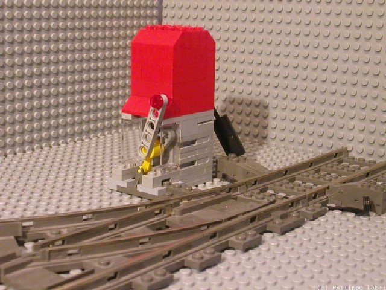

Le DCC permet la commande indépendante de plusieurs moteurs en utilisant la même ligne électrique. C’est employé le plus souvent par les modélistes pour piloter les trains sur un réseau. [Pour en savoir plus](http://benoit.bouchez.free.fr/digitrain4.htm). La motorisation des aiguillages 9V Lego a donné lieu déjà a beaucoup de propositions techniques. [Pour en savoir plus](http://www.freelug.org/article.php3?id_article=175). Le pionnier de cette application pour le Lego est [Mark Riley](http://news.lugnet.com/trains/?n=23465), mais la solution que je propose évite toute modification des coûteux aiguillages 9V Lego.

La solution proposée ici vise surtout à permettre l’utilisation d’un module DCC pour commander un moteur fixe quequepart le long de la voie ferrée. L’utilisation la plus immédiate est la commande d’un moteur d’aiguillage, mais on peut imaginer commander l’animation de beaucoup de choses telles qu’un manège, un éclairage public, un chantier BTP, etc... selon votre imagination.

Le module DCC choisi est l’un des moins cher, le modèle [LE1000A](http://www.lenz.com/manuals/index.htm) de chez Lenz (il est nommé LE1000W pour le marché américain et LE1000A pour le marché européen... ne me demandez pas pourquoi). Je l’ai trouvé à 34,50 Euros vendu par deux unités chez le détaillant en modélisme de mon quartier. Vous trouverez les photos décrivant les étapes de la fabrication de ce module dans [ma gallerie FreeLUG](http://photos.freelug.org/main.php/v/Frogleap/Pi_ces-fabriqu_es/ModuleDCC/). Tel que monté, je n’ai pas employé la sortie "commande d’éclairage" disponible sur le LE1000A et seule la sortie "moteur" est connectée. Si cela vous intéresse d’utiliser les deux fonctions, rien ne vous empêche de fabriquer un module dérivé de dimensions 2x6 tenons intégrant 1 entrée et 2 sorties électriques.  
En pratique on utilisera un [cable d’alimentation de voie](http://shop.lego.com/product.asp?p=10078&cn=52&d=12&t=7) pour prendre le courant DCC sur la voie du train et le brancher sur la borne rouge du module. Puis brancher le moteur sur la borne verte. Et le tour est joué. J’ai illustré cet exemple de montage avec [un aiguillage motorisé à la façon Mark Riley](http://photos.freelug.org/main.php/v/Frogleap/Motorisation-des-Aiguillages/AiguillageDCC/). Du coup, plus besoin de longs fils pour aller jusqu’à l’aiguillage motorisé et vous pourrez vous permettre de commander des aiguillages à l’autre bout du réseau sans avoir à jouer un remake de King-Kong dans New-York :)

Je n’entre pas dans les détails de la mise en oeuvre du DCC, cela dépasse largement le cadre de cet article et d’autres l’ont fait tellement bien. Une recherche avec les mots clés "DCC" et "train" vous en convaincra.

Philippe "frogleap" LabeL
