## Avertissement

Cet article ne s’adresse pas en premier lieu aux connaisseurs de trains LEGO® mais plutôt aux modélistes ferroviaires qui se posent des questions sur ce drôle de jouet qui "fait du train" et aux amateurs de LEGO qui découvrent que ce fabuleux jouet "fait aussi du train".

Les connaisseurs verrons que l’article contient quelques omissions ou commet quelques simplifications car il s’agit avant tout de donner une vision d’ensemble.

**Attention : Cet article n’est pas sponsorisé ni n’a été soumis à l’approbation de la société LEGO®. Veuillez consulter le [site officiel](http://www.lego.com/) de la société LEGO®.**

## Introduction

La société LEGO® est connue à travers ses produits, produits que vous pouvez contempler dans les grandes surfaces ou dans les magasins de jouets.

Mais bien souvent, vous ne verrez pas de trains LEGO® dans les rayons [^1]. Conséquence logique, les produits "trains" que propose la société LEGO®, surtout sur internet, restent très largement méconnus.

Souvent nous sommes contactés à ce sujet. Cet article a pour but de répondre aux interrogations les plus fréquentes.

## Un court historique

Ceci est peut être le plus surprenant : la société LEGO® fait du train mais surtout elle en fait depuis près de 40 ans.

Bien sur, la gamme Train a subit des modifications au cours des années. On distingue trois principales époques.

**–** \[L’époque bleu\]

L’époque bleu de 1966 à 1979 est marquée par l’usage de rails bleus. Les trains sont motorisés à l’aide d’un boîtier de piles (4.5V) embarqué.

**–** \[L’époque grise\]

qui dura de 1980 à 1990. Marqué par l’emploi de rails gris clair et d’une alimentation par troisième rail en 12V. On note aussi la présence d’automatismes (signalisations de voie par exemple).

**–** \[L’époque 9 volts\]

L’époque actuelle a débuté en 1991. Des rails gris foncés avec éléments conducteurs métalliques en sont la marque de fabrique [^2]. C’est cette époque que nous allons détailler.

Il existe une compatibilité **dimensionnelle** entre ces époques.

## Le train LEGO aujourd’hui

Comme nous venons de le voir, le train LEGO aujourd’hui c’est le train 9V. Nous détaillons uniquement cette époque car c’est la seule disponible aujourd’hui en neuf.

## Les sets officiels

Dans les "coffrets" complets, vous trouverez le plus généralement :  
**–** une locomotive  
**–** un ou plusieurs wagons  
**–** un moteur pour la locomotive  
**–** des rails  
**–** une alimentation qui fait aussi office de régulateur de vitesse.

Vous pourrez en trouver trois en ce moment :

**–** Le "High speed train" [4511](http://guide.lugnet.com/set/4511)  
**–** Le "Cargo train" [4512](http://guide.lugnet.com/set/4512)  
**–** Le "Motorized Hogwarts express" [10132](http://guide.lugnet.com/set/10132)

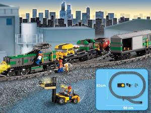

Le "Cargo train" est particulièrement apprécié par les adultes, [contrairement au 4511](/articles/194/). Le 10132 est un set Harry Potter.

Ces sets constituent un bon achat pour débuter. D’ailleurs ce sont les seuls que vous trouverez (difficilement) en vente en magasin. Toutefois, les personnes qui sont déjà équipées [^3] ne les apprécient guère car :

**–** Les rails sont en grande majorité des rails courbes, [^4] qui sont rapidement en surnombre.  
**–** De la même manière, les régulateurs de vitesse surnuméraires s’accumulent. Il ne vous en faudra toujours qu’un même si vous triplez la taille du circuit de base [^5]  
**–** Le prix d’un set complet est renchérit par la présence de ces pièces qui ne sont utiles qu’aux débutants. (un set complet coûte généralement entre 100 et 150 euros)

Pour palier à ces inconvénients, la société LEGO® met en vente les locomotives et les wagons, sans les accessoires, mais uniquement sur Internet. Vous ne trouverez donc pas ces sets en magasins (Ce sont des exclusifs [ShopAtHome](http://shop.lego.com/department.asp?d=12&t=7))

En ce moment sont disponibles :

Locomotives :

**–** La Santa Fe super chief [10020](http://guide.lugnet.com/set/10020)  
**–** La Burlington Northern Santa Fe [10133](http://guide.lugnet.com/set/10133)  
**–** La locomotive du train grande vitesse [10157](http://guide.lugnet.com/set/10157)  
**–** et la série des locomotives vapeurs de grande ou petite taille, dans différents coloris, avec ou sans tender [vapeurs](http://guide.lugnet.com/set/3741).

Parmi ces modèles, c’est sans doute la Santa Fe qui a connu le plus grand succès auprès des fans adultes.

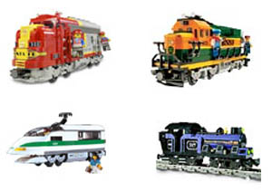

Wagons :

**–** Le "TTX Intermodal double-stack car" [10170](http://guide.lugnet.com/set/10170)  
**–** La voiture du train grande vitesse [10158](http://guide.lugnet.com/set/10158)  
**–** Le wagon plat à rancher [10013](http://guide.lugnet.com/set/10013)  
**–** Le "hopper wagon" [10017](http://guide.lugnet.com/set/10017)  
**–** Les voitures Santa Fe [10022](http://guide.lugnet.com/set/10022) et [10025](http://guide.lugnet.com/set/10025)

Comme pour les locomotives, là encore ce sont les modèles Santa Fe qui sont les plus populaires parmi les fans adultes.

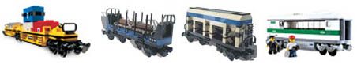

## Les pièces "trains"

**–** Les rails

Vous trouverez dans les sets de bases surtout des rails courbes. Pour vous constituer un réseau digne de ce nom, vous pourrez donc acheter en accessoires :

-   des rails droits
-   des aiguillages droits et gauches
-   des croisements.

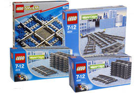

Vous trouverez [ici](http://www.ngltc.org/train_depot/plans.htm) de nombreux exemples de réseaux possibles.

**–** régulateur de vitesse.

N’en achetez pas en accessoire, vous en trouverez à meilleur compte dans les sets complets.

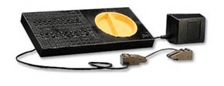

D’un point de vue pratique, il s’agit d’un transformateur de tension qui permet de descendre le 220V à 12V, couplé à une boitier qui délivre une tension variable de 0 à 9V directement dans les rails.

Attention toutefois à ne pas "charger" le réseau avec trop de locomotives. L’ampérage s’effondre et les trains n’avancent plus. 4 moteurs sur un réseau alimenté par un seul régulateur de vitesse et c’est déjà l’asphyxie. Même punition sur des réseaux trop étendus, les pertes en ligne s’accumulent et l’immobilisme vous guette.

Une astuce consiste alors à brancher deux régulateurs de vitesse (plutôt de part et d’autre du réseau). Ils sont protégés et ne craignent pas trop les court-circuit et autres surcharges.

**–** Les boggies

Ce qui fait qu’une locomotive est une locomotive, c’est aussi le boggie.

Pour faire simple, il n’existe qu’une sorte d’essieu, dans deux couleurs (noir et gris).

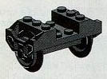

Etant donné la géométrie des rails, les boggies sont généralement :

-   fixes, composés d’un seul essieu, et rapprochés

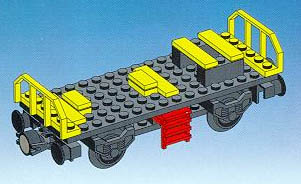

-   mobiles, composés de deux essieux.

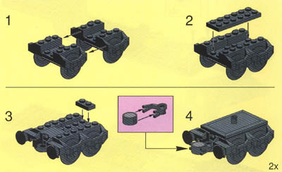

-   de trois essieux eux même obligatoirement placés de manière serrée pour pouvoir passer les courbes.

Exemple : [Tender du Hogwarts Express](http://guide.lugnet.com/set/?q=10132_1&v=z)

-   de trois essieux articulés comme sur la "crocodile"

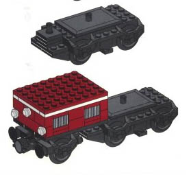

La motorisation se fait à l’aide d’un boggie spécifique à deux essieux qui capte le courant des rails [^6]

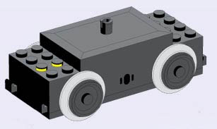

**–** Les attelages

Ce qui fait qu’un train est un train, c’est aussi l’attelage.

Là aussi, un seul est proposé, noir (avec les tampons noir ou gris). Le lien s’effectue à l’aide d’aimants. Il n’est pas rare de voir d’autres types d’attelages créés à partir d’autres pièces LEGO® (élastique, boggie partagée, rotule, etc.)

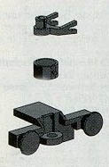

**–** autres pièces trains.

Vous trouverez aussi dans les sets trains des pièces relativement spécifiques, parmi elles :

-   les bases

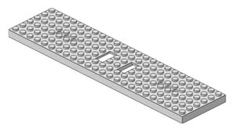

Les trains sont le plus souvent construits sur des bases de 6 tenons de large. Vous pouvez cependant construire des bases plus larges, plus longues en fonction de vos besoins avec d’autres plaques.

-   Des [fenêtres](http://guide.lugnet.com/set/3733) et des [portes](http://guide.lugnet.com/set/3735)

-   Un [pare-brise](http://www.peeron.com/inv/parts/6567c01)

## Les créations

Le jouet "LEGO" est devenu tout naturellement un matériau pour faire du modélisme ferroviaire. Certes, ce modélisme est "grossier" mais il est aussi techniquement plus accessible que le modélisme ferroviaire "classique". Il est en outre inter-générationnel.

Voyez à ce propos l’article sur [l’adhésion de FreeLUG à la FFMF](/articles/314/)

Parmi les adultes fan de LEGO® le train est un des sujets le plus populaire avec le médiéval, l’espace, et le Technic/Mindstorms. Il n’est donc pas étonnant de trouver sur Internet des créations personnelles (MOC) de fans adultes, parfois avec les notices de montages :

**–** les [créations de James Mathis](http://www.brickshelf.com/cgi-bin/gallery.cgi?f=1636) sont réputées.

**–** [Building Instruction Portal](http://www.bricksonthebrain.com/instructions/main.cfm?cat=1) regroupe des instructions de montage

**–** [MOCPages](http://www.mocpages.com/directory.php/7) est une source intarissable d’inspiration.

**–** Ne loupez pas la [BB63000 de Pascal](http://www.brickshelf.com/cgi-bin/gallery.cgi?f=119428)

**–** Enfin le site de Jeroeen vous propose des images hautes définitions de modèles CAO : [Digitalbricks](http://www.digitalbricks.nl/)

## Sujets connexes

**–** Mais alors, il existe des pièces autres que les briques ?

Oui. En fait, nous utilisons des briques classiques telles que vous les connaissez mais aussi de nombreuses pièces spécifiques (plaques, plaques modifiées, briques pentues, modifiées, fenêtres et portes, accessoires divers etc.)

**–** Pour vos créations personnelles (MOCs), ou trouvez vous toutes ces pièces ?

Il faut comprendre que les fans adultes de LEGO ont généralement un très gros budget consacré à leur hobby et il est plutôt courant de voir des collections de plus de 50.000 pièces LEGO®, ce qui représente une valeur de 5.000 euros. Ces chiffres ne sont pas la pour "impressionner" (d’ailleurs cela n’impressionera sans doute pas les modélistes ferroviaires classiques) mais pour faire comprendre que l’on ne pense pas le train LEGO en terme de "jouet" mais bien en terme de "hobby" - les moyens que l’on y consacre sont différents. Les pièces peuvent venir d’autres séries LEGO® comme "Designer", "Star Wars" ou "Harry Potter" ou bien de sets "Train" achetés en double.

Malgré ces collections de pièces importantes, il manque parfois des éléments. Beaucoup utilisent alors le magasin de vente au détail [BrickLink](http://www.bricklink.com/).

**A propos de BrickLink.**  
BrickLink est un site internet qui permet aux particuliers de vendre leurs pièces LEGO®. Les vendeurs ainsi que les acheteurs sont localisés dans le monde entier. Les pièces sont neuves ou d’occasion, souvent en excellente condition. Ce site n’appartient pas à la société LEGO®. Il est recommandé pour faire des achats sur ce site de connaître un peu d’anglais et de pouvoir régler ces achats grâce au mode de paiment Paypal©. Les pièces ne sont pas forcément très chères, ni très abordables mais les frais de port peuvent s’avérer conséquents.

Mais il ne faut pas non plus se décourager car certains font preuve d’une belle créativité avec une collection de pièces et un budget restreints.

## Le monorail

Le [monorail](http://guide.lugnet.com/set/?q=monorail) fut aussi très populaire, d’autant plus qu’il était présent dans une boite de la gamme "Space Classic", gamme elle même très populaire alors.

Malheureusement, le monorail n’est plus produit par la société LEGO® et son intérêt est devenu plus confidentiel.

## DUPLO aussi

La gamme DUPLO, réservée aux plus jeunes enfants, est aussi l’objet de [sets trains](http://guide.lugnet.com/set/?qc=dacta/duplo/trains).

## Pour en savoir plus

**–** N’hésitez pas à fouiller dans la [section train de FreeLUG](/rubriques/42/) où d’autres articles sur le sujet "train LEGO" vous attendent.

**–** Le [livre de Jake McKee](/articles/241/), en anglais malheureusement, est une très bonne entrée en matière en ce qui concerne le train LEGO 9V.

**–** Le [site officiel de LEGO®](http://www.lego.com/) propose aussi une [section Train](http://www.lego.com/eng/trains/)

[^1]: Les raisons de cette absence ne sont pas toujours claires

[^2]: L’année 2006 devrait voir arriver une version de rail sans bandes conductrices, moins cher, les trains étant alors alimentés par un boîtier de piles. Cette version, compatible avec la version actuelle, ne devrait pas s’y substituer mais au contraire la compléter

[^3]: Il n’est pas rare de voir des fans qui possèdent plus de 5 sets complets

[^4]: Cela permet de constituer un circuit de base circulaire

[^5]: Vous en trouverez d’ailleurs sur [bricklink](http://www.bricklink.com/) à très bon prix

[^6]: Il est par conséquent difficile de motoriser, par exemple, des locomotives en configuration CC
