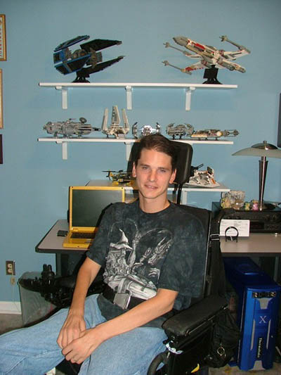
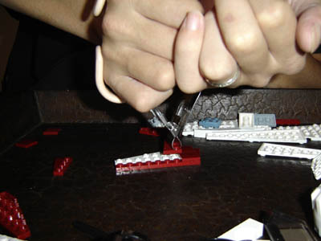
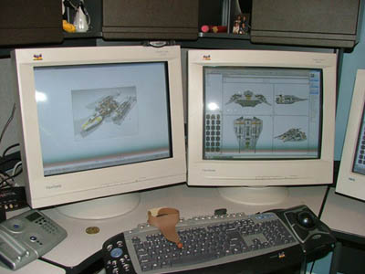

Quand le site [LEGOFan](http://www.legofan.org/) a été relancé, un message fut posté par une personne qui, pour construire avec des briques LEGO, a surmonté l’insurmontable. Son histoire est celle du courage face à l’adversité. Ce garçon s’appelle Scott Warfield et BrickJournal est fier de présenter son histoire exemplaire.

Ne vous êtes vous jamais demandé ce qu’il se passe quand on plonge en eaux peu profondes ? Je ne l’avais jamais imaginé jusqu’à ce qu’il y a trois ans de cela je plonge au mauvais endroit dans la piscine d’un ami. Il en résulta une fracture de la colonne vertébrale. Pour le dire plus simplement, je me suis brisé le cou.

Après quelques mois à l’hôpital, le diagnostic final fut celui d’une paralysie au niveau de la 6ième vertèbre. Une telle blessure implique une paralysie en dessous de la poitrine. Je peux utiliser mes épaules, mes biceps et mes poignets. Les biceps, situés sur le dessus du bras, me permettent de fléchir au niveau des coudes. Je ne peux pas utiliser mes triceps ou mes doigts. Les triceps sont sous les bras. Ils permettent d’étendre les bras. J’utilise un fauteuil roulant électrique, parfois une chaise classique pour muscler mes épaules et mes bras.

La plupart du temps à l’hôpital j’ai fait de la rééducation. J’ai réappris à manger seul, à passer une chemise et à utiliser mes poignets pour attraper certains objets. Les ergonomes m’ont aussi donné accès à des outils adaptés pour pouvoir écrire et utiliser un clavier d’ordinateur.

Après un an, j’ai pu reprendre mon activité de programmeur de logiciels. Par chance, la seule chose que j’ai du apprendre, ce sont de nouvelles méthodes d’utilisation d’un ordinateur, que ma rééducation heureusement m’avait offert. Un petit outil de frappe au poignet gauche, un boule de commande [^1] à la main droite et un logiciel de reconnaissance vocale m’aide dans mes efforts.

Avant mon accident, j’aimais faire de la moto, de la peinture et parfois, construire des modèles LEGO®. Après mon accident, il était clair que je ne pourrais plus jamais profiter de mes hobbys et que seul la télé et les ordinateurs occuperaient mes journées. A un point que j’en devenais dépressif. Il me fallait quelquechose qui m’éloignerais un peu de mes écrans.

Après mes occupations quotidiennes, je remarquais quelquechose de très intéressant à propos d’un de mes outils médicaux. Il s’agit d’une petite pince que j’utilise, par exemple, pour brancher des câbles d’ordinateur portable. Après l’avoir observé, je me suis demandé si cet outil me permettrais de manipuler des pièces LEGO® et ainsi de construire un modèle.

Je décidais de tenter de construire un petit set. Comme j’avais volé dans des hélicoptères à l’armée, je décidais d’en construire un. A ma surprise j’y parvins alors même que ce modèle contenait des pièces Technic. Incrédule à la vue du résultat, j’était heureux de cette performance. Mes parents et amis étaient même émerveillés étant donné la nature complexe du placement des pièces. Je décidais alors de construire quelquechose de plus complexe encore : Le Faucon Millénium.

Car ma femme me l’avait acheté en cadeau pour notre mariage. J’y travaillais pendant des semaines, ponctuant mon travail laborieux de jurons, pour y parvenir finalement. Le modèle est assez fragile comme vous le confirmera ma femme à qui je demandais de le poser sur l’étagère. Par la suite, je m’attaquais au Snow Speeder UCS. Encore une fois, parents et amis furent admiratifs de mes exploits. Ils étaient ébahis et intrigués de mon habileté à assembler de si petites pièces, tout cela sans l’usage de mes doigts.

Mais comment fait-on pour construire des modèles LEGO® sans utiliser ses doigts ? La réponse est en fait simple : lentement. Un set de 1000 pièces prendra plusieurs semaines. Evidemment il n’est pas question de compétition de vitesse de montage pour moi. Chaqu’une des étape demande de la patience. Assembler une pièce demande lenteur et mouvements calculés, et souvent il me faut plusieurs essais avant d’y parvenir.

Mon alliée est bien sur cette pince. Je peux facilement prendre les pièces comme vous le voyez sur cette photo.

Elle est vraiment utile à plein d’activités comme par exemple le branchement de mon portable. Les tenons sur les pièces les rendent d’ailleurs particulèrement facile à attraper.

Une fois que j’ai la pièce, j’utilise un plateau avec des bords surélevés. Cela me permet de coincer les pièces à assembler et à pousser l’une sur l’autre sans qu’elle s’échappe au sol où je ne pourrais pas les récupérer. Elles restent ainsi dans une zone controlée, à l’écart de mes chiens voraces pour qui une petite brique colorée ressemble à un festin.

Une chose que j’ai remarqué aussi, c’est que la société LEGO n’a pas conçu les instructions de montage pour des personnes atteinte de quadraplégie. Je ne leur en veux pas, qui aurait jamais pensé qu’un tétraplégique monterait des sets LEGO ? Mais je regarde les étapes suivantes afin de comprendre par avance ce que sous-entend tel ou tel montage. Souvent, je dois construire une structure qui me sert de support pour pouvoir assembler deux sous-ensembles. Le montage des ailes du SnwoSpeeder en est un example.

Je me rappelle que j’ai fini par me demander "mais pourquoi donc font ils des briques si petites ?". Je me battais littéralement pour placer une plaque lisse de 1x1 dans un espace pas plus grand qu’elle. Après plusieurs minutes d’essais, et non sans frustration, j’y suis arrivé, cette réussite me plaçant dans un état proche de l’euphorie.

Grâce à mes connaissances en informatique, j’ai pu utiliser MLCAD et LDraw afin de créer mes propres modèles. J’espère aussi pouvoir acheter les pièces pour les construire. Je travaille en ce moment sur la modélisation du vaisseau de combat de Buck Rogers.

Une autre facette réjouissante et magnifique que m’a offert LEGO, c’est de pouvoir partager du temps avec mon beau-fils de 11 ans. Tétraplégique, confiné dans une chaise roulante, je ne peux prendre part à des activités telles que le baseball ou simplement donner un coup de pied dans un ballon de foot, activités que pratiquent les garçons de 11 ans. Levin aime les briques LEGO autant que moi, et c’est donc quelquechose que nous pouvons faire ensemble. Cela me redonne le moral de pouvoir passer du temps avec lui à travers un hobby que nous aimons tout les deux autant.

Ce fut formidable de renouer avec ce loisir et d’y prendre du plaisir de nouveau. Je réalise maintenant que l’usage des ordinateurs pour mon boulot et la compagnie de la télévision ne constituerons plus mes uniques activités. Merci à la société LEGO.

[^1]: trackball
