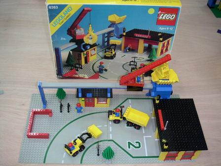
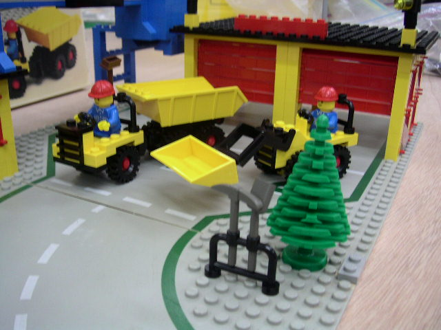
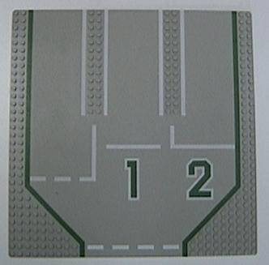
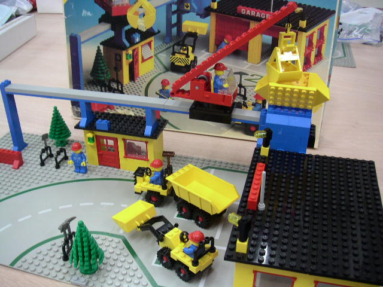
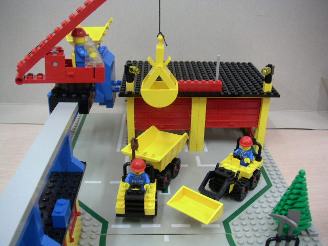
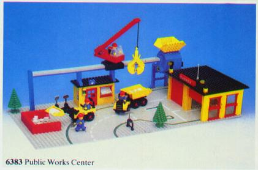
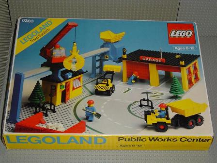
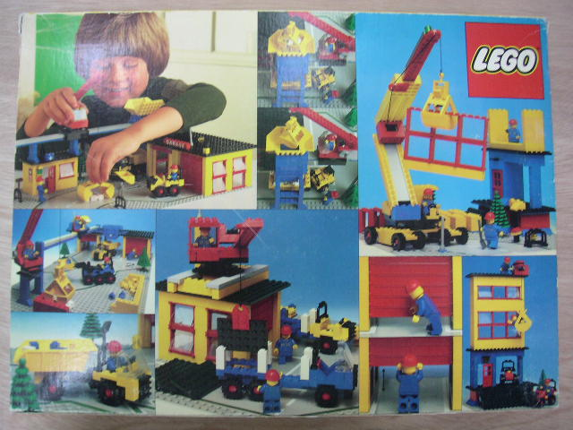

Présentation du set 6383 Public Works Center

**set 6383**

Si j’ai voulu vous présenter ce set c’est pour plusieurs raisons : la première c’est parce que je suis collectionneur de LEGO ville (1978-2007 principalement) et que ce gros set est incontournable vu sa beauté, son originalité et surtout il reflète la tradition des années 80 (sorti en 1981 en plus). La deuxième raison c’est que j’ai découvert ce set il y a seulement 4 ans car ce set n’existe pas en France du moins dans le catalogue de 1981. Et oui je dois l’avouer Internet a amplifié mon goût déjà fort pour la brique et j’y ai découvert de nombreux sets que j’appelle sets officieux (sets vendus que dans certains pays ou sets promotionnels). La troisième raison c’est de partager ma passion et ma vision de collectionneur avec d’autres d’où l’idée de ma demande à Maximilien de me et nous dévoiler sa vision de ce set puisque lui aussi est dans le thème de la ville. Je vous souhaite de découvrir ce set qui pour ma part est l’un des plus fantastiques.

## Originalité

Ce qui est frappant dès que l’on observe ce set, c’est que l’on se trouve dans un thème "les travaux publics" qui n’a jamais cessé d’exister depuis 1978 (naissance de la minifig) mais qui n’a jamais fait l’objet de grosses boîtes (laissons la période 2000-2005 de côté, set n°[6600](http://guide.lugnet.com/set/6600_2) et n°[7243](http://guide.lugnet.com/set/7243)pour les nommer).

## Tradition

La construction est fidèle au bâtiment de la police (n°[6384](http://guide.lugnet.com/set/6384)) et des pompiers (n°[6382](http://guide.lugnet.com/set/6382)) avec une plaque à 3 voies et 2 rideaux abaissables. Les véhicules de travaux ont pratiquement la même structure que les sets TP vendus à l’unité (n° \[[6652, 6648, 6678](http://guide.lugnet.com/set/?q=6652%2C6648_2%2C6678))

## Gros set

La numérotation le prouve car du N°6377 au N°6399 il n’y a que des gros sets (et quels sets !!!)... Les chiffres aussi pour l’époque : 395 pièces et 4 minifigs.

## Pièces uniques ou rares

**–** la plaque à 3 voies est à la fois classique mais le marquage au sol offre une autre possibilité de construction : elle permet de regrouper les 2 garages côte à côte (Il faudra attendre 1994 avec les pompiers n°[6571](http://guide.lugnet.com/set/6571) pour retrouver une configuration quasi identique sur plaque verte).

Notez que cette plaque est aussi présente dans le set [6391](http://guide.lugnet.com/set/6391).

**–** La pièce "Brick 1 x 2 with Groove". Bien que cela puisse vous étonner, cette pièce en jaune n’existe que dans ce set (et en plus il en faut 24 !).

  
**–** Idem pour la pièce jaune "Brick 1 x 14 with Groove"

  
**–** Idem pour les rideaux rouges il en faut 16.

  
**–** la pièce "Train Level Crossing Center Rail Cap Insert" est assez déroutante pour un collectionneur de la ville quant à sa largeur de 2 tenons sur sa longueur de 8.

## Beauté

Couleurs rouge, bleu, jaune et noir rend le set plus vivant, plus réaliste et plus visible. Un set des années 80 est toujours beau de toute façon (opinion personnelle).

## Constructibilité / faisabilité

J’ai essayé de le monter et il ne me manque que 10% des pièces (stickers reproductibles).

**Points négatifs :**  
**–** la grue est absolument pas crédible, trop simplet et manque de caractère : une modification est nécessaire.  
**–** trop petit pour accueillir d’autres engins de travaux publics.

**Points positifs :**  
**–** le système de la grue mobile est une très bonne idée.  
**–** s’intègre parfaitement avec les autres sets.  
**–** les couleurs variées, donne du plus au thème des TP, original...

## Comparaison

Il est difficile pour moi de le comparer avec le set n° 7243, seul à mon avis le plus proche. Car il est clair que le visage des sets de 1981 et ceux de 2005 n’ont rien à voir. Surtout que je ne possède pas actuellement le set N°7243. En tout cas c’est un vaste débat sur la qualité des sets d’hier et d’aujourd’hui.

## MOC

Soit en changeant simplement les couleurs soit en agrandissant ce set de façon à accueillir plus d’engins de TP.

## Prix

Entre 120$ et 450$ sur Bricklink.

Je laisse la parole à Maximilien @+ les amis...

_Une piqûre de rappel (bien nécessaire par les temps qui courent)._

C’était le bon vieux temps, le temps de l’insouciance, le temps de l’affirmation d’un véritable style de constructions LEGO : les sets Ville étaient nés et bien nés... Déjà, on pouvait mesurer les progrès accomplis en cascades depuis la création de la ville en 1979. Chaque année était alors l’occasion de voir de nouveaux moules produire de nouvelles pièces (lesquelles servent aujourd’hui, pour la plupart, de base à tout constructeur de ville qui se respecte).

1981, c’était l’époque où les créateurs se "laissaient aller" en n’hésitant pas à créer des bâtiments posés sur deux plaques de bases, les garages pullulaient, et les véhicules, quoique encore un peu "frêles", laissaient entrevoir des "lendemains qui chantent"... De tous ces sets incroyables ravivant dans le coeur du passionné un brin de nostalgie (dont certains s’arrachent aujourd’hui à prix d’or), le set 6383 est certainement la plus belle expression. Ici, on trouve de tout, tout ce qui a fait entrer dans la légende les sets de cette glorieuse époque se trouve rassemblé, avec en plus, une délicieux parfum d’exclusivité concernant certaines pièces... au moins pour celui qui les possède !!

La plaque de base pour garage par exemple : chez le (richissime) Oncle Sam, elle s’échange contre des sommes dépassant les... 30$ !! (compte tenu du fait que les LEGO sont réputés, souvent à juste titre, moins chers aux Etats-Unis qu’ici, cela laisse une idée de la valeur de la plaque...) Par contre il est encore possible de trouver des virages pour moins cher (si si, en cherchant bien lol). Et pour les garages, c’est le même constat : ils sont rares, extrêmement rares, et même uniques avec leurs briques jaunes et leurs "portes" intégralement rouges. Quand aux pièces sur lesquelles se déplace la grue, elles ont carrément disparu de la circulation depuis (notez au passage qu’après une courte retraite forcée, le godet est réapparu tel quel en 2005).

En revanche, force est de constater que ce ne sont ni les véhicules, ni les personnages qui ont propulsé ce set dans la légende. Ils sont cependant à considérer, non comme un ensemble de pièces relativement faciles à trouver (trop peut-être pour certaines ?), mais c’est dans leur rôle de témoins d’une époque révolue qu’ils prennent toute leur valeur (et là, j’invite les incrédules à explorer la gamme de trains de l’époque...)

La déception, si déception il devait y avoir, viendrait à n’en pas douter de l’outillage : s’il peut paraître simple, voir franchement indigent pour un garage style DDE, il faut se rappeler qu’à l’époque, les possibilités n’étaient pas aussi nombreuses qu’aujourd’hui... Mais bon ça c’est pour chercher la petite bête...

Voilà, il nous semblait à Jean-Gérald et à moi (Maximilien) intéressant de rappeler, alors qu’une toute nouvelle ville voit le jour en 2005, qu’il a existé, à une époque aujourd’hui lointaine (pas seulement en terme d’années...) des sets qui avaient alors le pouvoir de déclencher la passion (et de s’incruster durablement dans les mémoires), cette passion qui a fait de nous ce que nous sommes aujourd’hui... Espérons enfin que, dans une époque pleine de jeux vidéos, la nouvelle gamme ville, dont les véhicules accomplissent avec un certain brio le rare exploit d’être plus encombrants sans augmenter l’espace intérieur, cette gamme enthousiasmera une nouvelle génération de passionnés, lesquels auront en plus à relever le défi de défendre l’indépendance de LEGO par rapport aux autres marques (notamment les produits dérivés du cinéma...).

