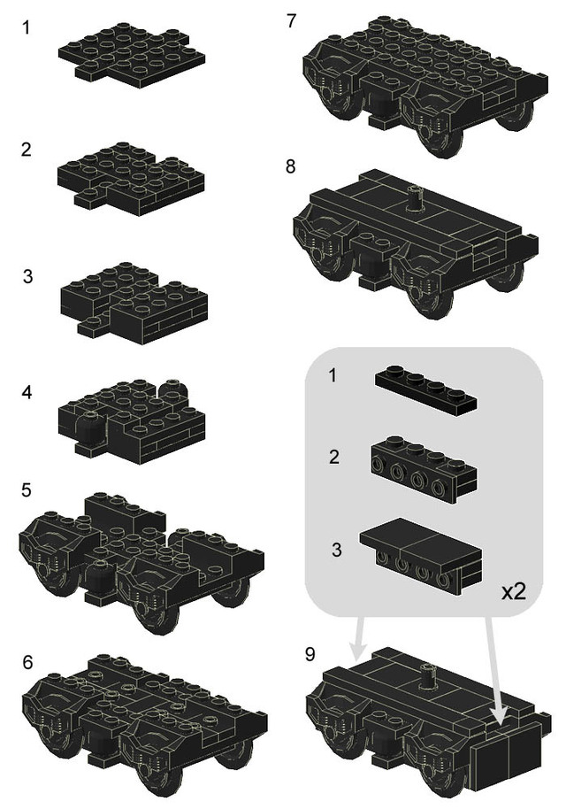

Il est souvent pratique lorsqu’on est en expo de pouvoir remplacer un boggie moteur 9V par un boggie équivalent mais non motorisé, afin de pouvoir accrocher plusieurs loco à un long convoie de train, sans surcharger le nombre de moteur sur la voie.

Ou alors tout simplement vous avez besoin d’un boggie ressemblant au moteur 9V pour les locomotives dont les deux boggies sont identiques.

Mais peut-être avez vous remarqué que les moteurs de train 9V ne sont pas si simple que cela à reproduire avec des pièces, car l’écartement entre les roues des deux essieux est de 3 tenons, et l’axe de rotation doit bien sûr être au milieu du boggie.

Confronté au problème pour ma BB 7200, j’ai dû trouver une solution. Je vous propose dans cet article la notice d’une version à peine modifiée pour plus de ressemblance (mais un peu plus fragile).

J’espère que cela vous sera utile, et bien sûr n’hésitez pas à modifier, améliorer ou simplifier le modèle selon vos besoins !

