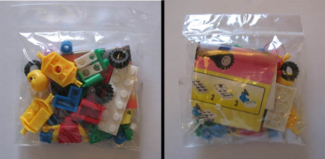
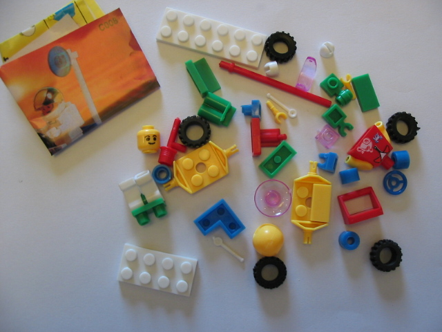
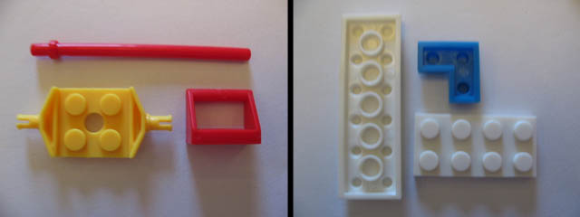
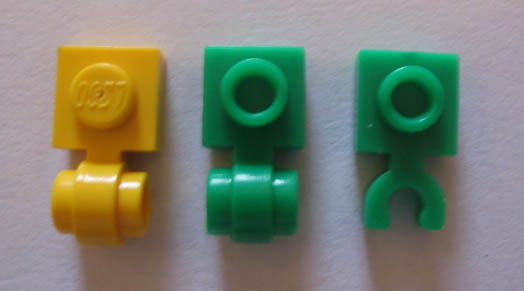
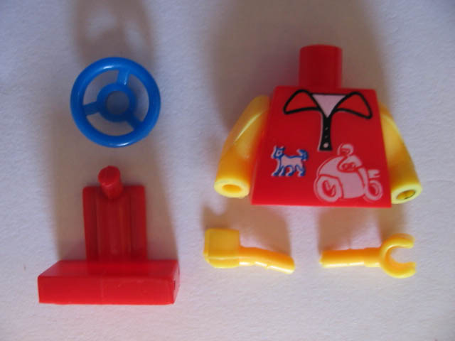
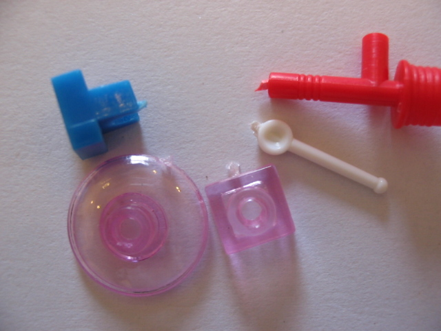
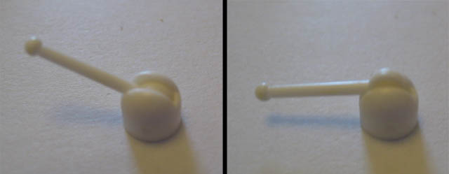
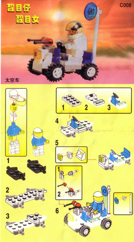
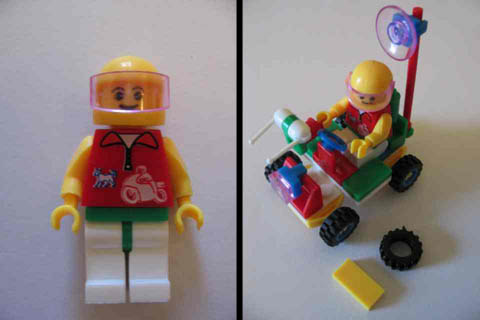

Récemment j’ai eu la chance de passer mes vacances à Shanghai et je suis tombé sur un petit set du thème espace avec des briques clonées.

Au départ je pensais qu’il s’agissait d’un modèle original fait à l’aide de briques clonées, mais par la suite on m’a signalé que ce modèle était une copie du design original du set LEGO [6516](http://guide.lugnet.com/set/6516), ce qui en fait du coup **une copie illégale**. Finalement j’ai eu l’occasion d’étudier la qualité des briques pour vous en faire part dans cet article.

Le set se présente sous emballage plastique réduit au minimum :

Voici l’ensemble des pièces une fois le set déballé :

De nombreuses pièces copiées dans ce set sont des pièces récentes, je pense notamment à la tile avec poignée, ou le support de roues. On peut noter toutefois quelques différences en dessous des briques, par exemple il n’y a pas de "tube" en dessous de la plate 2x2 corner. Heureusement il n’y a pas la marque "LEGO" inscrit sur les tenons.

Cependant certaines des pièces qui diffèrent de leur équivalent LEGO peuvent avoir un intérêt. Par exemple le tenon creux au dessus des plates modifiées pourrait permettre de faire des décalages d’un demi-tenon dans certains montages.  
Dans la photo ci-dessous la pièce jaune est une pièce LEGO, les pièces vertes sont des clones.

La première chose que l’on remarque c’est que certaines pièces qui sont pré-montées dans les boites LEGO, sont ici laissé en pièces détachées. Cela sans doute pour réduire les coûts de fabrication. Vous devrez donc les assembler vous-même, même si c’est parfois délicat pour un enfant. Voici deux exemples avec les mains de la minifig et le volant :

Notez au passage la sérigraphie du torse qui est pour le moins original pour un "spationaute"...

La deuxième chose qui saute aux yeux et qui est beaucoup plus problématique est la qualité du moulage. En effet de nombreuses pièces sont mal ébavurées, surtout d’ailleurs les pièces transparentes qui sont moulées avec un plastique différent. A mon avis, il faut préalablement ébavurer au cutter certaines pièces pour faciliter le montage, par exemple la plate 1x1 dans la photo ci-dessous, ne pourrait pas être placée à coté d’une autre brique si on n’enlève pas la bavure.

Un autre problème à signaler est le jeu trop important entre le levier et son support (voir photo ci-dessous). Du coup, il est quasi-impossible de jouer avec le levier sans qu’il vous reste dans la main. Evidemment ce problème est dû à la mauvaise précision des moules.

Concernant la notice, elle semble avoir été refaite, même s’il y a exactement le même nombre d’étapes que dans la notice originale :  
**–** certaines pièces ne sont pas de la même couleur (blanches au lieu de grises dans la notice originale)  
**–** le phare avant est horizontal alors qu’il est légèrement tourné vers le haut dans la notice original  
**–** la minifig tourne la tête à 90° alors qu’elle est plutot à 45° dans la notice originale.  
**–** la mise en page est différente.

Par contre la photo du modèle semble celle de la notice originale qui a été détourée et remise sur un autre fond.

Bien évidemment les couleurs ne correspondent absolument pas aux pièces qui étaient dans le sachet.

Pour information les deux textes jaunes signifient "Homme remarquable" et "Femme remarquable", et le petit texte noir signifie "véhicule de l’espace".

Enfin bref, voici la minifig (avec un blouson décoré d’un joli petit animal et d’une moto :-)) et le modèle une fois monté, avec deux pièces supplémentaires (qui ne sont pas les plus petites du set).

Le moins qu’on puisse dire, c’est que la qualité de cette copie est très mauvaise.  
TLC est déjà au courant de cette copie, si cela vous intéresse allez voir [l’article consacré aux copies](http://www.lego.com/eng/info/default.asp?page=pressdetail&contentid=3420&countrycode=2057&yearcode=2004&archive=true) sur le site de LEGO, et agrandissez la première image de la colone de droite, vous y retrouverez ce set au premier plan.
