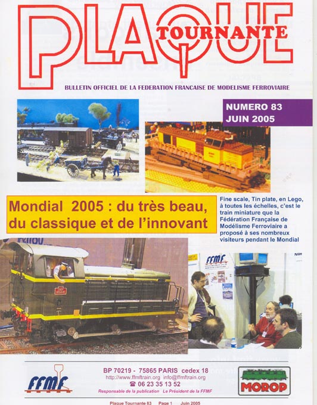
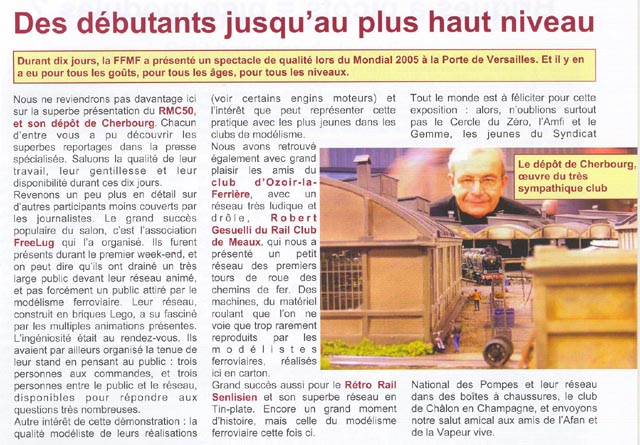

Les 23 et 24 Avril 2005, nous nous sommes retrouvés, une poignée de FreeLUGiens, à participer pour la première fois au Mondial de Maquette et du Modèle réduit.

Cette première participation a marqué les esprits avec plus de 35 000 visiteurs sur les deux jours et pas exclusivement pour les membres de FreeLUG qui ont déjà rendu compte de leur expérience dans un [précédent article](https://www.freelug.org/spip.php?article345),  
mais également pour nos hôtes et amis de la FFMF qui nous hébergeaient pour l’occasion.

(Si vous voulez voir quels liens unissent FreeLUG à la FFMF, reportez-vous à [l’article consacré à notre démarche d’affiliation](https://www.freelug.org/spip.php?article314).)

La FFMF édite périodiquement un journal, appelé "Plaque Tournante", qu’elle diffuse à ses adhérents.

**Journal de la FFMF**

Cela fait quelques mois que j’ai obtenu leur approbation pour reprendre les quelques pages de leur numéro consacré au Mondial 2005, numéro dans lequel nos amis de la FFMF nous ont fait l’honneur de réaliser le compte-rendu de notre participation.

**Article FFMF**

Comme vous pouvez le constater notre présence a été appréciée et je suis heureux de vous annoncer que la FFMF nous réinvite pour le **[Mondial 2006 du 13 au 17 Avril](http://www.salon-maquette.com/)**.

Le Mondial 2006 se tiendra toujours porte de Versailles à Paris, mais uniquement sur 5 jours, ce qui facilite l’organisation pour les associations qui n’ont pas forcément du personnel disponible pour assurer la permanence pour des durées plus importantes. Nous avons donc prévu d’exposer pour toute la durée du salon.

Afin de préparer cette grande exposition qui s’adresse plus particulièrement au grand public, un [espace Wiki](http://wiki.freelug.org/tiki-index.php?page=Mondial+de+la+Maquette+%C3%A0+Paris) est déjà à votre disposition pour vous inscrire.

Au passage, le mot d’ordre des organisateurs pour cette année, c’est "DU SPECTACULAIRE !", car cet événement représente une vitrine pour toutes les associations qui sont impliquées dans son organisation.

Afin que cette occasion puisse également nous servir de vitrine pour faire partager notre passion, j’ai eu l’idée d’organiser un concours pour inviter les autres clubs affiliés à la FFMF à se joindre à nous :

**Réglement du concours FFMF Mondial 2006**

Si voulez vous joindre à nous, merci de vous signaler avant le 31 Janvier 2006, afin que nous puissions boucler le plan de notre exposition, sachant que vous pouvez participer de plusieurs façons :

**–** Etre exposant durant les 5 jours du salon.  
**–** Réaliser tout ou partie d’un module, que vous confiez à un exposant.  
**–** Réaliser un élément de décors ou du matériel roulant que vous confiez à un exposant, ou que vous nous apporter le jour de votre visite.  
**–** Réaliser un module GBB.  
**–** Venir en tant que simple visiteur et participer à l’animation et à la rencontre avec le public.

N’hésitez pas à vous manifester rapidement, car la mi-avril c’est quasiment demain et nous bouclerons vraiment toutes les inscriptions à l’issue de notre prochaine Assemblée Générale.
