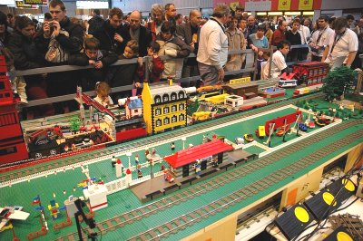
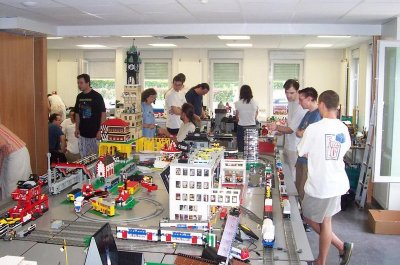
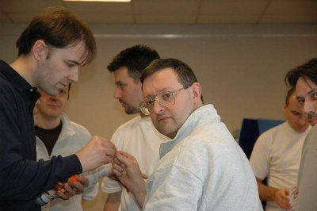

Le site de FreeLUG regorge d’articles sur de nombreux sujets rédigés par nos adhérents. Petite visite guidée du site.

## L’association

**Nous contacter**

Pour nous contacter, rien de plus simple. Consultez l’article [Nous contacter](/articles/10/).

**Notre but**

L’association FreeLUG a pour but premier le rassemblement des passionnés francophones de la brique LEGO.

Nous souhaitons ensuite partager notre passion, à travers nos rencontres, à travers le site et ses articles ou bien à travers les expositions où nous montrons nos dernières créations.

**Nos statuts**

Vous souhaitez connaître précisément le fonctionnement de notre association avant d’adhérer, consultez [les statuts](/articles/2/) ou bien [le règlement intérieur](/articles/135/).

Et si vous décidez de nous rejoindre, vous vous posez sans doute la question [Comment adhérer à l’association FreeLUG](/articles/76/).

**Nos activités**

Rencontres, expositions, repas ou autres évènements particuliers constituent nos principales activités. Consultez la rubrique [Réunions & Evénements](/rubriques/55/) pour en découvrir davantage.

**Communiquer avec d’autres passionnés**

Le plus simple est de vous [inscrire sur la liste de discussion](http://lists.freelug.org/cgi-bin/mailman/listinfo/freelug-general) ouverte à tous les passionnés.

Ou bien, de façon plus directe, vous pouvez aussi venir "chatter" avec d’autres soit par [le client web](http://www.freelug.info/cgi-bin/cgiirc/irc.cgi) ou bien en vous connectant avec un [client IRC comme XChat](/articles/297/) sur le serveur irc.freelug.org, channel #freelug.

## Les régions

Pour connaître plus particulièrement l’actualité de votre région, les évènements à venir ou passés, consultez les [rubriques régionales](/regions/). Pour connaître l’ensemble de nos prochains évènements, consultez donc la [liste des manifestations](https://www.freelug.org/manifestations.php3) et venez nous rencontrer lors d’un de ces évènements.

## La FAQ

Vous vous posez des questions comme où trouver des notices, vous comprenez peu le jargon de l’AFOL (que signifie d’ailleurs AFOL ?), consultez donc la [Foire aux Questions](/rubriques/68/).

Si malgré tout vous ne trouvez pas votre bonheur, essayez l’outil de recherche accessible depuis toutes les pages.

## Les thèmes

Vous êtes passionnés de trains, de StarWars ou bien encore de Technic, consultez donc les [rubriques thématiques](/themes/) pour découvrir des créations personnelles, des revues de modèles et bien d’autres choses.

## La galerie photos

Les adhérents de FreeLUG peuvent bénéficier d’[une galerie de photos](http://photos.freelug.org/) qui permet de partager ses dernières créations, ou bien de mettre en ligne les photos de nos expositions et évènements.

D’une façon générale, n’hésitez pas à fouiner à droite à gauche pour découvrir des articles intéressants. Et si vous cherchez une vue globale du site et de ses articles, regardez donc [le plan du site](https://www.freelug.org/plan.php3) ou consultez [le calendrier](https://www.freelug.org/agenda.php3) pour une vue par date.
