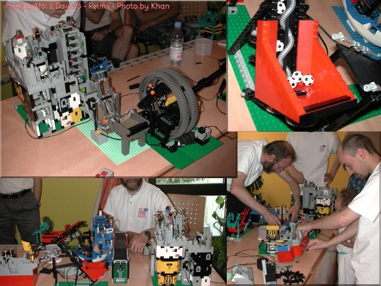
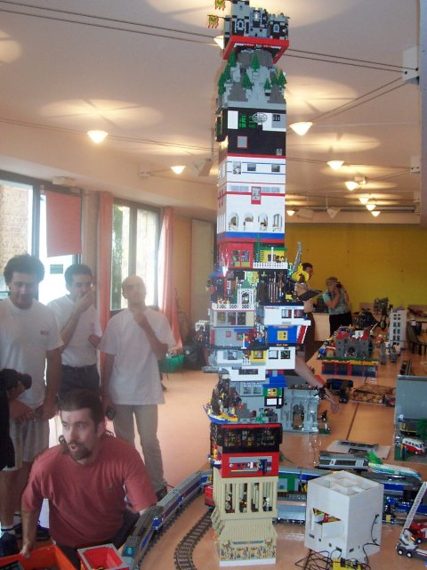
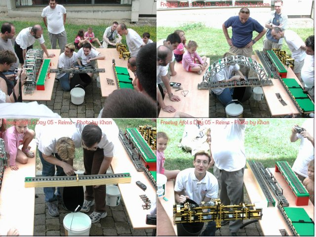
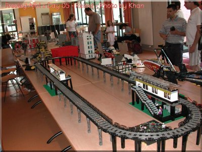
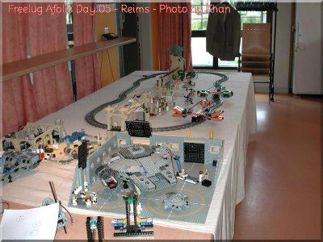

La troisième édition des Rencontres Estivales FreeLUG (Summer Afol’s Day) s’est déroulée à Reims. Un petit compte-rendu de ce weekend de fous.

Pour la troisième année consécutive, FreeLUG a organisé son Summer Afol’s Day. L’événement a pris place à Reims (Nord-Est), avec des AFOLs de France mais également de Belgique et de Hollande.

**

## Un peu d’histoire...

**

Les rencontres estivales FreeLUG (Summer AFol’s Day) sont nées en 2003, soit juste 6 mois après la création officielle de l’association. C’était une autre "bonne" raison de se retrouver. La première rencontre a eu lieu à Rennes (Nord-Ouest), puis à Grenoble (Sud-Est) en 2004.

Plusieurs raisons ont poussé l’organisation de cet événement. Tout d’abord, se retrouver. En effet les membres de FreeLUG sont repartis sur toute la France, voire la Belgique. Ensuite c’est l’occasion de se retrouver et passer du temps entre nous, pas de public, seulement des AFOLs, et ainsi pouvoir montrer nos MOCs, mettre en place des projets collaboratifs, boire un coup et bien manger car après tout, nous sommes français :)

Nous avons également essayer de changer de lieu chaque année de sorte que tout le monde puisse venir l’année où cela se passe dans sa région. Une autre bonne raison de ce changement est de satisfaire nos partenaires, épouses et enfants qui peuvent en profiter pour découvrir une de nos belles regions et éventuellement prendre une semaine de vacances sur place.

Chaque année, cette rencontre grossit, environ 20 AFOLs en 2003, quasiment 30 en 2004 et maintenant on atteint les 40. Cela grandit aussi dans la superficie de la salle louée et du nombre de jours. Dès la première année, les premiers arrivèrent le vendredi soir et les derniers partirent tard le dimanche soir.

## L’édition 2005

Cette année, nous avons eu 2 projets principaux collaboratifs, le [Grand Bidule à Balles](https://www.freelug.org/spip.php?article362) et le [Brickciel](https://www.freelug.org/spip.php?article148), et deux compétitions, le pont le plus résistant et la "course folle".

## GBB

Le [GBB](https://www.freelug.org/spip.php?article362) consiste en un ensemble de modules motorisés déplacants des balles LEGO. Ce fut un grand amusement de voir les modules construits à travers le pays, s’assembler et lancer (littérallement) les balles à travers la pièce.  
Après quelques réglages et modifications, les 12 modules travaillèrent ensemble et générèrent un joli flot de balles.  
Nous avons pu voir de très beaux design, motorisés par un simple moteur ou un RCX. Donc pas forcément besoin d’être un féru de construction technique. Nico avait construit un système shootant des balles, de l’autre coté, Philo ou Jean-Louis se "limitèrent" à des constructions techniques.

**GBC en délire**

Quelques photos des GBC de nos artistes

## BrickCiel

Le projet Brickciel est constitué d’un empilement de modules dont la taille est définie et de 8 briques de haut. Erik nous a lancé un défi pour cette année : atteindre le plafond de la salle. Pas à pas (ou plutôt modules après modules) la contruction grandit. On a finalement eu recours à Loys (2 mètres) pour ajouter les dernières constructions. Même si chaque module doit suivre des règles de constructions strictes afin de pouvoir soutenir le poids des modules du dessus, le design est libre. Cela a donné de belles et originales constructions. LeGnome a créé un module très haut (32 briques de hauteur) et a poussé le vice en organisant un jeu où nous avions à trouver le nombre de minifigs composant cette scène.

**Brickciel - Skybrick**

et hop le Brickciel atteint le plafond - Skybrick reaches the ceiling

## Concours de Pont

Le concours de pont le plus résistant a beaucoup retenu notre attention. D’un coté les ponts légers constitués de peu de pièces et de l’autre un aspect esthétiques ou technique des plus poussé. Le but était de résister à un poid minimum de 5kg.  
Un seau rempli d’eau simulait la charge. La plupart des ponts émirent quelques craquements au fur et à mesure de l’augmentation du poids. Mais ils ont tous supportés les 20kg de charge ! Surprenant !

**Bridge contest - concours de pont**

Comme le réseau, fléchit mais ne rompt pas - Crack but won’t break

## Course Folle

Le principe de la course folle est assez simple : construire un véhicule possédant au minimum deux roues et un pilote.  
Plus c’est dément, mieux c’est. Le véhicule est ensuite laché sur une rampe et essaie d’aller le plus loin possible.

## Et le reste

Une rencontre est toujours une bonne opportunité pour les fans de trains. Un réseau se contruisant au fur et à mesure des arrivées a pris place avec de beaux exemplaires de wagons et locomotives.

**Tramway**

Également fort intéressant le tramway de Nico. Nos amis hollandais sont venus avec de superbes constructions très détaillées. La première représentait une scène de la Grèce antique et la suivante une ville.

Sur le diorama StarWars, une course de pod opposait Anakin et Sebulba. Les pods étaient montés sur des moteurs de train standards, une vrai plaisir pour ajuster la vitesse afin qu’ils ne se rentrent pas dedans.

**Star Wars**

Animation sur le theme SW - SW layout

Cette rencontre est un événement attendu par beaucoup au sein de FreeLUG. Nous sommes fiers d’avoir acceuillis pour la seconde année, nos amis de Hollande qui ont apparement apprecié le weekend. Nous ne savons pas encore où nous serons l’an prochain, mais tous les AFOLs d’Europe ou de l’autre coté de la "flaque" sont les bienvenus. L’annonce de l’édition 2006 fera l’objet d’un nouvel article.

## Plus de photos ?

**–** [Galerie Freelug](http://gallery.freelug.org/Summer_AFOL_Days_2005)  
**–** [Sur Brickshelf](http://www.brickshelf.com/cgi-bin/gallery.cgi?f=136332)
