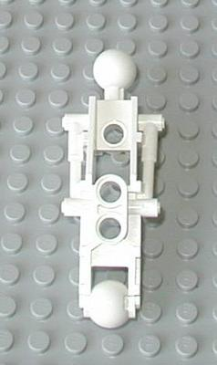
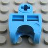
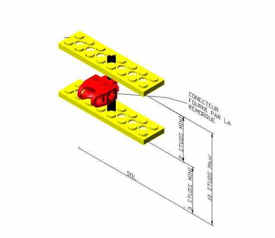
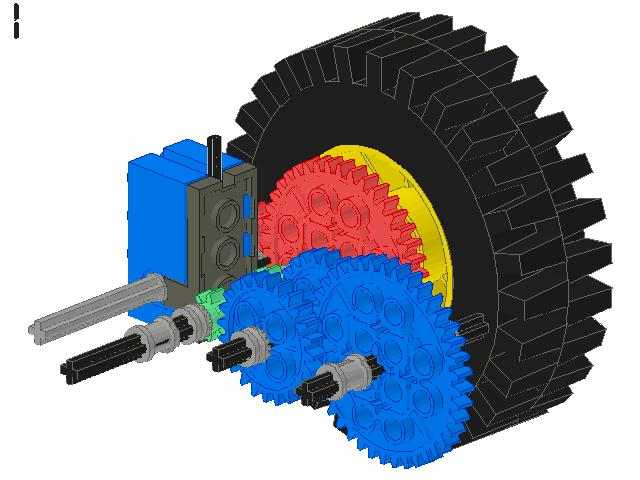
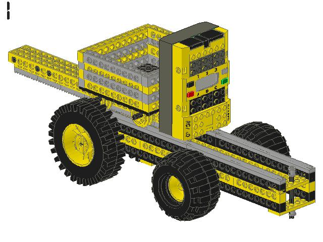

## Concours de POWER PULLER

## BUT

Aller le plus loin possible en tractant une remorque à résistance progressive.

## Règles techniques

**1 - Motorisation :**

**–** 2 moteurs traction (71427c01 ou 43362) maximum.

**2 - Alimentation :**

Par la remorque grâce à l’utilisation d’une alimentation secteur. La remorque comportera un RCX qui sera chargé de la gestion d’essais  
**–** 1 (un) seul câble électrique reliera la remorque au tracteur.  
Le tracteur comportera une seule prise située sur le dessus et à l’arrière du tracteur.  
**–** 2 câbles en polarité inverse permettront d’alimenter les moteurs quelque soit le sens de rotation de ceux-ci.

**3 - Poids et dimensions :**

**–** La largeur ne doit pas dépasser 26 studs, soit 208 mm ;  
**–** La longueur ne doit pas être supérieure à 52 studs, soit 416 mm ;  
**–** Le poids maximum est de 2kg.

**4 - Piste :**

**–** La piste fera 50cm de large et 250 cm de longueur utile  
**–** Elle est constituée d’une bande de revêtement de sol souple en pvc usuel (la référence et le fournisseur seront communiqués dès que connus)  
**–** Elle comportera un tasseau central de 10x15 mm (±2 mm) assurant le guidage de l’ensemble tracteur + remorque.  
**–** le "brillant" du revêtement de sol sera "cassé au papier abrasif" ou bien la face arrière du revêtement sera utilisée.

**5 - Liaison remorque - tracteur :**

Elle sera réalisée par l’ensemble de 2 connecteurs [31174](http://www.peeron.com/inv/parts/32174) et d’une pièce bionicle [50920](http://www.peeron.com/inv/parts/50920).

_Limite de fourniture_ : La liaison tracteur remorque nécessite de la part du tracteur, un axe technique vertical ou horizontal (vertical recommandé).

Voir [annexe 1](#Annexe1)

**–** Technic Bionicle Toa Hordika Lower Leg Section with Two Ball Joints (50920) [http://www.peeron.com/inv/parts/50920](http://www.peeron.com/inv/parts/50920)



  
**–** Technic Connector 2 x 3 with Ball Socket’ (32174) [http://www.peeron.com/inv/parts/32174](http://www.peeron.com/inv/parts/32174)



**6 - Remorque :**

_Principe_ :  
La remorque est constituée de 2 roues entraînant un mécanisme faisant avancer un poids. Les roues avant sont immobilisées en rotation. Voir le fichier MLCAD en [annexe 4](#Annexe4). La charge de la remorque est variable et sera définie en fonction des essais. Elle sera fixée 15 jours avant la première compétition.

**7 - Eléments de construction :**

Seules les pièces LEGO sont acceptées, exception faite pour les poids qui peuvent être de nature quelconque sous réserve qu’ils soient cachés à la vue.

**8 - Transmission :**

Le système de transmission est libre : 2 roues motrices ou transmission intégrale, 2, 4, 6 roues, chenilles, jambes ...

**9 - Boite à vitesse :**

Elles sont autorisées à condition que le changement soit automatique (sans intervention du concurrent).

**10 - RCX :**

Si au moins 2 concurrents présentent des tracteurs muni d’un RCX une catégorie Mindstorms sera créée. Mais ils doivent aussi participer au concours en catégorie Technique, soit avec un tracteur différent, soit le RCX en position OFF.

Les moteurs auxiliaires sont alimentés par le RCX et ne doivent en aucun cas ajouter leur puissance aux moteurs de Traction. L’utilisation de la télécommande est interdite.

**11 - Amélioration du grip :**

L’usage de produit favorisant le grip (résine de pin ou autre) est interdit.

L’amélioration du grip par des moyens mécaniques est toléré à condition que :

1.  l’intégrité des pièces lego soient respectée.
2.  aucune particule ou élément ne restent sur la piste (sable, clous ..).
3.  les gommes ne soient pas retaillées.

Les bandes de roulement additionnelles, chaînes sont tolérées.

## Organisation du concours

Le concours sera organisé sous forme de challenge de deux manches :  
**–** la 1ère manche se déroulera lors de l’AG 2006 de FreeLUG ;  
**–** la 2ème manche se déroulera lors de la réunion estivale de FreeLUG.

Cela donnera la possibilité de concourir à un maximum d’adhérents.  
Si un adhèrent participe aux deux manches seule la meilleure des deux manches sera comptabilisée.

L’adhérent peut confier son tracteur aux organisateurs qui concourront à sa place. Aucune réclamation ne sera recevable dans ce cas.

**1 - Nombres d’essais**

**–** Chaque manche comportera 3 essais non consécutifs ;  
**–** Seul le meilleur essai sera pris en compte ;  
**–** Tous les concurrents effectuent leurs essais ;  
**–** Entre chaque essai une période de 30 minutes permettra d’effectuer des améliorations ou la remise en état des tracteurs.

**2 - Durée des essais**

**–** Le tracteur a 1 minute pour franchir la ligne d’arrivée ;  
**–** Si au bout d’une minute il n’a pas franchi la ligne, la distance sera prise en compte pour le classement ;  
**–** Si la ligne est franchie alors le temps sera pris en compte.

**3 - Temps de préparation**

Le concurrent a 3 minutes pour installer son tracteur, une fois la remorque mise en position prête à fonctionner.

**4 - Temps d’évacuation**

Une fois la minute écoulée et les résultats entérinés par le juge, le concurrent a 2 minutes pour libérer la piste.

**5 - Validité de l’essai**

Pour qu’un essai soit valide il faut que :

1.  le tracteur ne soit pas sorti de la piste ;
2.  le concurrent ait dégagé la piste dans le temps imparti ;
3.  les vérifications soient conformes.

**6 - Vérification**

Avant tout essai, le poids et l’encombrement seront vérifié :  
**–** Le poids par une balance ;  
**–** L’encombrement à l’aide d’un boite calibrée aux dimensions intérieures de 26 et 52 studs.

**7 - Inscriptions**

Pour permettre la bonne organisation des réunions, il est nécessaire de s’inscrire comme participant sur le [WiKi de FreeLUG](http://wiki.freelug.org/) à cet endroit : [http://wiki.ipsyn.net/tiki-index.ph...](http://wiki.ipsyn.net/tiki-index.php?page=Power+Puller)

Les compagnes et enfants des membres sont les bienvenus.

si un invité, non membre de FreeLUG mais qui a été invité par un membre, veut concourir, il est le bienvenu.

Les inscriptions seront closes une semaine avant la réunion.

**8 - Classement**

Le concours se faisant en 2 manches le classement se fera par points. Seule la meilleure manche sera prise en compte. Les points des 2 meilleurs essais seront additionnés pour donner le résultat de la manche.

**9 - Calcul des points**

Le RCX de la remorque calculera les points. Un capteur de rotation entraîné par les roues AR et l’horloge interne serviront de base pour le calcul des points.  
**–** Le tracteur qui parcourra les 2500 mm en 1 mn se verra attribuer 1000 points ;  
**–** Chaque 1/10 de secondes gagné donnera 1 point supplémentaire ;  
**–** Chaque 2.5 mm non parcouru enlèvera 1 point.

Voir [l’annexe 3](#Annexe3) pour le programme du RCX, et [l’annexe 2](#Annexe2) pour la chaîne cinématique de la remorque.

## ANNEXE

**1 - LIAISON REMORQUE-TRACTEUR**
{: #Annexe1}

**–** La fourniture du tracteur s’arrête à l’axe technique (noir) ;  
**–** Il peut être vertical ou horizontal, dans ce dernier cas portez l’espace à 3 studs ;  
**–** Le connecteur rouge fait parti de la remorque.



**2 - CHAINE CINEMATIQUE**
{: #Annexe2}

Les roues arrière entraînent la partie mobile de la remorque par l’intermédiaire du train d’engrenage bleu.

Le capteur de rotation est entraîné par le train d’engrenage rouge.

**Calcul de la distance**  
Chaque top du capteur de rotation correspond à la formule :  
_D x Π / Re x T_  
où  
_D_ = diamètre de la roue en mm = **62**  
_Π_ = Pi = **3.1416**  
_Re_ = rapport de réduction = 40/8 = **5**  
_T_ = top par tour = **16**

Résultat :  
62 x 3.1416 / (40 / 8) x 16 = 2.44 mm

Le RCX comptera 1000 tops et coupera le courant ou coupera le courant au bout d’une minute.



**3 - Programme**
{: #Annexe3}

```
/*********************************************
***** programme concours Power Puller ********
**********************************************/
int distance = 0,temp = 0, resul = 0;

task main ()
{
SetSensor (SENSOR_1, SENSOR_ROTATION);
SetSensorType (SENSOR_1, SENSOR_TYPE_ROTATION);
SetSensorMode (SENSOR_1, SENSOR_MODE_ROTATION);
 while (true)
 {
   until (Message () != 0); // attend le top depart
   start timer;
   start parcour;
   Message () = 0 ;
   OnFwd (OUT_A);            // lance les moteurs
   OnRev (OUT_B);            // en fonction du tracteur
 }
} // fin tache main
task timer ()
{
  ClearTimer (0);
  until (Timer (0)>= 6000);   // attend 1 minute
  Off (OUT_A+OUT_B);         // coupe les moteurs
  stop parcour;
  resul = SENSOR_1;        // memorise la distance
  SetUserDisplay (resul, 4);   // affiche le resultat
}
task parcour ()
{
 ClearSensor (SENSOR_1);
 until (SENSOR_1 >= 1000);    // attend 1000 pas
 temp = Timer (0);           // memorise le temps
 ClearTimer (0);             // met le timer a 0
 stop timer;                 // arrete la tache
 resul = 1000 + (6000-temp);   // calcule le resultat
 SetUserDisplay (resul, 4);    // affiche le resultat

}
```

**4 - REMORQUE (PRINCIPE)**
{: #Annexe4}



  
**–** Le fichier MLcad correspondant

[](https://www.freelug.org/IMG/zip/remorque.ldr.zip "Zip - 1.2 kio")

**fichier MLcad de la remorque**

ceci est le fichier Mlcad de la remorque dans sont etat actuel
