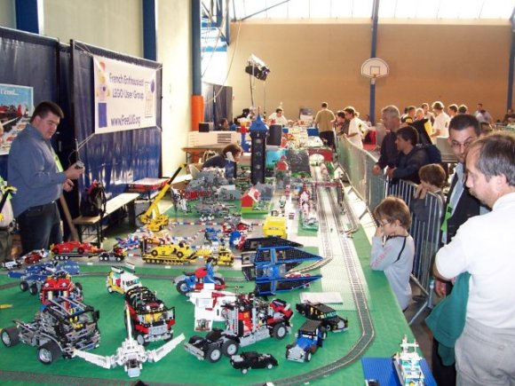
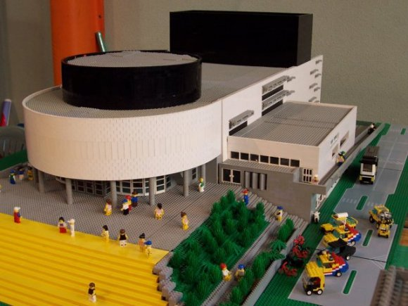
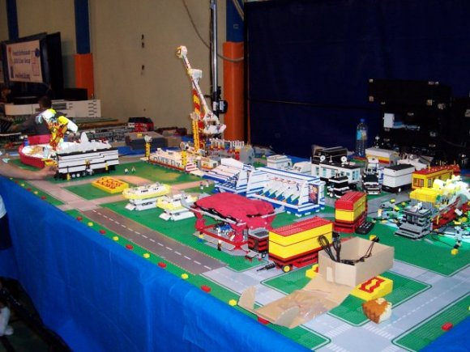

Les 29 & 30 octobre derniers, FreeLUG et Brique à Brac ont été conviés à participer à une exposition de modélisme, organisée par le Grenoble Maquette Club.

C’était notre seconde participation à cette exposition bianuelle. Nous avons d’excellentes relations avec le GMC ; du coup, nous avons pu obtenir l’espace souhaité, à savoir la largeur totale du fond du gymnase. Nous nous sommes finalement étalés sur un stand de 25m de long.

**La table**

On n’en voit pas le bout !!

Nous étions plus d’une dizaine à s’être rassemblés pour l’occasion, dont quelques parisiens : Maximillien, et Erik qui commençait son tour de France des Afols. Merci à eux d’être venus nous voir !!

Au niveau de l’exposition de notre stand, nous avions privilégié les mocs. Il y a eu quelques morceaux de choix, comme le viaduc construit en "kit démontable", et une reproduction très fidèle de la maison de la culture de Grenoble ; la première du genre qui ait été imaginée en France.

**La maison de la culture de Grenoble**

Un des participant nous a présenté une fête forraine. Le public a pu observer son installation, son animation et son démontage tout au long du week end.

**la fête forraine**

Installation des stands

La longueur de la table nous a permis d’avoir une longue ligne droite de rails. Du coup, Xavier a fait des essais de vitesse avec son TGV...

Le dimanche soir, il faut savoir que 90% des mocs ont été complètement démontés, dont le viaduc et la maison de la culture... Tout ceci n’est qu’éphémère, finalement !!...

**–** [Essai de vitesse en video](http://www.brickshelf.com/gallery/Banban/Exhibition/Claix2005/xavier_tgv2.avi)  
**–** Galerie d’[images sur Brickself](http://www.brickshelf.com/cgi-bin/gallery.cgi?f=151940)
