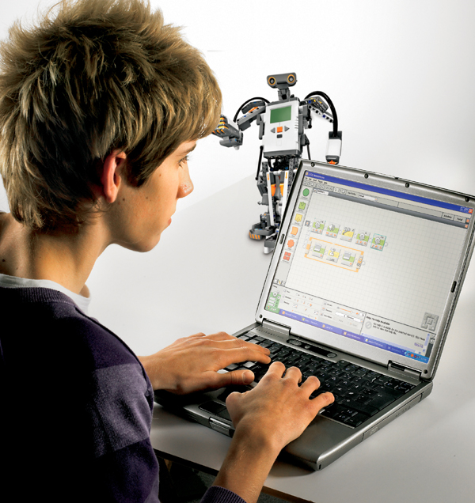
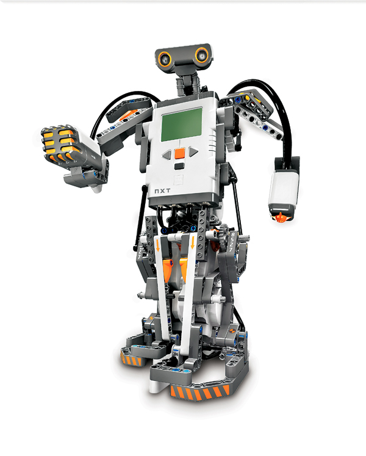
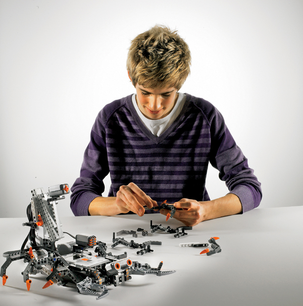

Ce nouveau système robotique s’appuie sur un environnement de programmation basé sur le système graphique de développement logiciel LabView de la société National Instruments, compatible PC et Mac. MindStorms NXT, annoncé lors du salon "Consumer Electronics TradeShow" de Las Vegas, sera disponible en août 2006.

Dans le même esprit que l’original MINDSTORMS Robotics Invention System, créé en 1998, la société LEGO utilise les nouvelles technologies telles qu’un processeur 32-bit, de nouveaux moteurs et détecteurs, une système de communication sans fil Bluetooth® et un outil de développement logiciel amélioré.

Les plus jeunes utilisateurs créeront facilement leurs programmes alors que les plus grands apprécieront d’écrire des programmes complexes pour leurs robots. Ce nouveau logiciel sera disponible aussi bien dans la version grand public que dans la version Education. (La version DACTA du logiciel actuel - ROBOLAB, déjà basé sur LabView - est différente de celle que vous avez pu acquérir avec votre kit RIS).

Comme le dit Søren Lund, directeur de LEGO MINDSTORMS, pour élargir la cible des plus jeunes aux plus expérimentés, il est important d’offrir un logiciel de développement au potentiel non limité. Le moteur de programmation LabView est à la fois simple d’emploi pour un enfant de 10 ans et technique pour susciter créativité et défi aux adultes.

Le NXT en lui même a grossièrement la même taille que le vieux RCX jaune, mais la similarité s’arrête là.

La couleur blanc cassé et quatre boutons de contrôle (gauche, droite, fonctions de menu "select" et "escape") donne au NXT l’apparence d’un iPod. Sept ports - trois sorties et quatre entrées - permettent de communiquer avec des déctecteurs et d’autres périphériques. Sur le vieux RCX, ces ports se situent sur la face avant, autour de l’écran LCD et sont couverts de tenons. Sur le NXT, les ports sont situés dessous et dessus et ressemblent à des connecteurs de téléphone RJ11 mais sont propriétaires (différents).

A côté des ports de sorties se trouve un prise USB 2.0, mais le NXT propose aussi une compatibilité BlueTooth.

En utilisant les boutons de contrôle, vous naviguez dans le menu du NXT qui s’avère plus maniable et procure plus d’options que l’affichage du RCX jaune.

Construit sur le succès de MindStorms, cette nouvelle version doit permettre de construire et programmer un robot en 30 minutes. Dans le même temps, les nouvelles technologies et des détecteurs aux capacités améliorées ajoutent un niveau de sophistication qui réjouira les créateurs expérimentés.

L’ajout d’une connexion Bluetooth permet de télécommander un robot par exemple par l’intermédiaire d’un téléphone portable ou d’un PDA.

Caracteristiques de MindStorms NXT :

**–** 3 servo moteurs (contrôle précis de l’angle de rotation)  
**–** Détecteur ultrason permettant au robot de "voir"  
**–** Détecteur de son  
**–** Détecteur de lumière (intensité lumineuse ET couleur)  
**–** Détecteur de contact  
**–** 519 pièces LEGO TECHNIC®

**–** Instructions de montage étape par étape pour 18 défis de construction (robots humanoïdes, mécanismes, animaux, véhicules).

**–** Toute une communauté sur [www.mindstorms.com](http://www.mindstorms.com/) pour des développement tiers.

LEGO MINDSTORMS NXT sera disponible à partir d’août (en magasin ou en ligne sur [LEGO.com](http://www.lego.com/)) pour un prix conseillé de 250 euros environ.
