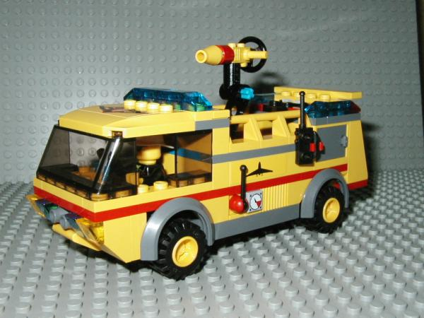
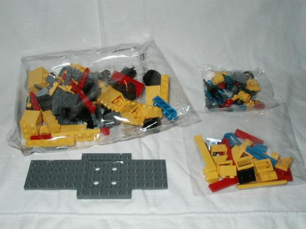
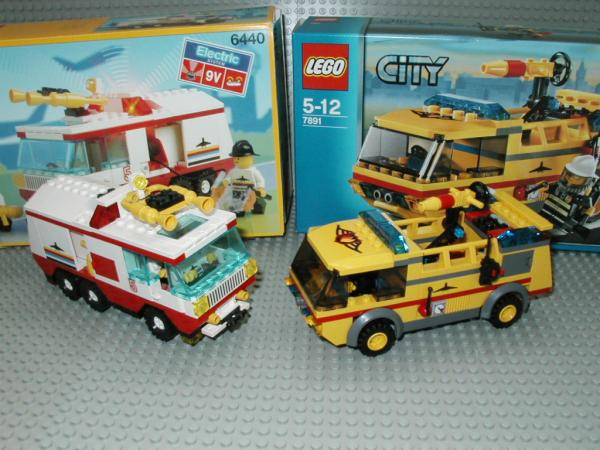
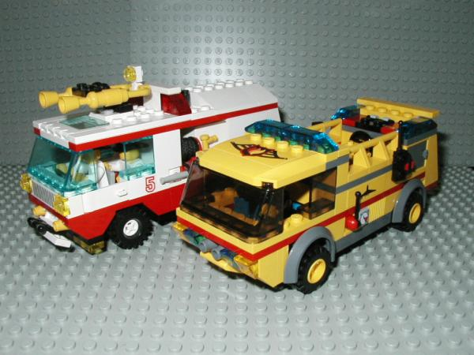
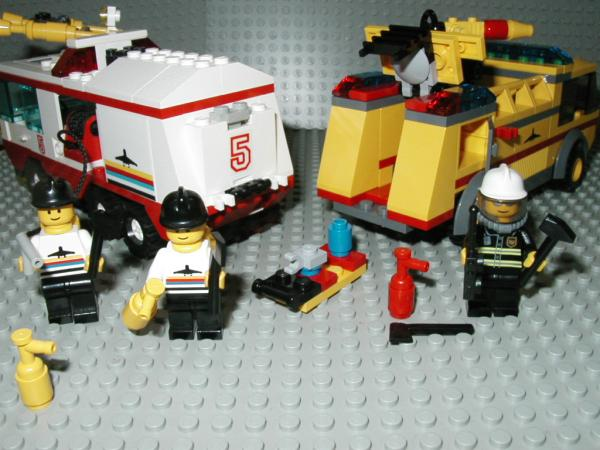
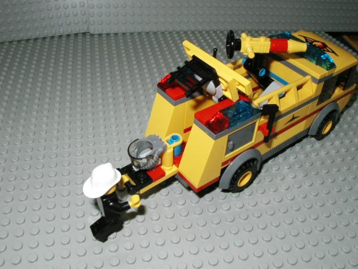

A la vue des premières images non officielles parues sur le Net en Octobre 2005, le camion pompier 7891 m’a aussitôt rappelé le set 6440. J’ai alors envisagé d’écrire un article comparatif dès que j’aurais le nouvel engin dans les mains. Chose promise, chose due, le set vient de sortir dans les magasins, et je ne peux donc m’empêcher de vous le présenter.

**Qu’il est beau le camion**

## Fiches techniques

Set [7891](http://guide.lugnet.com/set/7891)  
**–** Année : 2006  
**–** Nombre de pièces : 148  
**–** Prix : 12,99€

**3 sachets et le chassis**

Set [6440](http://guide.lugnet.com/set/6440)  
**–** Année : 1991  
**–** Nombre de pièces : 84  
**–** Prix (Lugnet) : 27,50$

De taille de boîte identique, la nouvelle version compte presque deux fois plus de pièces pour un prix deux fois moindre.

**Trouvez les 7 différences**

## Points communs

Sans conteste, le design des deux camions est très proche.  
De même largeur (6 tenons), de même longueur (18 tenons), les deux camions ont cette même cabine prolongée par deux panels, et se terminent tout deux par une pente avec les briques inclinées à 75°.

On retrouve également deux petits canons sur le nez du camion, cachés sur le 6440 par une plaque lisse amovible.

**15 ans les séparent**

Enfin, les autocollants reprennent l’écusson aux trois flammes, perpétuant une tradition presque trentenaire, et le symbole de l’aéroport LEGO quasi à l’identique des années 80.

Mais les ressemblances s’arrêtent à peu près là.

## Différences

La première différence, flagrante, est la couleur. Blanc et rouge pour l’ancien, le nouveau camion arbore un jaune, couleur plus fréquente pour ce genre de véhicules.

La seconde, est la disparition du système Son et Lumière. Dommage de ne plus avoir un camion pompier qui puisse rouler sirène hurlante et gyrophares allumés, mais cela contribue essentiellement à la différence de prix des deux sets. Le 7891 se rattrape avec quantité de pièces en bleu transparent.

Le 7891 ne dispose que d’une minifig contre deux pour son ainé. D’une façon générale, le 7891 semble moins bien équipé que son prédécesseur :  
**–** absence du tuyau, un comble pour un camion pompier ;  
**–** canon à eau simple contre un double équipé d’un projecteur ;  
**–** simple essieu à l’arrière contre un double, mais on gagne les jolis passages de roues.

Côté outillage, on retrouve à peu près la même chose : bouteilles à oxygène, haches, extincteurs...

**Equipements des camions**

L’équipement respiratoire du 7891 se range à l’arrière sur un petit chariot. Le canon à eau se rétracte à l’intérieur du camion. Mais où est donc passée la citerne ?

**Rangement de l’équipement**

## Conclusion

Au design moderne, collant à celui de la gamme actuelle, le 7891 reste néanmoins une belle réussite. Etant donné son prix, il serait dommage de s’en priver et de ne pas enrichir sa collection aéroportuaire et/ou pompière.
