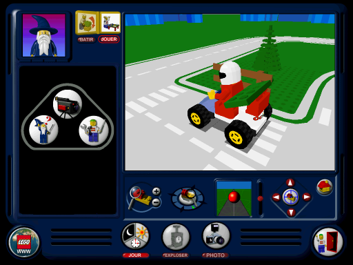
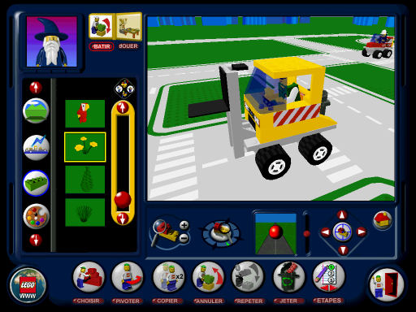
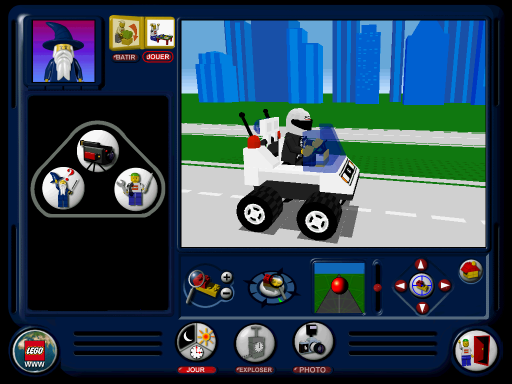
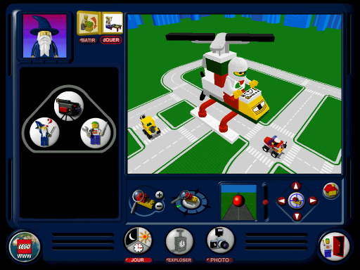
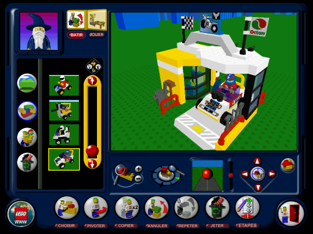
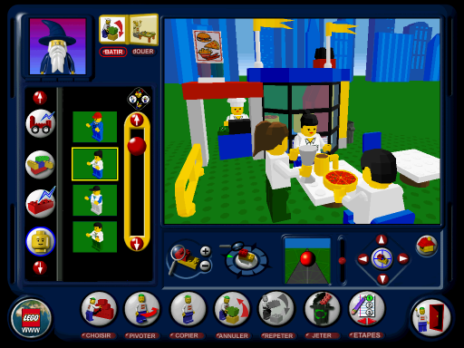

Sorti à une époque où jeu vidéo en 3D signifiait dégommer tout ce qui bouge à coup de décharges de chevrotine, ce jeu innovant avec lequel LEGO marquait son entrée dans l’univers vidéo-ludique n’a pourtant pas soulevé l’enthousiasme escompté.

La faute à la juniorisation. Et pourtant il faut bien reconnaître qu’assembler des briques à la souris c’est fastidieux et que les performances 3D en temps réel n’autorisent pas vraiment un grand nombre de briques, par conséquent il est injuste de rejeter la juniorisation car elle va dans le sens du jeu vidéo. La faute aussi au trop petit nombre de briques. C’est vrai que l’assortiment disponible est restreint et l’on regrette parfois l’absence des vieilles pièces qu’on pensait incontournables mais aussi des nouveautés City 1999 qui apporteraient un complément fort appréciable (notamment le toit vitré n°30343).

Mais là encore cette impression de départ est plutôt démentie par l’inventaire :  
**–** 261 briques génériques  
**–** 119 briques "transport" pour faire des véhicules  
**–** 28 pièces "action"

Soit un total de 408 briques, c’est petit mais c’est suffisant pour couvrir les besoins essentiels, surtout si l’on considère que l’on est de toute façon limité par les possibilités d’animation, donc pas la peine de pouvoir construire n’importe quoi si on ne peut pas l’animer.

En fait ce qui a manqué à LEGO Creator c’est davantage la volonté de jouer le jeu. Si l’on oublie ses préférences personnelles et ce que l’on construit habituellement pour laisser sa chance au jeu alors LEGO Creator offre des possibilités encore aujourd’hui inaccessibles à des outils bien plus complets comme la librairie LDraw et ses logiciels compatibles.

## Les véhicules

Au début on a l’impression irritante que l’on ne peut que reproduire les modèles pré-construits. Cette impression s’efface peu à peu alors que l’on crée de nouveaux véhicules. On a parfois quelques difficultés à placer le conducteur. On finit par créer des véhicules certes pas originaux mais tout de même inédits.

Quelques exemples :

**Kart**

**Chariot élévateur**

**Patrouille de police**

**Hélicoptère léger**

## Les bâtiments

On est davantage pénalisé que pour les véhicules (qui eux bénéficient des 119 briques "transport"), surtout par le manque de variété dans les fenêtres et les toitures. Après quelques tentatives infructueuses on parvient toutefois à quelques résultats présentables.

Deux exemples :

**Garage**

**Etablissement de restauration**

## Les manques

Hormis l’inventaire qu’on aimerait bien pouvoir étendre il y a quelques restrictions supplémentaires qui pèsent au bout de plusieurs utilisations.

Citons en vrac :  
**–** quand on est habitué à MLCad, seulement 4 briques visibles dans la palette de pièces ça passe pour une brimade  
**–** les véhicules qui collisionnent ont une fâcheuse tendance à repartir en marche arrière, on aimerait un système de circulation sans collision et qui tienne compte de la signalisation ainsi que la possibilité de traverser la route sur des passages piéton  
**–** pour pivoter 1/4 de tour dans le sens des aiguilles il faut cliquer 3 fois le bouton pivoter, un clic-droit ne ferait-il pas mieux l’affaire ?  
**–** la commande manuelle des voitures et des avions est ridiculement hyper-réactive au joypad  
**–** le chariot élévateur est incapable de soulever quoi que ce soit, il aurait été judicieux de lui adjoindre une palette à charger/décharger  
**–** on a tendance à ne pas mettre de personnages animés pour ne pas gêner la circulation, on regrette l’absence de vrais piétons qui suivraient la route et traverseraient en évitant les voitures  
**–** on aimerait pouvoir monter/descendre d’un véhicule ou avion  
**–** on est limité à 5 sons disponibles pour les personnages, dommage car on aimerait bien pouvoir rajouter des nouveaux sons au lieu de bêtement écraser les anciens

En jouant on se prend à imaginer de nouvelles fonctionnalités, par exemple on pourrait jouer en réseau et chatter, le texte apparaîtrait dans des bulles façon bande-dessinée, on pourrait sélectionner les créations des autres joueurs, sauvegarder celles qu’on aime et voter pour les meilleures.

## Conclusion

Malgré ses insuffisances LEGO Creator est un logiciel doué un peu ignoré, comme si l’on préférait ne rien faire à ne pas pouvoir tout faire. Il y avait pourtant là une mine d’or et l’occasion unique pour les adultes de faire des choses à partager avec les plus jeunes et qui leur montrent que l’imagination peu compenser le manque de briques, alors que le surplus de briques ne comble pas le manque d’imagination. Et du côté de LEGO Media International on a tout misé sur la construction en oubliant que le principal intérêt du jeu réside principalement dans ses capacités d’animation.

## Fiche technique

**–** Année de sortie : 1998  
**–** Nécessite : Windows 98, 500Mhz et 128Mo RAM recommandé  
**–** Prix : 350 francs  
**–** En bonus : le set 2584 "Bob le motard"  
**–** Site officiel : [la page de LEGO Interactive](http://www.lego.com/eng/interactive/product.asp?Title=Creator&Code=PC)  
**–** Produit : [la description sur Amazon](http://www.amazon.com/exec/obidos/tg/detail/-/B00002EPYL/002-8549963-5427226?v=glance&vi=reviews)  
**–** Bob le motard : [les photos sur BrickShelf](http://www.brickshelf.com/cgi-bin/gallery.cgi?f=167111)  
**–** L’inventaire : [toutes les pièces du jeu sur BrickShelf](http://www.brickshelf.com/cgi-bin/gallery.cgi?f=170577)  
**–** [Téléchargement des créations illustrées](http://perso.wanadoo.fr/alphablock/downloads/lego_cad.zip) dans cet article.
