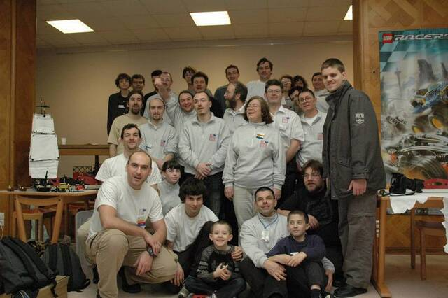
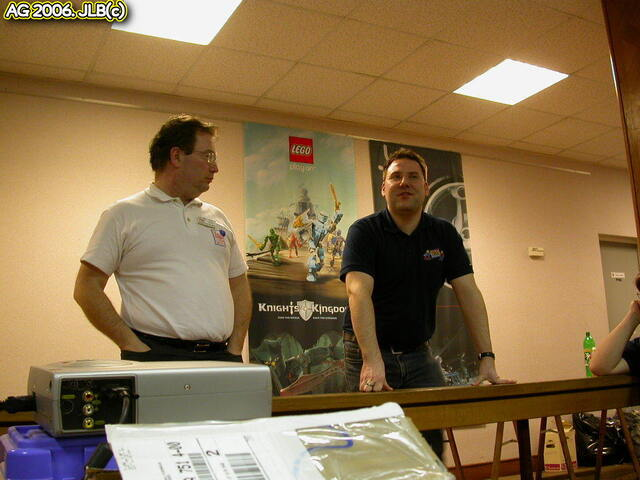
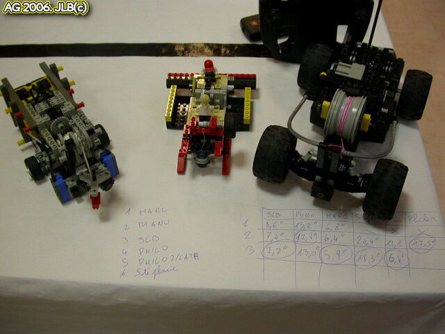

En paralèlle de l’assemblée générale qui s’est déroulée le samedi, le week-end du 18 et 19 Février 2006 a été l’occasion de se retrouver une fois de plus.

## Activités du week-end

**Photo de groupe !**

**Exposition privée**

Comme à l’accoutumer, nous étions nombreux à avoir amené MOCs et derniers modèles du commerce. Ainsi Philippe nous a montré son atelier ferroviaire animé et nous avons pu admirer le ferry de Jean-Marc. Citons également, en vrac, le portique de Rémi qui a pu soulevé l’un de ses 10 camions Ferrari, les voiliers de Pierre et Anthony, la micro-ville d’Eric, le pont en bois de Nicolas, le train-grue de l’autre Nicolas, la désormais incontournable fraiseuse de Richard, la ville de Pascal, les chalutiers de Mederik ou bien encore les mosaïques de nos héros de bandes dessinées de Denis.

Parmi les nouveautés LEGO apportées, nous avons pu découvrir le dernier avion ( en trois exemplaires ! ), l’aéroport, des Exo-Force et le chariot Technic 8283.

**Visite de Jan Beyer**

Jan Beyer, responsable LEGO de la communauté AFOLs, nous a rendu visite sur les deux jours. Il fut grandement acceuilli pour son premier séjour en France.

Il s’est prêté samedi en fin de journée à la traditionnelle session de questions/réponses, à laquelle n’échappent pas les représentants LEGO lors de rencontres AFOLs.

**Didier, en traducteur, et Jan Beyer**

Le compte rendu de cette session est disponible dans le [compte-rendu de l’assemblée générale](/articles/470/).

Jan nous a également apporté quelques surprises, qui ont fait le bonheur des chanceux lors de la tombola.

**Concours du puits**

Un concours de robots a eu lieu le dimanche, [Le concours du puits.](/articles/456/). Du robot autonome piloté par RCX à la voiture téléguidée, en passant par le RCX télécommandé, ce concours fut encore un bon moment de plaisir, surtout lorsque l’un d’entre eux chute dans le puit. Marc a réussi un tour de force en concourant avec un train !

Le classement final est le suivant :

| Nom | Essai 1 | Essai 2 | Essai 3 |
| --- | --- | --- | --- |
| [JLB](http://gallery2.freelug.org/main.php/v/JLB/AG2006/JLB-dscn6242.jpg.html) | 8,6" | 7,4" | **7,2"** |
| [Philo](http://gallery2.freelug.org/main.php/v/JLB/AG2006/JLB-dscn6240.jpg.html) | 13,2" | **12,8"** | 13,0" |
| [Marc](http://gallery2.freelug.org/main.php/v/JLB/AG2006/JLB-dscn6243.jpg.html) | 6,8" | 6,4" | **5,8"** |
| [Stéphane](http://gallery2.freelug.org/main.php/v/JLB/AG2006/JLB-dscn6239.jpg.html) | X | 20,4" | **18,3"** |
| Manu | X | 17,1" | **6,4"** |
| [Catherine](http://gallery2.freelug.org/main.php/v/JLB/AG2006/JLB-dscn6238.jpg.html) | X | **17,5"** | X |

**Quelques uns des robots**

**Tombola (le samedi)**

Comme convenu depuis des mois, les briques que l’association avait pu obtenir lors de l’animation à Deauville ont été distribuées sous forme de tombola. Chaque participant a pu repartir avec un gros sachet de briques. Les lots amenés par Jan Beyer ont été distribués au tirage au sort parmi les participants. Certains ont pu gagné l’une des deux grandes plaques de base transparentes, et Didier est reparti avec le dragster de Batman, boîte qui venait de sortir de l’usine LEGO la veille !

**Echange de briques**

Un autre moment programmé lors de cette assemblée était l’opération échange de briques qui a permis à ceux qui le souhaitaient (et dans la limite des disponibilité) d’échanger des vieilles briques usagées contre des briques neuves, également récupérées par l’association ( lot LEGOFestival et ILTCO ).

**Visite chez notre partenaire PicWic**

Et comme chaque année, le dimanche matin fût pour les lève-tôts l’occasion de dépenser ses sous dans le magasin PicWic de Sainte Geneviève, partenaire FreeLUG. Certains sont repartis avec des séries complètes (Exo-Force, mini Racers, City etc.). Il faut dire que les 15% de réduction et l’effet de groupe n’y sont pas étrangers :)

**Galeries**  
**–** [FreeLUG](http://gallery2.freelug.org/main.php/v/FreeLUG/Evennements/AG_18022006/)  
**–** [JLB](http://gallery2.freelug.org/main.php/v/JLB/AG2006/)  
**–** [Legnome](http://www.brickshelf.com/cgi-bin/gallery.cgi?f=170084)  
**–** [f1tvf](http://www.brickshelf.com/cgi-bin/gallery.cgi?f=169538)
