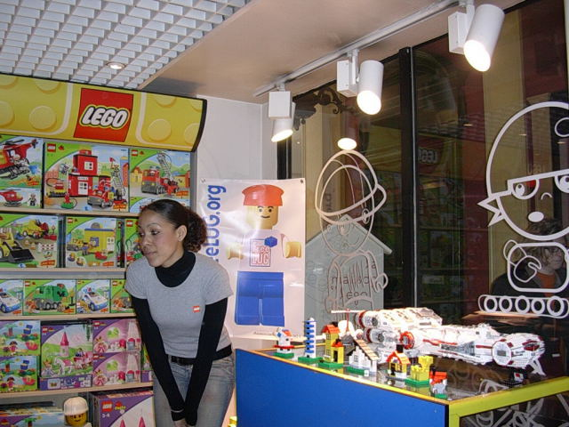
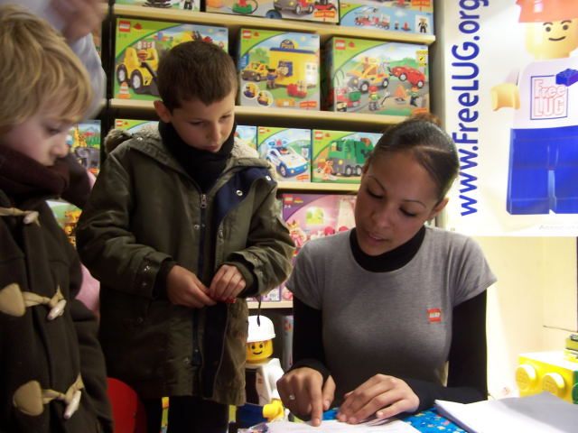
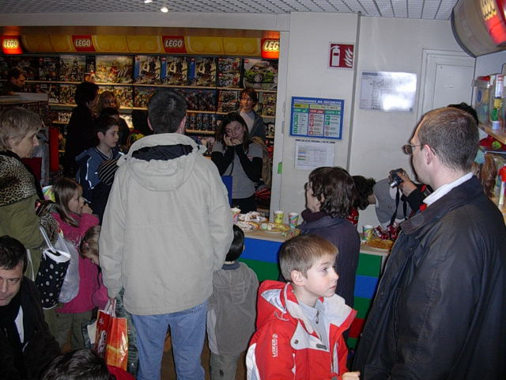

En ce mois de Février 2006, nous nous sommes donc retrouvés le samedi 25 février après midi avec l’équipe de la boutique LEGO® pour participer à la promotion de la nouvelle gamme Exo-Force.

La boutique LEGO® du village JouéClub, Boulevard des Italiens à Paris est depuis de longue date un partenaire de FreeLUG.

Il présente la particularité d’être sous la responsabilité directe de LEGO France et d’être à ce titre un point de vente prioritaire pour les sorties des nouvelles gammes.

Depuis que nous avons fait connaissance avec Ingrid, la responsable de ce point de vente, nous avons pu tisser des liens privilégiés, qui prennent de plus en plus d’importance à la lumière de l’intérêt que la société LEGO commence à porter à la communauté AFOL et j’ai été à ce titre particulièrement heureux de pouvoir répondre à cette solicitation.

La société LEGO entretient également des relations avec des écoles de commerce et permet régulièrement à des stagiaires de se mettre en situation, soit sur les points de vente ou bien dans les différents services d’accueil consommateur.

C’est dans ce contexte, que Myriam, stagiaire à la boutique d’Ingrid, a eu pour mission d’organiser cette animation.

**Myriam**

On peut dire que Myriam a bien fait les choses puisqu’une quarantaine d’enfants ont pu participer à cette animation.

Les enfants devaient donc parcourir les autres boutiques afin de trouver des indices leur permettant de découvrir les mots de la phrase mystère.

**Contrôle de la phrase mystère !**

Tous les participants repartaient ensuite avec un petit cadeau.

En parallèle, un tirage au sort était organisé en soirée, pour permettre de distribuer 10 lots supplémentaires , tous issus de la nouvelle gamme [Exo-force](/articles/473/) que Manu a commencé à nous présenter.

**Remise des prix**

Un sympathique petit goûter était à disposition des enfants et des parents et tout le monde a été ravi de participer.

Tout a été parfaitement maîtrisé par l’équipe de la boutique et le rôle de FreeLUG a vraiment été des plus simple à assurer.

Je remercie donc Ingrid, Myriam et Sandrina pour leur accueil à la boutique et nous souhaitons bonne chance à toute l’équipe pour la suite de leur carrière, sachant qu’elles pourront de nouveau compter sur nous pour de prochaines animations.
