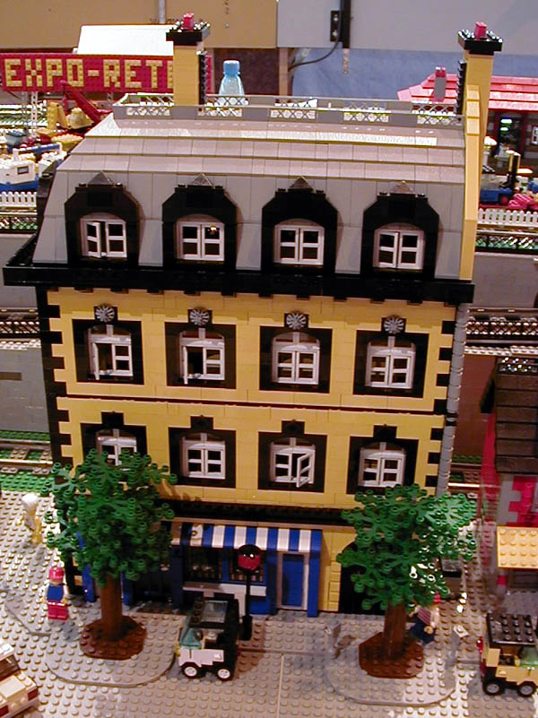
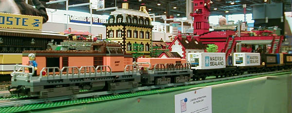
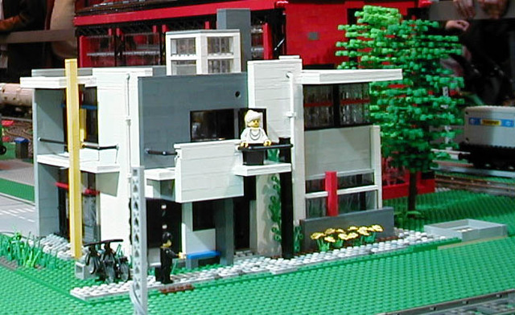
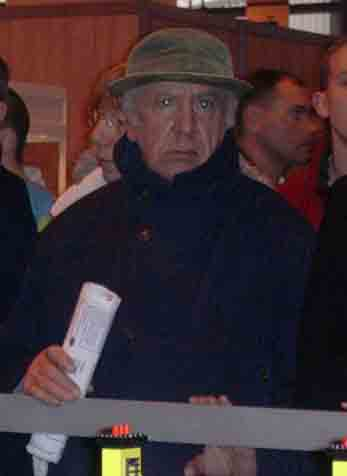
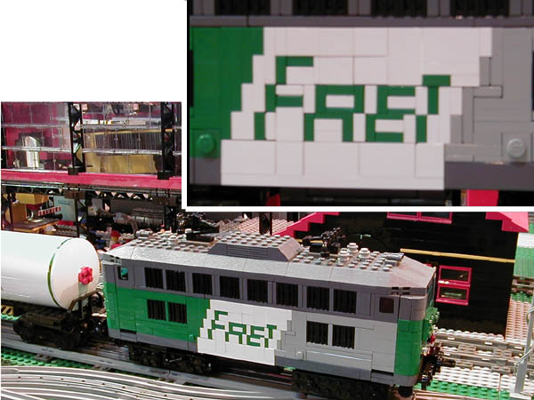
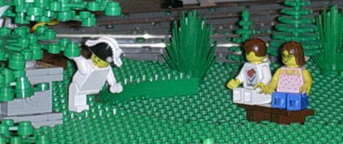
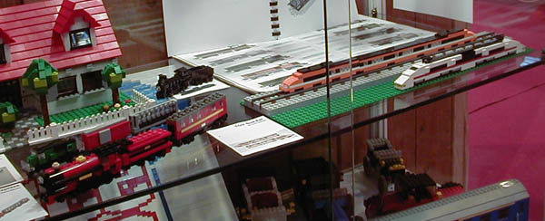
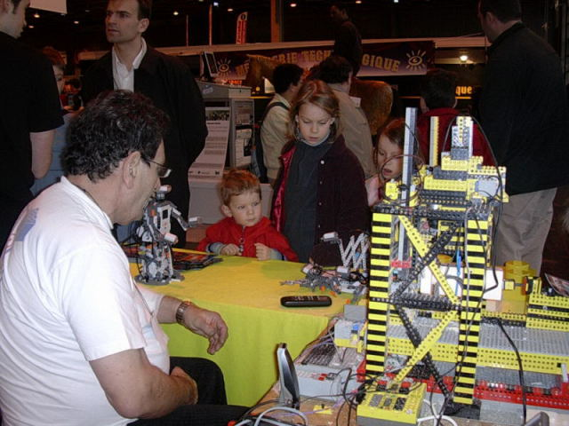

Cette année encore, en collaboration avec la FFMF, FreeLUG était présent au salon International du Modélisme de Paris, Porte de Versailles.

...et encore une fois le succès public fut au rendez-vous.

Les nombreux membres qui participaient à l’appel de Didier Malon, coordinateur de l’exposition FreeLUG, n’ont pas chômé pour répondre aux nombreuses questions des spectateurs qui n’en revenaient pas de voir un réseau de "trains LEGO©" s’étalant sur 16m².

Il est vrai qu’au milieu des réseaux traditionnels HO ou N peut-être un peu austères pour les plus jeunes, notre réseau "en LEGO", coloré, attirait l’oeil des enfants. Les plus grands aussi étaient très curieux et n’étaient pas avares de commentaires et de félicitations.

**Immeuble d’Eric - Eric’s building**

Outre le réseau "9V" parcouru par un Hogwart Express et un TGV Réseau fort apprécié des enfants, un réseau "12V" automatisé (feux, aiguillages) laissait admirer une BB63000 en tête d’un train de fret.

**BB63000 de Pascal - Pascal’s BB63000**

Parmi les exposants, bien sûr les membres français étaient les plus nombreux mais nos amis Belges et Néerlandais avaient fait le déplacement pour notre plus grand plaisir. Ils sont bien sûr venus avec leurs créations, notamment architecturales, d’un réalisme étonnant.

**Maison Schröder-Schräder, par Jan Albert - Schröder-Schräder House, by Jan**

La première surprise sur ce salon, avant même que notre installation se mette en place a été un appel d’un journaliste de France 2 qui a manifesté le désir de faire un reportage sur notre exposition.

Rendez-vous a été pris pour le jour de l’installation et l’équipe qui devait à l’origine passer la matinée avec nous, est restée la journée entière sur le stand à discuter et à prendre à la volée quelques images de nos préparatifs, car bien que présents depuis 9h00 du matin, nous n’avons pu démarrer l’installation que vers 17h00, faute de tables... Il a fallu effectuer plusieurs démarches auprès des services de l’organisation pour que le nombre suffisant de tables soit enfin mis à notre disposition.

La seconde surprise a été de remarquer que nos amis de la FFMF avaient positionné notre stand au coeur de leur exposition. Nous étions entre voisins à coté des clubs de modélisme ferroviaire de Morsang-sur-Orge et d’Arpajon. Notre position stratégique drainait un large public familial qui passait un bon moment à relever tous les détails présents sur notre diorama.

L’équipe de France 2 [^1] est repassée le matin du premier jour pour prendre quelques réactions du public, réactions toujours positives. J’ai noté une petite scène d’hystérie d’un petit garçon qui ne voulait pas s’en aller parce que "c’était trop bien !", mais surtout beaucoup d’intérêt de la part d’adultes qui nous posaient énormément de questions sur nos approvisionnements de briques, les temps passés à la réalisation, les références des modèles exposés et l’existence des notices.

Le lendemain du [reportage télé](http://gallery.freelug.org/main.php/v/Gyclore/Mondial+de+la+maquette+2006.wmv.html), nous avons même reçu un passionné de 70 ans, qui fait du LEGO depuis 40 ans et qui a découvert avec une joie non dissimulée, qu’il n’était pas un cas unique !

**70 ans dont 40 à faire des LEGO - 70 years old, within 30 years playing LEGO**

Les jours suivants nous avons rencontré plusieurs visiteurs qui nous ont avoué avoir fait le déplacement rien que pour venir nous rendre visite.

Devant un tel retour on ne peut qu’être heureux d’avoir fait tous les efforts et sacrifices nécessaires à la mise en place de cette exposition.

Nos amis Néerlandais Casper et Jan Albert ont été vraiment supers par leur présence et la qualité de leur contribution. Ils ont pu profiter de leur passage pour faire un peu de tourisme, ce qui a ajouté du plaisir à l’agréable.

De Belgique, Vincent, Jean et sa petite famille ont apporté également une belle contribution à notre exposition. J’ai le sentiment qu’il est plus facile de construire l’Europe avec des briques LEGO qu’en suivant les exemples de nos politiciens.

Quand Pascal disait "le 12 tu sors", je ne crois pas qu’il faisait référence à la tension de son réseau, qui a encore une fois ravi le public et qui nous a donné l’occasion de présenter l’évolution du train LEGO en insistant sur les derniers développements concernant les rails en plastiques.  
Eric y faisait d’ailleurs une petite allusion, ce qui laissait l’ami Gilles de glace, trop occupé à gérer sa patinoire.

Le degré de réalisme atteint par l’autre Erik (un k à part) [^2], nous a valu également l’intérêt des journalistes de Loco Revue et nous a permis également de présenter à nos amis exposants les subtilités de nos techniques de construction.

**BB25500 en livrée Fret d’Erik - Freight BB25500 designed by Erik**

Quant à la caserne de pompiers de Loys, elle fait secrètement rêver certains commerciaux de LEGO qui aimeraient bien l’avoir à leur catalogue.

Le plateau réalisé par Denis, qui bien qu’absent sur le stand avait tenu à être de la fête apportait un peu d’espace à la vision d’ensemble et servait de cadre à l’exposition rétro des modèles de collection apportés par Jean, avec en point d’orgue le magnifique Pavillon d’Amour réalisé par Casper, signé comme il se doit avec son petit fou en cavale et portant cette année une dédicace spéciale destinée à sa girlfriend Barbara, restée au pays.

**Casper et Barbara**

Jan Albert et Vincent nous ont régalés avec leurs trains et Didier nous a apporté quelques mini-réalisations [^3] qui ont montrées que l’imagination n’était pas une question de quantité de briques.

**Trains miniatures - Micro scale trains**

Enfin, cerise sur le gâteau, nous n’étions pas qu’entre grands enfants à faire tourner nos petits trains, car d’autres fana (avec un N et non un D) de la brique étaient présents dans l’espace robotique, où Richard, alias Vauban présentait en avant première, en compagnie des représentants de LEGO France, le nouveau Mindstorm® NXT qui ne sortira qu’au mois d’Octobre.

**Grogneuneu IV et Dremel II - Richard’s drilling table**

Et puis Pascal, trouvant qu’on ne voyait pas assez les LEGO sur le salon a soudoyé avec l’aide de Médérik les représentants de la fédération de modélisme naval pour aller faire faire quelques ronds dans l’eau à son nouveau bateau LEGO.  
(Il n’a pas coulé !! Mais c’était limite...)

Il pense déjà à organiser l’année prochaine une course de Racer en attendant un éventuel MOC volant !!!

## Quelques impressions des participants

_Impressions de frogleap._ Une exposition très sympathique à tous points de vue. Les participants et participantes toujours avec le sourire, c’est vrai qu’on en profite bien de ces expositions pour jouer ensemble au LEGO et tellement mieux que ce qu’on pourrait rêver pour chez soi. Le public avec des compliments et de l’admiration devant les constructions, qui font plaisir à entendre. L’organisation de la FFMF qui nous facilite bien la vie pendant les jours d’exposition avec la popote et les repas en commun. Bref, une belle expérience et beaucoup d’amusement. Heureusement que Didier Malon était là pour assurer tous les détails. Merci Didier ! Vivement la prochaine édition.

_Impressions de Chimere._ Comme à chaque fois, c’est le plaisir des enfants qui a fait la réussite de cette exposition. Bien sûr, Didier avait organisé cela d’une main de maître. Coté LEGO, je pense que la série des 7 locomotives "SNCF" était du plus bel effet, même aux yeux des modélistes qui nous entouraient. Et les batiments animés, y a pas à dire, c’est vraiment top !!! Rendez vous à la prochaine exposition...

_Impressions du Gnome._ J’étais impatient de me rendre à cette exposition, et je pensais que les 5 jours seraient peut-être un peu longs, mais finalement, je ne les ai pas vus passer... Un grand chapeau à Didier (Qdm) pour l’organisation, et un grand merci à lui pour le sacrifice de son bâtiment ( même pas le temps de dire ouf ! qu’il était déjà rasé... ) Le seul couac de notre réseau, un bâtiment et une maison hantée sur le même emplacement, faute de concertation, mais que Didier se rassure, c’était sa dernière apparition. Elle sera prochainement démontée, puis complètement refaite, car des problèmes techniques à 10 minutes de l’ouverture du salon ont rendu les portes d’entrée inutilisables. Une exposition vraiment superbe, et une ambiance plus que sympa ! Quand à Richard, sa démonstration de fraiseuse 3D tout en LEGO, a été superbe... La seule panne, venait de sa Dremel, qui a lâché, mais les LEGO, eux, ont tenu le coup, preuve de la fiabilité de sa mécanique. Bravo à lui !

**–** [La galerie de qdm](http://photos.freelug.org/main.php/v/La-Gallerie-de-qdm/Mondial-2006/Exposition/)  
**–** [La galerie de 6studs](http://www.brickshelf.com/cgi-bin/gallery.cgi?f=179064)  
**–** [La galerie de frogleap](http://photos.freelug.org/main.php/v/Frogleap/ExpositionsLego/2006-Paris-15-16-17-Avril/)  
**–** [La galerie de f1tvf](http://www.brickshelf.com/cgi-bin/gallery.cgi?f=179476)  
**–** [La galerie de Chimere](http://www.brickshelf.com/cgi-bin/gallery.cgi?f=179453)  
**–** [La galerie du Gnome](http://www.brickshelf.com/cgi-bin/gallery.cgi?f=179485)

[^1]: Composée de Laurent Hirsch (interview), Mathieu Dreujou (image), Emmanuel Rassat (son) et Bernard Gazet (montage)

[^2]: Nos lecteurs les plus assidus auront noté une baisse de forme de Didier qui nous gratifie dans cet article d’un unique jeu de mot...ou peut être suis-je encore plus fatigué que lui 8-)

[^3]: par Jason Allemann, Tony Hafner, Kecia Hansen et Paul Jansen
