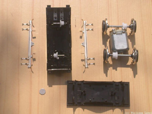
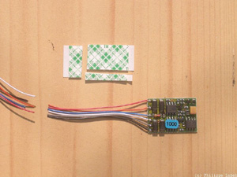
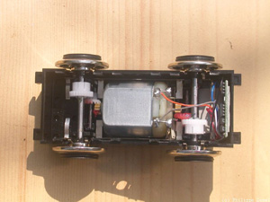
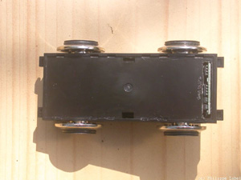

Comment intégrer un module DCC Lenz LE1000 dans un moteur 9V LEGO.

Le [DCC](http://train.modele.free.fr/index1.htm?page=digital0.htm) (pour Digital Command Control) est une technique de pilotage de trains miniatures de plus en plus répandue dans le monde des modélistes. Il permet de piloter plusieurs locomotives sur le même rail et offre aussi la télécommande de fonctions sur la locomotive y compris à l’arrêt.

Le module [LE1000](http://www.lenz.com/manuals/decoders/le1000.pdf) de chez Lenz est très dépouillé, il délivre seulement jusqu’à 1A au moteur et offre une seule alimentation éclairage jusqu’à 100mA. C’est pourquoi c’est le décodeur le moins cher du marché. Ces fonctions correspondent parfaitement aux besoins du moteur LEGO qui est équipé d’un moteur consommant moins de 1A en charge et avec une seule prise pour accessoires sur le dessus du moteur, qu’on utilise le plus souvent pour ajouter de l’éclairage à la locomotive.

Après quelques essais, et pour vous mettre l’eau à la bouche, je vous propose en quelques photos de voir comment on peut assez facilement intégrer ce module DCC dans le moteur 9V LEGO.

Tout d’abord il faut ouvrir le moteur 9V LEGO.

Puis après avoir préparé le module LE1000.

Il faut l’installer dans le moteur 9V...

...qu’on aura un peu ajouré pour faire de la place.

Les [explications complètes](https://chezfilou.pagesperso-orange.fr/montages-lego/Moteur9V_DCC/MoteurDCC.html) sont aussi disponibles pour ceux qui auront envie de franchir le pas.

En tous cas, dès qu’on commence à jouer au train en DCC on ne peut plus s’en passer tant les possibilités sont nombreuses. Pensez seulement aux éclairages pleine puissance de la locomotive à l’arrêt, mais aussi aux vitesses très lentes à pleine puissance et aux manœuvres sans perturber la circulation générale.

Le module installé, il faut utiliser la centrale de pilotage DCC pour programmer le moteur. Essentiellement, il faut lui attribuer un numéro d’adresse et dans le cas particulier du matériel LEGO en 9V, pensez à régler la tension de sortie de la prise accessoires à 9V, sinon elle délivre du 16V en standard ce qui est trop pour nos petites lampes. Ces détails seront développés dans un prochain article.

Jouez bien !

Philippe "frogleap" Label
