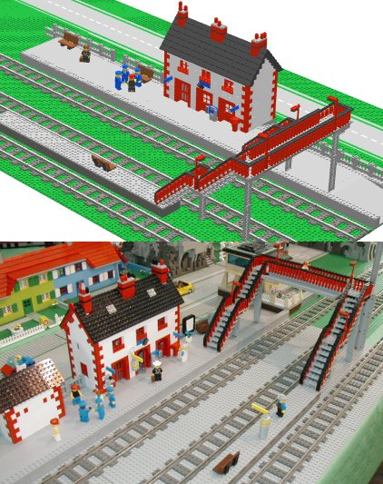
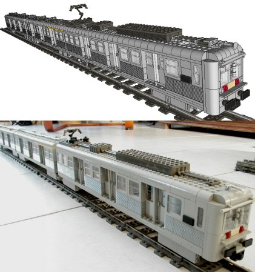
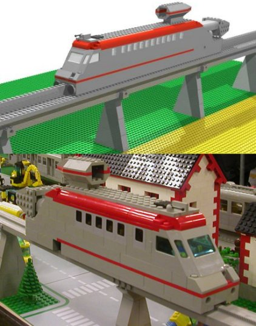
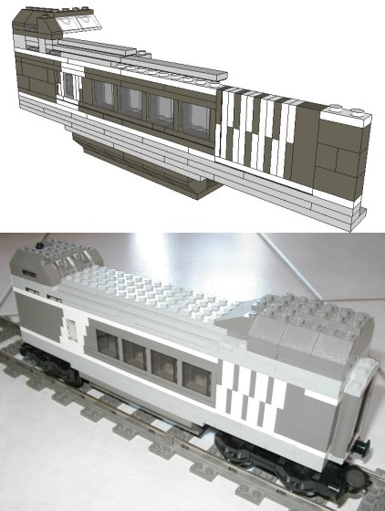
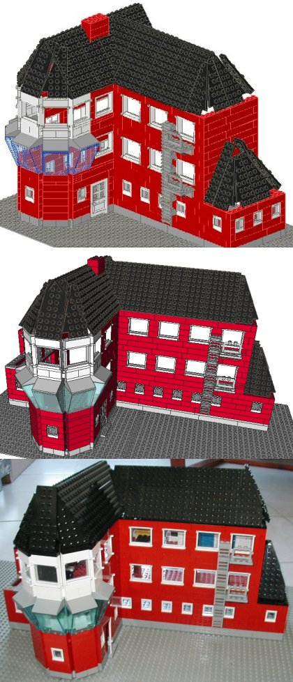
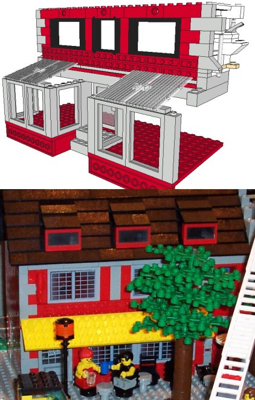

Cela fait plus de deux ans que je conçois de façon quasi-exclusive mes MOCs sur MLCad avant de les construire. Pourquoi, comment, je vais tenter de répondre à ces interrogations sur cette démarche un peu particulière.

**Avertissement :** Cet article n’est en aucun cas un tutorial de MLCad. Je vous renvoie aux articles de la [rubrique CAD](/rubriques/44/) de FreeLUG.

## MLCad, un outil fabuleux quand on n’a pas les briques sous la main

MLCad [^1] me servait initialement à réaliser un modèle déjà construit, ceci afin d’en obtenir une notice ou bien d’en garder une trace. C’est, je pense, un emploi courant de MLCad.

Lors des mes études, je me suis retrouvé dans un studio de 20m², à 500km de mes LEGO. Pour assouvir ma passion pour les briques LEGO, je me suis orienté vers MLCad. Cela me permettait de continuer à construire, virtuellement bien sûr. Puis est venu le temps de préparer des expositions, notamment celle d’Orléans 2004. J’ai alors réalisé mes MOCs ( petite gare de banlieue parisienne et rame Z6300, qui desservait ces mêmes gares ) sur MLCad. Les plans conçus, quand je revenais chez mes parents pour les vacances, il me restait plus qu’à construire le MOC.

Aujourd’hui de nouveau avec mes briques, on pourrait se dire qu’il n’est plus nécessaire de passer par MLCad pour concevoir. Et pourtant... La difficulté à laquelle je dois faire face actuellement est celui de la place. Qui d’entre nous n’a jamais eu un soucis de place pour ses LEGO... Mon stock ayant grandement augmenté ces dernières années ( bizarrement, depuis l’existence de FreeLUG :) ), mes capacités de tri arrivent à saturation, et accéder à ma caisse de slopes par exemple est un vrai jeu de taquin.

Résultat, je met plus de temps à chercher une pièce qu’à construire un [ISD](http://guide.lugnet.com/set/10030) (bon, j’exagère un peu...). Alors qu’avec MLCad, toutes les pièces sont à portée de main. Il m’est donc plus aisé de concevoir le MOC sur ordinateur que de chercher de façon éparse les briques nécessaires lors de la construction.

## Les objectifs de la modélisation avant construction

Même avec un rangement performant et un tri efficace, je continuerais de concevoir sur MLCad. On y prend goût et surtout, cela apporte quelques bons supports.

Support, oui, car l’usage que j’en fait n’est pas une modélisation parfaite et finie du MOC. C’est un support, souvent dans un état avancé, du MOC.

**Obtenir un aperçu général du MOC**

Mon objectif principal est d’obtenir un résultat visuellement proche de ce que je souhaite avoir en briques réelles. J’obtiens une bonne idée de la taille, des proportions, mais également de la quantité de pièces nécessaires. J’évite ainsi de me lancer dans un projet et de construire pendant plusieurs jours pour tomber sur une construction disproportionnée ou manquer crucialement de briques.

**Disponibilité des pièces**

Nous n’avons pas toujours les pièces nécessaires pour la construction du MOC. La modélisation permet de s’affranchir de cette limite, que ce soit pour les quantités, ou bien pour les couleurs. On peut ainsi obtenir un aperçu dans les couleurs souhaitées d’une création, valider le schéma de couleurs et alors se procurer les pièces manquantes. Attention de ne pas tomber dans le piège d’utiliser des pièces maitresses qui n’existeraient pas dans la couleur voulue...

**Valider certains points de montage...**

Lorsque les MOCs se complexifient, avec par exemple un usage intensif de SNOT, la modélisation permet de réaliser de nombreux essais pour s’assurer du bon respect du ratio 5:2 propre au SNOT.

**... mais qui n’empêche pas l’usage de vraies briques**

L’usage de MLCad ne se substitue pas à celui de l’emploi de briques. Il est parfois nécessaire de vérifier que certains assemblages sont effectivement réalisables avec de vraies briques.

**Un pas vers la notice...**

Le fait de réaliser, même partiellement, le MOC sur MLCad nous rapproche plus facilement de la réalisation de la notice une fois le modèle construit et fini, au plus grand plaisir de ceux qui aimeraient se refaire le MOC.

**... et un autre vers la liste des pièces nécessaires**

Quand la modélisation est bien avancée, et qu’on se décide à passer à la construction, il suffit alors de relever la liste des pièces nécessaires à aller chercher dans son stock (ou à commander). Et j’y gagne beaucoup de temps.

## Quelques exemples

Je montre ici quelques exemples entre le dernier état de la modélisation MLCad avant construction, et le MOC construit.

Très souvent, le MOC diffère du rendu. En effet, lors de la construction, de nouvelles idées peuvent germer, des difficultés peuvent apparaitre, des optimisations se faire etc. La modélisation reste pour moi avant tout un guide visuel, même si elle tend à devenir un moyen de dresser la liste exhaustive des pièces nécessaires.

**Gare de banlieue**

Réalisée pour l’exposition d’Orléans 2004, je me suis basé sur la gare de Juziers, en région parisienne. MLCad m’a permis de représenter l’espace que j’avais à disposition pour l’exposition et ainsi de définir le plan d’occupation.

Entre les deux, on note entre autre la différence du toit. Initialement, c’était dû à un manque de slopes noires. Mais le résultat final est bien meilleur, car il m’a permis d’apporter quelques détails supplémentaires et du réalisme.

**Automotrice Z6300**

Rame pas excessivement complexe, la modélisation m’a surtout permis de valider la quantité des briques 1x2 grill et des 2x3 arrondies nécessaires, que j’ai pu puiser dans [mes voitures Santa-Fe](http://guide.lugnet.com/set/?q=10022%2C10025).

**Aérotrain I80HV**

Egalement pour l’exposition d’Orléans, j’avais prévu la reproduction de cet engin qui appartient à l’histoire orléannaise. Entre les deux, la longueur est réduite, et le support (rails tout en briques) est remplacé par du monorail.

**Voiture de mesure Mélusine**

Voiture de mesure et de contrôle qui s’insère dans une rame de TGV, cette Mélusine est basée sur le design du TGV de Xavier. Ici seul un côté a été modélisé, pour me fournir un support à la construction.

**Gare de triage, dépôt d’Achères**

Ce bâtiment, reproduction de la gare de triage du dépôt d’Achères (Yvelines) a été grandement conçu sur MLCad. On peut noter l’évolution de la taille entre les différentes versions. La version CAD ne possède aucun aménagement intérieur contrairement à la version en briques.

**Café de la gare**

Parfois, la modélisation ne permet pas d’aboutir à un résultat correct dans la réalité.

Cette version CAD n’a plus grand chose à voir avec la version en briques.

## Conclusion

Technique que je repoussais au début ( "Rien n’est mieux que d’avoir les briques dans les mains"), c’est aujourd’hui pour moi un passage obligé avant toute construction. C’est un prototypage virtuel de la construction, qui me permet de valider de nombreux points essentiels. Avec une notice partielle et les briques nécessaires réunies, le montage du modèle final s’en trouve facilité.

[^1]: Je cite dans cet article MLCad car c’est l’outil que j’utilise. Bien sûr, tout ceci reste vrai avec d’autres outils comme LeoCad.
