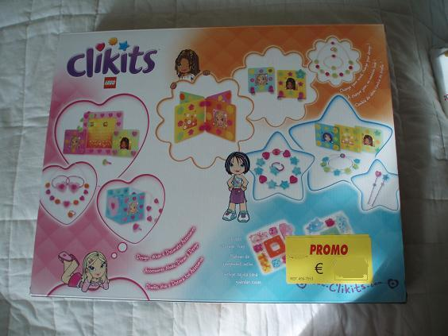
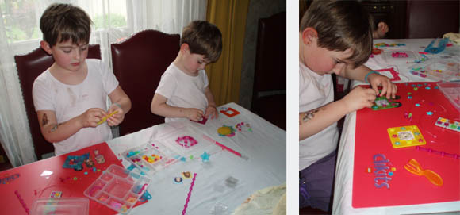
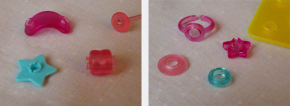
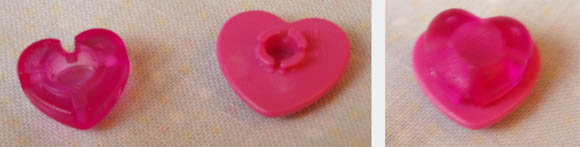
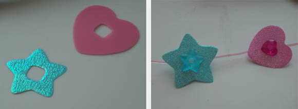
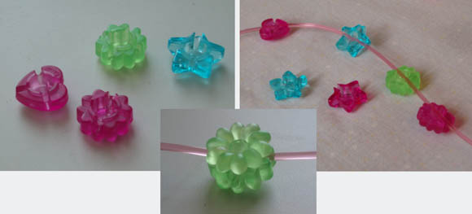
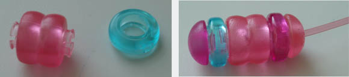
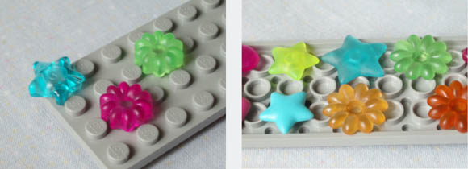

« Clikits » est une des gammes LEGO®. Elle est peu connue. Plusieurs raisons à cela.

D’abord, cette gamme est vendue en exclusivité sur le [ShopAtHome](http://shop.lego.com/), le magasin en ligne de la société LEGO. On arrive quand même à en trouver dans les points de vente de l’enseigne Maxi Toys.

Ensuite cette gamme n’a été lancée qu’en 2003. Nous avions d’ailleurs profité lors de son lancement au LEGOWORLD 2003 d’[échantillons gratuits](http://guide.lugnet.com/set/1385).

Enfin c’est un produit destinée aux filles. Il s’agit plus d’accesoires de mode que d’un jeu de construction.

Le fan adulte n’apprécie donc pas ce produit. Comme nous venons de le voir, la notion de construction qui lui est chère est réduite à sa plus simple expression, les couleurs des pièces sont des teintes pastels (roses, vert d’eau, tilleul...) souvent translucides qui sont bien loin de celles qu’il recherche - couleurs dark (foncées), sand (délavées) ou neutres (gris et noir, tan...) - les décorations sont plus romantiques que réalistes, enfin la gamme de tarif de ce produit est dans la fourchette haute.

Malheureusement cette analyse conduit à un corrolaire : le produit n’a pas rencontré son public (en clair il n’a pas été commercialement couronné de succès). La conséquence est que la gamme ne sera pas renouvelée en 2007. C’est dommage car nous ne sommes pas tous des fans adultes et certaines petites filles raffolent de ces Clikits. Cependant vous trouverez maintenant des sets Clikits en promotion (notamment si vous surveillez la section « Sales and Deals » du site de vente en ligne).

C’est donc pour nous le moment ou jamais de vous présenter cette gamme.

Lugnet nous indique que cette gamme aura comporté [environ 80 sets](http://guide.lugnet.com/set/?qc=lego/clikits). Ils se composent d’accessoires de modes destinés aux petites filles (la société LEGO précise à partir de 6 ans) : barrettes, bagues, attache cheveux, sacs, cadres photos, colliers et bracelets. Ces accessoires sont personnalisables à l’aide de petits éléments clipsables (fleurs, coeurs, étoiles...) et c’est en fait là qu’on trouve une notion résiduelle de montage.

Le système de connexion entre pièces est différents des tenons et tubes classiques que nous connaissons bien, mais il lui reste similaire. Nous verrons d’ailleurs plus loin qu’il lui est compatible. Concrètement, il est semblable aux boutons « pression ».

**Connecteur type mâle et femelle.**

Les boutons décoratifs (fleurs, coeurs, étoiles...), cadres, bagues,etc - qui portent ces connecteurs se clipsent les uns sur les autres.

La connexion est assez lâche pour permettre d’intercaler des éléments de faibles épaisseurs, comme ces feuilles aux formes décoratives percées en leur centre, les laissant libre en rotation.

Les boutons décoratifs portant des connecteurs type femelle sont généralement épais et traversés de canaux qui permettent de clipser les boutons sur des cordelettes (colliers, bracelets, liens divers).

D’autres éléments qui comportent des connecteurs sur les deux faces permettent des emboitements multiples.

Malgré les différences de système de connexion, la compatibilité avec les pièces LEGO « classiques » existe bel et bien. Les connecteurs type femelle s’emboitent parfaitement bien sur les tenons alors que les connecteurs type mâle se fixent dans ou entre les tubes.

Cette compatibilité nous permet d’imaginer que les éléments Clikits puissent être utiles pour agrémenter des maquettes de manèges, de magasins de bonbons, des scenettes de réceptions festives (mariage) ou même inspirer des paysages de planètes extra-terrestres à la flore exhubérante.

Voilà pour ce court exposé sur les Clikits, maintenant c’est à vous de jouer !
