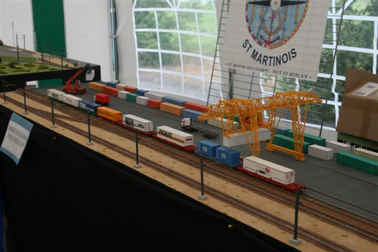
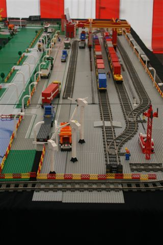
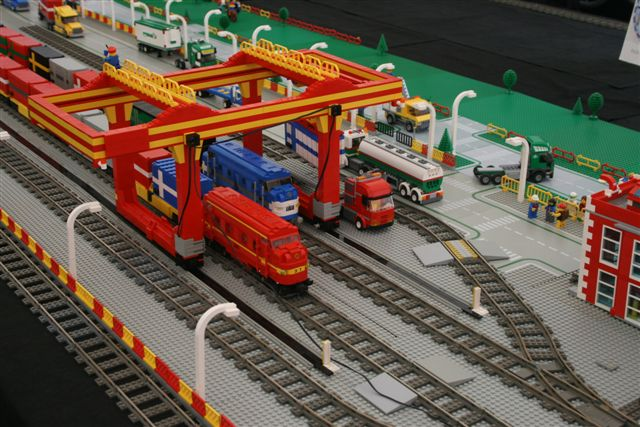
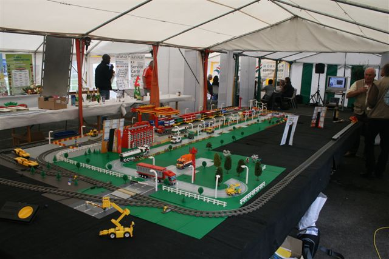
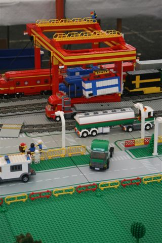
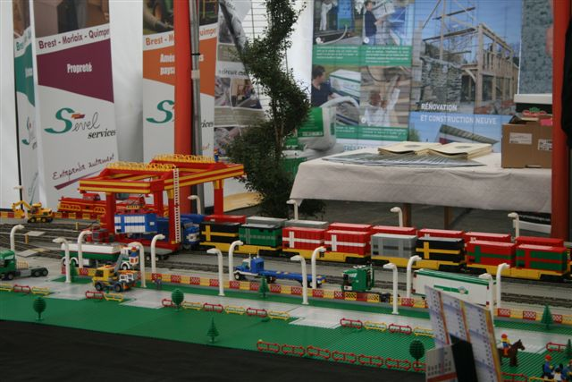
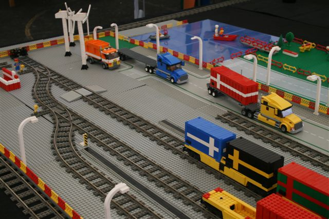
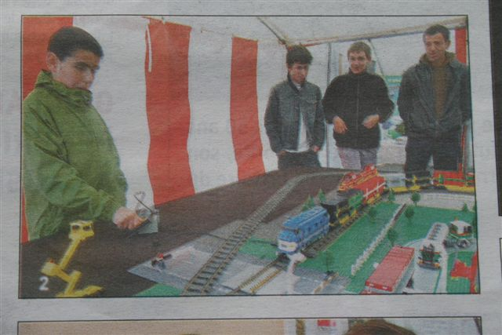
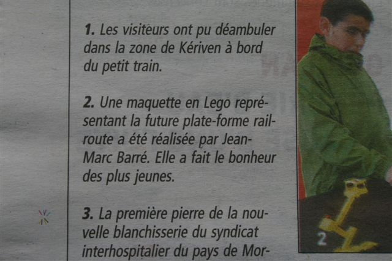
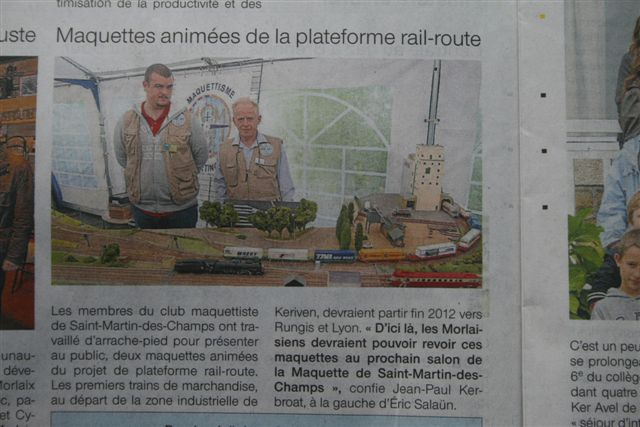

A l’appel de la Communauté des Communes du Pays de Morlaix, aidée du Conseil Général du Finistère, de Bretagne, des entreprises, mon club de la maquette et FreeLUG locale ont accepté de présenter un projet commun de revitalisation de la plate-forme rail-route située dans la zone industrielle de Keriven [^1].

Ce projet est financé par la Communauté.

Deux layouts d’exposition et démonstration sortiront : Un en réseau ferroviaire HO et un en version LEGO.

En début d’année, nous avons pu nous procurer le fameux projet confidentiel d’un bureau d’études. En ce qui me concerne, je me suis attelé à construire un portique de conception allemande (ndlr : à l’heure actuelle, on ne sait toujours rien du chargement et déchargement des conteneurs) et à concevoir la plate-forme du futur.

En LEGO, avec nos rails, c’est difficile de coller à la topographie des lieux existants et à l’abandon...

J’ai demandé aux officiels, la possibilité d’avoir une salle gratuite pour 3 jours, accord immédiat.

Plusieurs versions de la plate-forme sont sorties de ces 3 jours, une seule a été retenue par moi pour la fête (6mx3.50).

Le jour de la fête, sous Barnum géant, beaucoup de personnes ont cru que mon projet était officiel, en fait, c’est une "vision d’artiste" se rapprochant le plus de la réalité.

Plusieurs élus m’ont dit qu’il y avait des idées pertinentes dans mon projet, bonne surprise.

Le public, élus, chefs d’entreprises, professeurs, élèves des écoles de commerce, ont joué toute la journée avec les trains de ma plate-forme.

Gros succès malgré une pluie intermittente .

Ultérieurement, les layouts seront présentés aux mairies de la Communauté.

Coté technique LEGO, j’ai récupéré toutes mes plaques du grand diorama trains et ferries, un nouveau diorama alternatif est né : le rail-route.

Après la fête, pour les salons futurs, j’ai remanié mon projet pour un montage et démontage facile, un engin de levage type PPM 40t a été créé et ajouté.

En conclusion, FreeLUG locale et la petite brique ont été très heureuses de participer au projet d’intérêt général. L’avenir nous dira si nos idées seront reprises par les décideurs économiques, je me suis efforcé de présenter un projet crédible, cohérent, rapide, efficace...

Une brique sérigraphiée est sortie pour l’occasion.

[Galerie photos](http://photos.freelug.org/main.php/v/barr__/expositions/2011/keriven/)

_Jean-Marc_

Ci-après, extrait d’un article de presse.

[^1]: La plate-forme a été abandonnée depuis 20 ans à cause de la SNCF qui n’a pas su gérer correctement le fret. Les conteneurs partent de Morlaix pour Rungis, l’Allemagne, la Suisse avec un opérateur privé, sur sillons SNCF, exit la SNCF qui a perdu le monopole.
